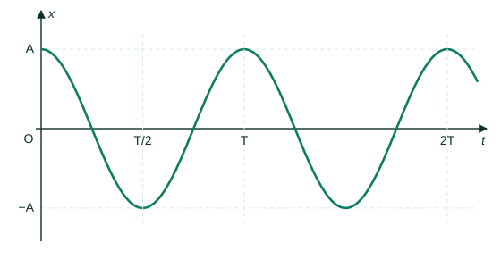
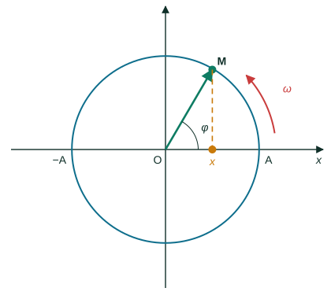

# Dao động điều hoà

## 1. Dao động cơ

:::def Dao động cơ
Chuyển động **qua lại quanh một vị trí cân bằng** (VTCB). Ví dụ: quả lắc đồng hồ, dây đàn rung, pít-tông trong xi-lanh.
:::

:::def Dao động tuần hoàn
Dao động mà trạng thái chuyển động (vị trí và vận tốc) **lặp lại như cũ** sau những khoảng thời gian bằng nhau.
- **Chu kì** $T$ (s): khoảng thời gian ngắn nhất để vật thực hiện **một dao động toàn phần**.
- **Tần số** $f$ (Hz): số dao động toàn phần thực hiện trong 1 giây, $f = \dfrac{1}{T}$.
:::

## 2. Dao động điều hoà

:::def Dao động điều hoà
Dao động trong đó **li độ** của vật là một hàm **côsin (hay sin)** của thời gian:
$$x = A\cos(\omega t + \varphi)$$
:::

| Đại lượng | Tên gọi | Ý nghĩa |
|---|---|---|
| $x$ | Li độ | Toạ độ của vật tính từ VTCB, có thể âm hoặc dương |
| $A$ | Biên độ ($A > 0$) | Độ lớn cực đại của li độ |
| $\omega$ | Tần số góc (rad/s) | Cho biết dao động nhanh hay chậm, $\omega = \dfrac{2\pi}{T} = 2\pi f$ |
| $\omega t + \varphi$ | Pha dao động (rad) | Xác định trạng thái dao động tại thời điểm $t$ |
| $\varphi$ | Pha ban đầu (rad) | Trạng thái dao động lúc $t = 0$ |

- Vật dao động trên đoạn thẳng dài $L = 2A$ (gọi là **chiều dài quỹ đạo**).
- Ở **vị trí biên** ($x = \pm A$), vật đổi chiều chuyển động; ở **VTCB** ($x = 0$), vật chuyển động nhanh nhất.

## 3. Liên hệ với chuyển động tròn đều

:::def Mối liên hệ
Một điểm M chuyển động tròn đều trên đường tròn bán kính $A$ với tốc độ góc $\omega$. **Hình chiếu** của M lên một trục đi qua tâm (trục Ox) dao động điều hoà với biên độ $A$ và tần số góc $\omega$.
- Bán kính đường tròn ↔ biên độ $A$.
- Tốc độ góc của M ↔ tần số góc $\omega$.
- Góc $\widehat{(Ox, OM)}$ tại thời điểm $t$ ↔ pha dao động $\omega t + \varphi$.
:::

Đường tròn này gọi là **vòng tròn lượng giác** (VTLG) – công cụ rất mạnh để giải bài tập về thời gian và quãng đường.

## 4. Ví dụ minh hoạ

:::example Ví dụ 1 – Đọc phương trình
Một vật dao động điều hoà với $x = 5\cos\!\left(4\pi t + \dfrac{\pi}{3}\right)$ (cm). Xác định biên độ, tần số góc, chu kì, tần số, pha ban đầu và li độ lúc $t = 0$.

**Giải.** $A = 5$ cm; $\omega = 4\pi$ rad/s; $T = \dfrac{2\pi}{\omega} = 0{,}5$ s; $f = 2$ Hz; $\varphi = \dfrac{\pi}{3}$.
Lúc $t = 0$: $x = 5\cos\dfrac{\pi}{3} = 2{,}5$ cm.
:::

:::example Ví dụ 2 – Đưa về dạng côsin
Viết phương trình $x = -4\sin(2\pi t)$ (cm) về dạng $x = A\cos(\omega t + \varphi)$.

**Giải.** Dùng $-\sin\alpha = \cos\!\left(\alpha + \dfrac{\pi}{2}\right)$:
$$x = 4\cos\!\left(2\pi t + \frac{\pi}{2}\right)\ \text{(cm)}$$
Biên độ luôn dương: $A = 4$ cm; $\varphi = \dfrac{\pi}{2}$.
:::

:::warn Dễ nhầm
Biên độ $A$ **luôn dương**. Gặp $x = -A\cos(\omega t + \varphi)$ thì đổi thành $x = A\cos(\omega t + \varphi + \pi)$.
:::

## Tóm tắt nhanh

- Dao động điều hoà: $x = A\cos(\omega t + \varphi)$; $\omega = 2\pi/T = 2\pi f$.
- Biên độ $A$, chiều dài quỹ đạo $2A$; pha $\omega t + \varphi$ cho biết trạng thái dao động.
- Hình chiếu của chuyển động tròn đều lên một đường kính là dao động điều hoà.
