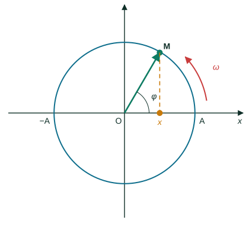

# Mô tả dao động điều hoà

## 1. Các đại lượng đặc trưng

| Đại lượng | Kí hiệu – đơn vị | Công thức, ý nghĩa |
|---|---|---|
| Biên độ | $A$ (m, cm) | Độ lệch lớn nhất khỏi VTCB |
| Chu kì | $T$ (s) | Thời gian thực hiện một dao động toàn phần; $T = \dfrac{t}{N}$ ($N$ dao động trong thời gian $t$) |
| Tần số | $f$ (Hz) | Số dao động trong 1 s; $f = \dfrac{1}{T}$ |
| Tần số góc | $\omega$ (rad/s) | $\omega = \dfrac{2\pi}{T} = 2\pi f$ |
| Pha dao động | $\omega t + \varphi$ (rad) | Trạng thái dao động ở thời điểm $t$ |
| Pha ban đầu | $\varphi$ (rad) | Trạng thái dao động lúc $t = 0$ |

## 2. Độ lệch pha

:::def Độ lệch pha của hai dao động cùng tần số
Với $x_1 = A_1\cos(\omega t + \varphi_1)$ và $x_2 = A_2\cos(\omega t + \varphi_2)$:
$$\Delta\varphi = \varphi_2 - \varphi_1$$
- $\Delta\varphi > 0$: dao động 2 **sớm pha** hơn dao động 1; $\Delta\varphi < 0$: **trễ pha**.
- $\Delta\varphi = 2k\pi$: **cùng pha** – hai vật cùng đi qua VTCB, cùng đến biên một lúc.
- $\Delta\varphi = (2k + 1)\pi$: **ngược pha** – luôn ở hai phía đối xứng của VTCB.
- $\Delta\varphi = (2k + 1)\dfrac{\pi}{2}$: **vuông pha** – một vật ở VTCB thì vật kia ở biên.
:::

:::formula Độ lệch pha từ đồ thị
Hai đồ thị lệch nhau một khoảng thời gian $\Delta t$ thì:
$$|\Delta\varphi| = \omega\,\Delta t = 2\pi\,\frac{\Delta t}{T}$$
:::

## 3. Vòng tròn lượng giác – xác định pha và thời gian

:::tip Quy ước trên VTLG
- M quay **ngược chiều kim đồng hồ** với tốc độ góc $\omega$.
- M ở **nửa trên** đường tròn ($0 < \text{pha} < \pi$): vật chuyển động theo **chiều âm**.
- M ở **nửa dưới** ($-\pi < \text{pha} < 0$): vật chuyển động theo **chiều dương**.
:::

| Vị trí ban đầu của vật | Pha ban đầu $\varphi$ |
|---|---|
| Biên dương ($x = A$) | $0$ |
| Biên âm ($x = -A$) | $\pi$ |
| VTCB, đi theo chiều âm | $\dfrac{\pi}{2}$ |
| VTCB, đi theo chiều dương | $-\dfrac{\pi}{2}$ |
| $x = \dfrac{A}{2}$, đi theo chiều dương | $-\dfrac{\pi}{3}$ |
| $x = \dfrac{A\sqrt{2}}{2}$, đi theo chiều âm | $\dfrac{\pi}{4}$ |

:::formula Thời gian ngắn nhất
Góc quét của M: $\Delta\alpha = \omega\,\Delta t \Rightarrow \Delta t = \dfrac{\Delta\alpha}{\omega} = \dfrac{\Delta\alpha}{2\pi}T$.
Một số khoảng thời gian thường gặp:
- Từ VTCB ra biên (hoặc ngược lại): $\dfrac{T}{4}$.
- Từ VTCB đến $x = \pm\dfrac{A}{2}$: $\dfrac{T}{12}$; từ $\pm\dfrac{A}{2}$ ra biên: $\dfrac{T}{6}$.
- Từ VTCB đến $x = \pm\dfrac{A\sqrt{2}}{2}$: $\dfrac{T}{8}$.
:::

:::formula Quãng đường
Trong một chu kì vật đi được $4A$; trong nửa chu kì đi được $2A$ (bất kể xuất phát từ đâu).
:::

## 4. Ví dụ minh hoạ

:::example Ví dụ 1 – Tìm pha ban đầu
Vật dao động với $A = 4$ cm, $T = 2$ s. Lúc $t = 0$ vật ở li độ $x = 2$ cm và đang chuyển động theo chiều dương. Viết phương trình dao động.

**Giải.** $\omega = \pi$ rad/s. $\cos\varphi = \dfrac{2}{4} = \dfrac{1}{2}$; vật đi theo chiều dương nên M ở nửa dưới ⟹ $\varphi = -\dfrac{\pi}{3}$.
$$x = 4\cos\!\left(\pi t - \frac{\pi}{3}\right)\ \text{(cm)}$$
:::

:::example Ví dụ 2 – Thời gian ngắn nhất
Vật dao động với chu kì 1,2 s. Tính thời gian ngắn nhất để vật đi từ $x = \dfrac{A}{2}$ đến $x = -\dfrac{A}{2}$.

**Giải.** Trên VTLG, M quét từ pha $\dfrac{\pi}{3}$ đến $\dfrac{2\pi}{3}$: $\Delta\alpha = \dfrac{\pi}{3}$.
$$\Delta t = \frac{\Delta\alpha}{2\pi}T = \frac{1}{6}\cdot 1{,}2 = 0{,}2\ \text{s}$$
(Hoặc: $\dfrac{T}{12} + \dfrac{T}{12} = \dfrac{T}{6}$.)
:::

:::example Ví dụ 3 – Độ lệch pha
Hai dao động $x_1 = 3\cos\!\left(5t + \dfrac{\pi}{6}\right)$ và $x_2 = 4\cos\!\left(5t - \dfrac{\pi}{3}\right)$. So sánh pha hai dao động.

**Giải.** $\Delta\varphi = \varphi_2 - \varphi_1 = -\dfrac{\pi}{3} - \dfrac{\pi}{6} = -\dfrac{\pi}{2}$: dao động 2 **trễ pha** $\dfrac{\pi}{2}$ so với dao động 1 – hai dao động **vuông pha**.
:::

## Tóm tắt nhanh

- $T = t/N$, $f = 1/T$, $\omega = 2\pi f$.
- Cùng pha: $\Delta\varphi = 2k\pi$; ngược pha: $(2k+1)\pi$; vuông pha: $(2k+1)\pi/2$.
- VTLG: nửa trên → đi chiều âm; nửa dưới → đi chiều dương; $\Delta t = \dfrac{\Delta\alpha}{2\pi}T$.
- Một chu kì đi $4A$, nửa chu kì đi $2A$.
