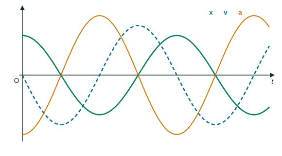

# Vận tốc và gia tốc trong dao động điều hoà

## 1. Vận tốc

Vận tốc là đạo hàm của li độ theo thời gian:

:::formula Vận tốc
$$v = x' = -\omega A\sin(\omega t + \varphi) = \omega A\cos\!\left(\omega t + \varphi + \frac{\pi}{2}\right)$$
Vận tốc **sớm pha** $\dfrac{\pi}{2}$ so với li độ. Tốc độ cực đại: $v_{\max} = \omega A$.
:::

| Vị trí | Vận tốc |
|---|---|
| VTCB ($x = 0$) | Tốc độ **cực đại** $\omega A$ |
| Biên ($x = \pm A$) | Bằng **0** |

## 2. Gia tốc

:::formula Gia tốc
$$a = v' = -\omega^2 A\cos(\omega t + \varphi) = -\omega^2 x$$
Gia tốc **ngược pha** với li độ, **sớm pha** $\dfrac{\pi}{2}$ so với vận tốc. Độ lớn cực đại: $a_{\max} = \omega^2 A$ (ở biên).
:::

:::note Đặc điểm của gia tốc
- Vectơ gia tốc **luôn hướng về VTCB**, độ lớn tỉ lệ với độ lớn li độ.
- Tại VTCB, $a = 0$; tại biên, $|a| = \omega^2A$ lớn nhất.
- Lực gây ra gia tốc $F = ma = -m\omega^2 x$ gọi là **lực kéo về** (lực hồi phục).
:::

:::warn Dễ nhầm
- Vật đi **từ biên về VTCB**: chuyển động **nhanh dần** ($\vec{a}$ cùng chiều $\vec{v}$).
- Vật đi **từ VTCB ra biên**: chuyển động **chậm dần** ($\vec{a}$ ngược chiều $\vec{v}$).
- Dao động điều hoà **không** phải chuyển động nhanh/chậm dần **đều** vì gia tốc luôn thay đổi.
:::

## 3. Hệ thức độc lập với thời gian

Hai đại lượng **vuông pha** $m = M\cos(\omega t + \varphi_1)$ và $n = N\cos(\omega t + \varphi_2)$ luôn thoả mãn $\left(\dfrac{m}{M}\right)^2 + \left(\dfrac{n}{N}\right)^2 = 1$. Áp dụng:

:::formula Các hệ thức độc lập
$$\left(\frac{x}{A}\right)^2 + \left(\frac{v}{\omega A}\right)^2 = 1 \quad\Rightarrow\quad A^2 = x^2 + \frac{v^2}{\omega^2}$$
$$\left(\frac{v}{\omega A}\right)^2 + \left(\frac{a}{\omega^2A}\right)^2 = 1 \quad\Rightarrow\quad A^2 = \frac{v^2}{\omega^2} + \frac{a^2}{\omega^4}$$
$$a = -\omega^2 x$$
:::

| Cặp đại lượng | Quan hệ pha | Dạng đồ thị |
|---|---|---|
| $v$ theo $x$ | Vuông pha | **Elip**, cắt trục $x$ tại $\pm A$, cắt trục $v$ tại $\pm\omega A$ |
| $a$ theo $v$ | Vuông pha | **Elip**, cắt trục $v$ tại $\pm\omega A$, cắt trục $a$ tại $\pm\omega^2A$ |
| $a$ theo $x$ | Ngược pha | **Đoạn thẳng** đi qua gốc toạ độ, hệ số góc $-\omega^2$, nằm từ $(-A;\ \omega^2A)$ đến $(A;\ -\omega^2A)$ |

## 4. Ví dụ minh hoạ

:::example Ví dụ 1 – Giá trị cực đại
Vật dao động $x = 6\cos(10t)$ (cm). Tính tốc độ cực đại và gia tốc cực đại.

**Giải.** $v_{\max} = \omega A = 10\cdot 6 = 60$ cm/s; $a_{\max} = \omega^2 A = 100\cdot 6 = 600$ cm/s² $= 6$ m/s².
:::

:::example Ví dụ 2 – Hệ thức độc lập
Vật dao động điều hoà với $\omega = 4$ rad/s. Khi li độ là 3 cm thì tốc độ là 16 cm/s. Tính biên độ.

**Giải.** $A = \sqrt{x^2 + \dfrac{v^2}{\omega^2}} = \sqrt{9 + 16} = 5$ cm.
:::

:::example Ví dụ 3 – Tìm ω từ hai trạng thái
Khi vật có li độ $x_1 = 3$ cm thì tốc độ $v_1 = 40$ cm/s; khi $x_2 = 4$ cm thì $v_2 = 30$ cm/s. Tìm $\omega$ và $A$.

**Giải.** Từ $x_1^2 + \dfrac{v_1^2}{\omega^2} = x_2^2 + \dfrac{v_2^2}{\omega^2}$:
$$\omega^2 = \frac{v_1^2 - v_2^2}{x_2^2 - x_1^2} = \frac{1600 - 900}{16 - 9} = 100 \Rightarrow \omega = 10\ \text{rad/s}$$
$A = \sqrt{9 + 16} = 5$ cm.
:::

## Tóm tắt nhanh

- $v_{\max} = \omega A$ (ở VTCB); $a_{\max} = \omega^2A$ (ở biên); $a = -\omega^2x$.
- $v$ sớm pha $\pi/2$ so với $x$; $a$ ngược pha với $x$.
- $A^2 = x^2 + \dfrac{v^2}{\omega^2}$; đồ thị $v$–$x$ và $a$–$v$ là elip, $a$–$x$ là đoạn thẳng qua gốc.
