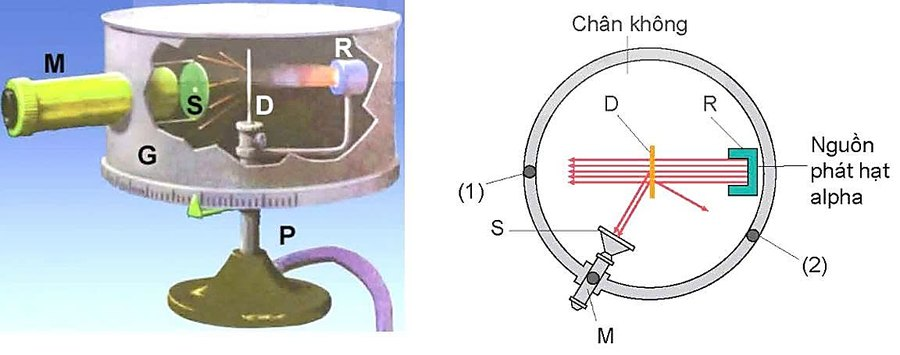
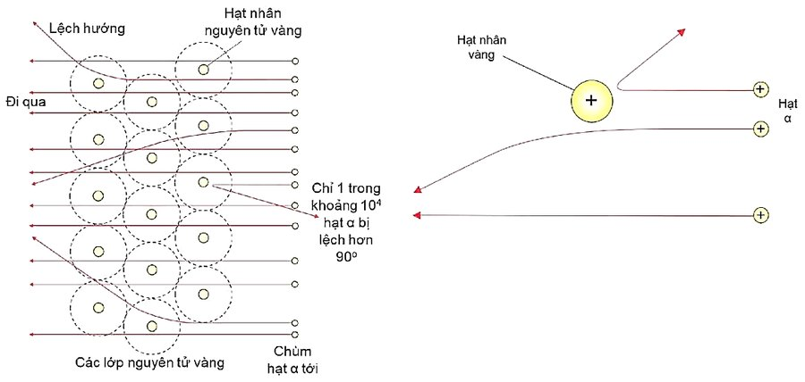
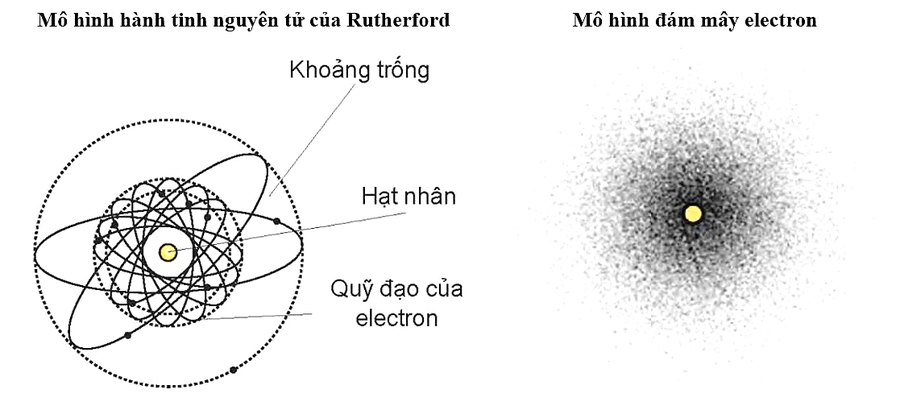

# Cấu trúc hạt nhân

## 1. Thí nghiệm tán xạ hạt alpha (Rutherford, 1911)

Bắn chùm hạt alpha (mang điện dương) vào một lá vàng rất mỏng:

- **Hầu hết** hạt alpha đi **thẳng** qua lá vàng.
- Một số ít bị **lệch** hướng; rất ít (khoảng 1/10 000) bị **bật ngược** lại.

:::def Kết luận – Mẫu hành tinh nguyên tử
- Nguyên tử có cấu tạo **rỗng**; phần lớn khối lượng và toàn bộ điện tích dương tập trung trong **hạt nhân** rất nhỏ ở tâm.
- Electron chuyển động xung quanh hạt nhân. Kích thước hạt nhân (cỡ $10^{-15}$–$10^{-14}$ m) nhỏ hơn kích thước nguyên tử (cỡ $10^{-10}$ m) khoảng **10 000 – 100 000 lần**.
:::

## 2. Cấu trúc hạt nhân

:::def Thành phần của hạt nhân
Hạt nhân được tạo thành từ các **nucleon**, gồm hai loại:
- **Proton (p):** mang điện tích $+e = +1{,}6\cdot 10^{-19}$ C; khối lượng $m_p \approx 1{,}0073$ amu.
- **Neutron (n):** không mang điện; khối lượng $m_n \approx 1{,}0087$ amu.
:::

| Đại lượng | Kí hiệu | Ý nghĩa |
|---|---|---|
| Số proton (nguyên tử số) | $Z$ | Bằng số thứ tự trong bảng tuần hoàn |
| Số neutron | $N$ | $N = A - Z$ |
| Số khối (số nucleon) | $A$ | $A = Z + N$ |

:::formula Kí hiệu hạt nhân
$${}^{A}_{Z}\text{X}$$
Ví dụ: ${}^{12}_{6}\text{C}$ có 6 proton, 6 neutron; ${}^{238}_{92}\text{U}$ có 92 proton, 146 neutron.
Điện tích hạt nhân: $q = +Ze$.
:::

:::def Đồng vị
Các hạt nhân có **cùng số proton $Z$** nhưng **khác số neutron** (do đó khác số khối $A$) gọi là các **đồng vị**. Ví dụ: ${}^{1}_{1}\text{H}$, ${}^{2}_{1}\text{H}$ (deuterium), ${}^{3}_{1}\text{H}$ (tritium); ${}^{12}_{6}\text{C}$, ${}^{14}_{6}\text{C}$.
:::

### Khối lượng và kích thước hạt nhân

- Đơn vị khối lượng nguyên tử: $1\ \text{amu} = \dfrac{1}{12}$ khối lượng nguyên tử ${}^{12}_{6}\text{C}$ $\approx 1{,}66054\cdot 10^{-27}$ kg. Khối lượng hạt nhân (tính bằng amu) **xấp xỉ bằng số khối** $A$.
- Coi hạt nhân là hình cầu, bán kính:

:::formula Bán kính hạt nhân
$$R \approx 1{,}2\cdot 10^{-15}\,A^{1/3}\ \text{(m)}$$
Vì thể tích tỉ lệ với $A$ nên **mật độ khối lượng** của mọi hạt nhân gần như bằng nhau (cỡ $10^{17}$ kg/m³ – vô cùng lớn).
:::

:::note Lực hạt nhân
Các proton đẩy nhau bằng lực điện rất mạnh nhưng hạt nhân vẫn bền vững nhờ **lực hạt nhân** – lực hút giữa các nucleon, **rất mạnh** nhưng chỉ tác dụng ở **khoảng cách rất ngắn** (cỡ kích thước hạt nhân, $10^{-15}$ m), không phụ thuộc điện tích.
:::

## 3. Ví dụ minh hoạ

:::example Ví dụ 1 – Thành phần hạt nhân
Cho hạt nhân ${}^{17}_{8}\text{O}$. a) Tìm số nucleon, proton, neutron. b) Tính điện tích hạt nhân.

**Giải.** a) $A = 17$; $Z = 8$; $N = 17 - 8 = 9$.
b) $q = +Ze = 8\cdot 1{,}6\cdot 10^{-19} = 1{,}28\cdot 10^{-18}$ C.
:::

:::example Ví dụ 2 – Đếm hạt trong một khối chất
Một khối ${}^{238}_{92}\text{U}$ có khối lượng 59,6 g (lấy khối lượng mol 238 g/mol). Tính số hạt nhân, số proton và số neutron trong khối này.

**Giải.** Số hạt nhân: $N_{hn} = \dfrac{59{,}6}{238}\cdot 6{,}02\cdot 10^{23} \approx 1{,}51\cdot 10^{23}$.
Mỗi hạt nhân có 92 proton và 146 neutron:
- Số proton: $92\cdot 1{,}51\cdot 10^{23} \approx 1{,}39\cdot 10^{25}$;
- Số neutron: $146\cdot 1{,}51\cdot 10^{23} \approx 2{,}20\cdot 10^{25}$.
:::

:::example Ví dụ 3 – So sánh kích thước
So sánh khối lượng và bán kính của hạt nhân ${}^{238}_{92}\text{U}$ với hạt nhân ${}^{40}_{20}\text{Ca}$.

**Giải.** Khối lượng: $\dfrac{m_U}{m_{Ca}} \approx \dfrac{238}{40} \approx 6$ lần.
Bán kính: $\dfrac{R_U}{R_{Ca}} = \left(\dfrac{238}{40}\right)^{1/3} \approx 1{,}8$ lần.
:::

## Tóm tắt nhanh

- Thí nghiệm Rutherford ⟹ nguyên tử rỗng, có hạt nhân rất nhỏ mang điện dương ở tâm.
- ${}^{A}_{Z}\text{X}$: $Z$ proton, $A - Z$ neutron; đồng vị: cùng $Z$, khác $A$.
- $R \approx 1{,}2\cdot 10^{-15}A^{1/3}$ m; mật độ hạt nhân gần như không đổi.
