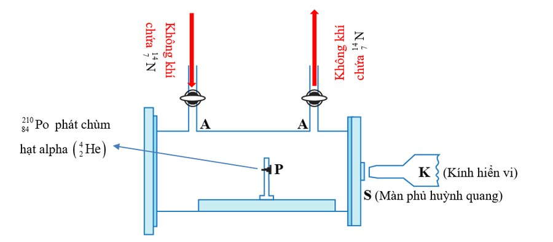
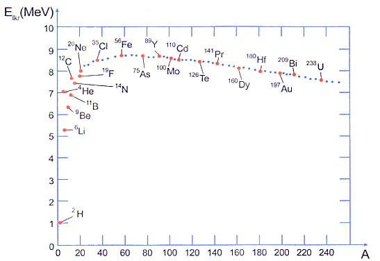
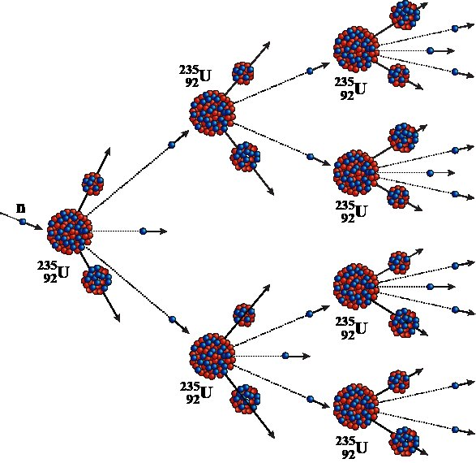

# Phản ứng hạt nhân – Năng lượng liên kết

## 1. Phản ứng hạt nhân

:::def Phản ứng hạt nhân
Quá trình biến đổi của hạt nhân, trong đó hạt nhân này **biến thành** hạt nhân khác. Có hai loại:
- **Phản ứng tự phát:** một hạt nhân không bền tự biến đổi (phóng xạ).
- **Phản ứng kích thích:** các hạt nhân tương tác với nhau tạo thành hạt nhân mới (phân hạch, nhiệt hạch, bắn phá hạt nhân).
:::

Năm 1919, Rutherford bắn hạt alpha vào khí nitrogen và lần đầu tạo ra phản ứng hạt nhân nhân tạo:
$${}^{4}_{2}\text{He} + {}^{14}_{7}\text{N} \rightarrow {}^{17}_{8}\text{O} + {}^{1}_{1}\text{H}$$

### Các định luật bảo toàn

Xét phản ứng ${}^{A_1}_{Z_1}\text{A} + {}^{A_2}_{Z_2}\text{B} \rightarrow {}^{A_3}_{Z_3}\text{C} + {}^{A_4}_{Z_4}\text{D}$:

:::formula Các đại lượng được bảo toàn
1. **Số nucleon (số khối):** $A_1 + A_2 = A_3 + A_4$
2. **Điện tích:** $Z_1 + Z_2 = Z_3 + Z_4$
3. **Động lượng:** $\vec{p}_A + \vec{p}_B = \vec{p}_C + \vec{p}_D$
4. **Năng lượng toàn phần** (gồm năng lượng nghỉ và động năng)
:::

:::warn Không bảo toàn
Trong phản ứng hạt nhân **không** bảo toàn khối lượng nghỉ, **không** bảo toàn riêng số proton hay số neutron (neutron có thể biến thành proton trong phân rã β).
:::

Kí hiệu một số hạt thường gặp: proton ${}^{1}_{1}\text{p}$, neutron ${}^{1}_{0}\text{n}$, alpha ${}^{4}_{2}\text{He}$, electron ${}^{\;\,0}_{-1}\text{e}$, positron ${}^{0}_{1}\text{e}$, photon gamma ${}^{0}_{0}\gamma$.

## 2. Năng lượng liên kết

:::formula Hệ thức Einstein
$$E = m\,c^2$$
Đổi đơn vị thường dùng: $1\ \text{amu}\cdot c^2 \approx 931{,}5$ MeV; $1\ \text{MeV} = 1{,}6\cdot 10^{-13}$ J.
:::

:::def Độ hụt khối
Khối lượng hạt nhân **nhỏ hơn** tổng khối lượng các nucleon tạo thành nó. Hiệu số đó là **độ hụt khối**:
$$\Delta m = Z\,m_p + (A - Z)\,m_n - m_X$$
:::

:::def Năng lượng liên kết
Năng lượng **toả ra** khi các nucleon riêng rẽ liên kết thành hạt nhân (cũng là năng lượng tối thiểu để **tách** hạt nhân thành các nucleon riêng rẽ):
$$E_{lk} = \Delta m\,c^2$$
**Năng lượng liên kết riêng** $\varepsilon = \dfrac{E_{lk}}{A}$ (năng lượng liên kết tính cho mỗi nucleon) đặc trưng cho **mức độ bền vững** của hạt nhân.
:::

:::tip Đọc đồ thị năng lượng liên kết riêng
- $\varepsilon$ càng lớn thì hạt nhân càng **bền**.
- Các hạt nhân có số khối trung bình ($50 < A < 95$) bền nhất; ${}^{56}\text{Fe}$ có $\varepsilon \approx 8{,}8$ MeV/nucleon.
- Hạt nhân **rất nặng** tách ra (phân hạch) hoặc hạt nhân **rất nhẹ** hợp lại (nhiệt hạch) đều tạo ra hạt nhân bền hơn ⟹ **toả năng lượng**.
:::

## 3. Năng lượng của phản ứng hạt nhân

:::formula Năng lượng phản ứng
$$\Delta E = (m_{\text{trước}} - m_{\text{sau}})\,c^2 = E_{lk,\text{sau}} - E_{lk,\text{trước}}$$
- $\Delta E > 0$: phản ứng **toả** năng lượng.
- $\Delta E < 0$: phản ứng **thu** năng lượng (cần cung cấp động năng cho các hạt ban đầu).
:::

### Phân hạch và nhiệt hạch

| | Phân hạch | Nhiệt hạch (tổng hợp hạt nhân) |
|---|---|---|
| Bản chất | Hạt nhân nặng (U-235, Pu-239) hấp thụ neutron chậm, vỡ thành hai hạt nhân trung bình và vài neutron | Hai hạt nhân rất nhẹ (H, He) kết hợp thành hạt nhân nặng hơn |
| Điều kiện | Cần neutron chậm; khối lượng nhiên liệu đủ lớn để duy trì phản ứng dây chuyền | Nhiệt độ rất cao (cỡ trăm triệu độ) |
| Năng lượng | Khoảng 200 MeV mỗi phân hạch U-235 | Toả năng lượng rất lớn tính theo khối lượng nhiên liệu |
| Ví dụ | Lò phản ứng hạt nhân, bom nguyên tử | Năng lượng Mặt Trời, bom H |

Phương trình phân hạch điển hình: ${}^{1}_{0}\text{n} + {}^{235}_{92}\text{U} \rightarrow {}^{95}_{39}\text{Y} + {}^{138}_{53}\text{I} + 3\,{}^{1}_{0}\text{n}$

:::def Hệ số nhân neutron k
Số neutron trung bình còn lại sau mỗi phân hạch gây được phân hạch tiếp theo.
- $k < 1$: phản ứng tắt dần.
- $k = 1$: phản ứng **tự duy trì, điều khiển được** (lò phản ứng hạt nhân).
- $k > 1$: phản ứng tăng vọt, **không điều khiển được** (bom nguyên tử).
:::

## 4. Ví dụ minh hoạ

:::example Ví dụ 1 – Năng lượng nghỉ
Tính năng lượng nghỉ của 2 g chất bất kì.

**Giải.** $E = mc^2 = 2\cdot 10^{-3}\cdot(3\cdot 10^8)^2 = 1{,}8\cdot 10^{14}$ J.
:::

:::example Ví dụ 2 – So sánh độ bền
Cho $m_{He} = 4{,}0015$ amu; $m_O = 15{,}9905$ amu; $m_p = 1{,}0073$ amu; $m_n = 1{,}0087$ amu. Hạt nhân ${}^{4}_{2}\text{He}$ hay ${}^{16}_{8}\text{O}$ bền hơn?

**Giải.**
- He: $\Delta m = 2\cdot 1{,}0073 + 2\cdot 1{,}0087 - 4{,}0015 = 0{,}0305$ amu ⟹ $E_{lk} \approx 28{,}4$ MeV ⟹ $\varepsilon \approx 7{,}10$ MeV/nucleon.
- O: $\Delta m = 8\cdot 1{,}0073 + 8\cdot 1{,}0087 - 15{,}9905 = 0{,}1375$ amu ⟹ $E_{lk} \approx 128{,}1$ MeV ⟹ $\varepsilon \approx 8{,}01$ MeV/nucleon.

$\varepsilon_O > \varepsilon_{He}$ nên hạt nhân **oxygen bền hơn**.
:::

:::example Ví dụ 3 – Phản ứng thu năng lượng
Xét phản ứng ${}^{4}_{2}\text{He} + {}^{14}_{7}\text{N} \rightarrow {}^{17}_{8}\text{O} + {}^{1}_{1}\text{H}$ với $m_{He} = 4{,}0015$; $m_N = 13{,}9992$; $m_O = 16{,}9947$; $m_H = 1{,}0073$ (amu). Phản ứng toả hay thu bao nhiêu năng lượng?

**Giải.** $m_{\text{trước}} = 18{,}0007$ amu; $m_{\text{sau}} = 18{,}0020$ amu.
$$\Delta E = (18{,}0007 - 18{,}0020)\cdot 931{,}5 \approx -1{,}21\ \text{MeV}$$
Phản ứng **thu** khoảng 1,21 MeV.
:::

:::example Ví dụ 4 – Phản ứng dây chuyền
Mỗi phân hạch U-235 toả 200 MeV; hệ số nhân neutron $k = 2$. Bắt đầu từ một phân hạch, sau 4 thế hệ có bao nhiêu phân hạch và toả bao nhiêu năng lượng?

**Giải.** Số phân hạch: $1 + 2 + 4 + 8 = 15$. Năng lượng: $15\cdot 200 = 3000$ MeV.
:::

## Tóm tắt nhanh

- Phản ứng hạt nhân bảo toàn: số nucleon, điện tích, động lượng, năng lượng toàn phần.
- $\Delta m = Zm_p + (A - Z)m_n - m_X$; $E_{lk} = \Delta m c^2$; $\varepsilon = E_{lk}/A$ càng lớn càng bền.
- $\Delta E = (m_{\text{trước}} - m_{\text{sau}})c^2$; 1 amu·c² ≈ 931,5 MeV.
- Phân hạch (hạt nặng vỡ ra) và nhiệt hạch (hạt nhẹ hợp lại) đều toả năng lượng.
