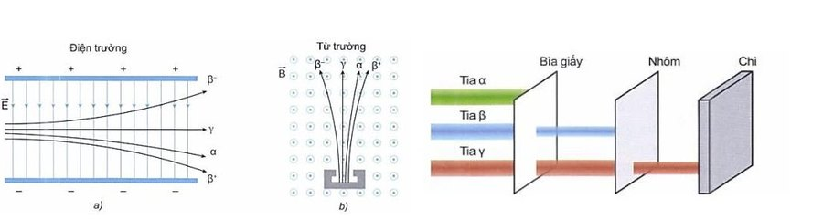
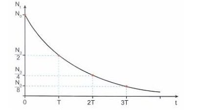
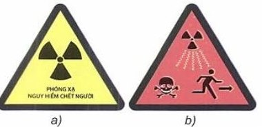
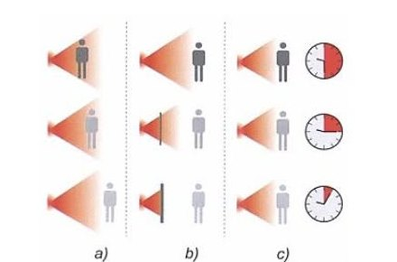

# Hiện tượng phóng xạ

## 1. Hiện tượng phóng xạ

:::def Phóng xạ
**Phóng xạ** là quá trình một hạt nhân **không bền** tự phát biến đổi thành hạt nhân khác, đồng thời phát ra các tia phóng xạ.
- Là quá trình **tự phát**, **ngẫu nhiên**: không thể biết chính xác lúc nào một hạt nhân sẽ phân rã.
- **Không chịu ảnh hưởng** của các yếu tố bên ngoài như nhiệt độ, áp suất, trạng thái hoá học.
:::

Hạt nhân ban đầu gọi là **hạt nhân mẹ**, hạt nhân tạo thành gọi là **hạt nhân con**.

## 2. Các loại tia phóng xạ

| Loại | Bản chất | Phương trình | Đặc điểm |
|---|---|---|---|
| Alpha (α) | Hạt nhân ${}^{4}_{2}\text{He}$, điện tích $+2e$ | ${}^{A}_{Z}\text{X} \rightarrow {}^{A-4}_{Z-2}\text{Y} + {}^{4}_{2}\text{He}$ | Ion hoá mạnh; đi được vài cm trong không khí; bị tờ giấy chặn lại |
| Beta trừ (β⁻) | Electron ${}^{\;\,0}_{-1}\text{e}$ | ${}^{A}_{Z}\text{X} \rightarrow {}^{A}_{Z+1}\text{Y} + {}^{\;\,0}_{-1}\text{e} + \bar{\nu}$ | Đi được vài m trong không khí; bị tấm nhôm vài mm chặn |
| Beta cộng (β⁺) | Positron ${}^{0}_{1}\text{e}$ | ${}^{A}_{Z}\text{X} \rightarrow {}^{A}_{Z-1}\text{Y} + {}^{0}_{1}\text{e} + \nu$ | Tương tự β⁻ nhưng mang điện dương |
| Gamma (γ) | Sóng điện từ (photon) năng lượng rất cao | Đi kèm phóng xạ α, β | Không mang điện, không lệch trong điện trường, từ trường; đâm xuyên rất mạnh (cần chì, bê tông dày) |

:::note Ghi nhớ
- Phóng xạ α: hạt nhân con **lùi 2 ô** trong bảng tuần hoàn, số khối giảm 4.
- Phóng xạ β⁻: con **tiến 1 ô**, số khối không đổi (một neutron biến thành proton).
- Phóng xạ β⁺: con **lùi 1 ô**, số khối không đổi (một proton biến thành neutron).
- Phóng xạ γ: không làm thay đổi hạt nhân (chỉ giải phóng năng lượng).
:::

## 3. Định luật phóng xạ

:::def Chu kì bán rã T
Khoảng thời gian để **một nửa** số hạt nhân của mẫu chất phóng xạ bị phân rã.
**Hằng số phóng xạ** $\lambda = \dfrac{\ln 2}{T}$ (đơn vị s⁻¹).
:::

:::formula Định luật phóng xạ
Số hạt nhân (khối lượng) **còn lại** sau thời gian $t$:
$$N = N_0\,2^{-t/T} = N_0\,e^{-\lambda t};\qquad m = m_0\,2^{-t/T}$$
Số hạt nhân **đã bị phân rã**: $\Delta N = N_0 - N = N_0\left(1 - 2^{-t/T}\right)$.
:::

| Thời gian | $T$ | $2T$ | $3T$ | $4T$ | $nT$ |
|---|---|---|---|---|---|
| Phần còn lại | 1/2 | 1/4 | 1/8 | 1/16 | $1/2^n$ |

:::tip Hạt nhân con
Mỗi hạt nhân mẹ phân rã tạo ra **một** hạt nhân con, nên số hạt nhân con tạo thành bằng $\Delta N$. Khối lượng con: $m_{con} = \dfrac{\Delta N}{N_A}A_{con}$.
Tỉ số $\dfrac{N_{con}}{N_{mẹ}} = 2^{t/T} - 1$.
:::

## 4. Độ phóng xạ

:::def Độ phóng xạ H
Đại lượng đặc trưng cho **tính phóng xạ mạnh hay yếu** của một mẫu chất, bằng **số phân rã trong 1 giây**:
$$H = \lambda N = H_0\,2^{-t/T}$$
Đơn vị: **becquerel (Bq)**, 1 Bq = 1 phân rã/giây. Đơn vị cũ: curie, 1 Ci = $3{,}7\cdot 10^{10}$ Bq.
:::

:::warn Dễ nhầm
Khi tính $H = \lambda N$, $\lambda$ phải đổi sang **s⁻¹** (chu kì $T$ tính bằng giây) thì $H$ mới ra Bq.
:::

## 5. Ảnh hưởng của tia phóng xạ và an toàn phóng xạ

Tia phóng xạ có khả năng **ion hoá**, có thể phá huỷ tế bào, gây đột biến gen, ung thư. Mức độ nguy hiểm tăng theo liều lượng và thời gian tiếp xúc.

:::def Nguyên tắc an toàn phóng xạ
- **Giữ khoảng cách** đủ xa nguồn phóng xạ.
- **Che chắn** bằng vật liệu phù hợp (chì, bê tông).
- **Giảm thời gian** tiếp xúc với nguồn phóng xạ.
:::

## 6. Ví dụ minh hoạ

:::example Ví dụ 1 – Khối lượng còn lại
Ban đầu có 1 kg ${}^{60}\text{Co}$, chu kì bán rã 5,33 năm.
a) Sau 15 năm còn bao nhiêu Co? b) Sau bao lâu còn 10 g? c) Sau bao lâu còn 62,5 g?

**Giải.** a) $m = 1000\cdot 2^{-15/5{,}33} \approx 1000\cdot 0{,}142 \approx 142$ g.
b) $2^{-t/T} = 0{,}01 \Rightarrow t = T\log_2 100 \approx 5{,}33\cdot 6{,}64 \approx 35{,}4$ năm.
c) $\dfrac{62{,}5}{1000} = \dfrac{1}{16} = 2^{-4} \Rightarrow t = 4T = 21{,}32$ năm.
:::

:::example Ví dụ 2 – Độ phóng xạ
Ban đầu có 5 g ${}^{222}\text{Rn}$, chu kì bán rã 3,8 ngày. Tính độ phóng xạ ban đầu.

**Giải.** $N_0 = \dfrac{5}{222}\cdot 6{,}02\cdot 10^{23} \approx 1{,}356\cdot 10^{22}$.
$\lambda = \dfrac{\ln 2}{3{,}8\cdot 86\,400} \approx 2{,}11\cdot 10^{-6}$ s⁻¹.
$$H_0 = \lambda N_0 \approx 2{,}86\cdot 10^{16}\ \text{Bq} \approx 7{,}7\cdot 10^5\ \text{Ci}$$
:::

:::example Ví dụ 3 – Tỉ số hạt nhân con và mẹ
Hạt nhân X phóng xạ tạo thành hạt nhân Y bền; ban đầu chỉ có X. Sau thời gian $t = 2T$, tỉ số số hạt Y và X là bao nhiêu?

**Giải.** $\dfrac{N_Y}{N_X} = 2^{t/T} - 1 = 2^2 - 1 = 3$.
:::

## Tóm tắt nhanh

- Phóng xạ: tự phát, ngẫu nhiên, không phụ thuộc điều kiện bên ngoài.
- α: con lùi 2 ô, A giảm 4; β⁻: tiến 1 ô; β⁺: lùi 1 ô; γ: không đổi hạt nhân.
- $N = N_0 2^{-t/T}$; $\lambda = \ln 2/T$; $H = \lambda N$ (Bq).
- An toàn: khoảng cách – che chắn – thời gian.
