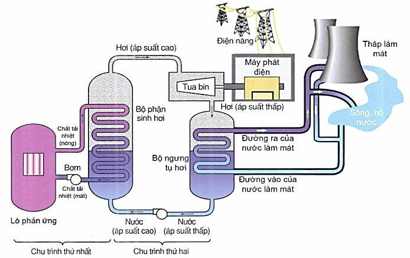
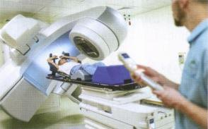

# Công nghiệp hạt nhân

## 1. Nhà máy điện hạt nhân

:::def Nguyên tắc hoạt động
Năng lượng toả ra từ **phản ứng phân hạch dây chuyền có điều khiển** ($k = 1$) trong lò phản ứng làm nóng chất tải nhiệt → đun nước thành hơi → hơi nước làm quay **tua bin** → tua bin quay **máy phát điện**.
:::

**Các bộ phận chính của lò phản ứng:**
- **Nhiên liệu:** thanh nhiên liệu chứa U-235 (đã làm giàu) hoặc Pu-239.
- **Chất làm chậm** (nước, nước nặng, than chì): làm chậm neutron để dễ gây phân hạch.
- **Thanh điều khiển** (chứa boron, cadmium): hấp thụ bớt neutron để giữ $k = 1$.
- **Chất tải nhiệt:** đưa nhiệt từ lò ra bộ phận sinh hơi.
- **Vỏ bảo vệ** bằng bê tông, thép dày: ngăn bức xạ ra ngoài.

| Ưu điểm | Nhược điểm |
|---|---|
| Công suất lớn, ổn định; ít nhiên liệu | Chi phí xây dựng cao, đòi hỏi công nghệ an toàn rất nghiêm ngặt |
| Không phát thải khí CO₂ khi vận hành | Chất thải phóng xạ khó xử lí; hậu quả nghiêm trọng nếu xảy ra sự cố |

## 2. Y học hạt nhân

### a) Chẩn đoán

- **Chụp ảnh phóng xạ (SPECT, PET):** đưa vào cơ thể một lượng nhỏ **chất đánh dấu phóng xạ** (ví dụ F-18, Tc-99m); chất này tập trung ở cơ quan cần khám, bức xạ phát ra được thu lại để dựng ảnh 3D, phát hiện khối u, đánh giá chức năng cơ quan.
- **Đồng vị đánh dấu:** theo dõi sự di chuyển và chuyển hoá của các chất trong cơ thể (ví dụ I-131 kiểm tra tuyến giáp).

### b) Điều trị

- **Xạ trị:** dùng tia gamma (nguồn Co-60) hoặc chùm hạt năng lượng cao chiếu vào khối u để tiêu diệt tế bào ung thư.
- **Xạ trị trong:** đưa đồng vị phóng xạ vào gần khối u (ví dụ I-131 điều trị ung thư tuyến giáp).

## 3. Ứng dụng trong công nghiệp, nông nghiệp và đời sống

- **Chiếu xạ thực phẩm:** tiêu diệt vi khuẩn, nấm mốc, kéo dài thời gian bảo quản (thực phẩm **không** trở nên phóng xạ).
- **Tạo giống cây trồng mới:** chiếu xạ hạt giống gây đột biến có lợi.
- **Kiểm tra không phá huỷ:** chụp ảnh gamma phát hiện vết nứt trong mối hàn, đường ống.
- **Xác định tuổi cổ vật** bằng đồng vị C-14 (chu kì bán rã khoảng 5730 năm).

## 4. Ví dụ minh hoạ

:::example Ví dụ 1 – Nhiên liệu của nhà máy điện hạt nhân
Nhà máy điện nguyên tử công suất điện 5 MW, hiệu suất 17%, dùng U-235; mỗi phân hạch toả 200 MeV. Tính khối lượng U-235 tiêu thụ trong một ngày.

**Giải.** Năng lượng phân hạch cần trong một ngày:
$$E = \frac{P\,t}{H} = \frac{5\cdot 10^6\cdot 86\,400}{0{,}17} \approx 2{,}54\cdot 10^{12}\ \text{J}$$
Mỗi phân hạch: $200\cdot 1{,}6\cdot 10^{-13} = 3{,}2\cdot 10^{-11}$ J ⟹ số phân hạch $N \approx 7{,}94\cdot 10^{22}$.
$$m = \frac{N}{N_A}\cdot 235 \approx \frac{7{,}94\cdot 10^{22}}{6{,}02\cdot 10^{23}}\cdot 235 \approx 31\ \text{g}$$
Chỉ khoảng 31 g U-235 mỗi ngày.
:::

:::example Ví dụ 2 – Nguồn xạ trị yếu dần
Máy xạ trị dùng nguồn Co-60 có chu kì bán rã 5,27 năm. Lần đầu, mỗi lần chiếu mất 10 phút. Sau 1 năm, để bệnh nhân nhận cùng liều chiếu thì mỗi lần cần chiếu bao lâu?

**Giải.** Sau 1 năm, độ phóng xạ còn: $\dfrac{H}{H_0} = 2^{-1/5{,}27} \approx 0{,}877$.
Liều chiếu tỉ lệ với $H\cdot t$ nên $t = \dfrac{10}{0{,}877} \approx 11{,}4$ phút.
:::

## Tóm tắt nhanh

- Nhà máy điện hạt nhân: phân hạch có điều khiển ($k = 1$) → nhiệt → hơi nước → tua bin → máy phát.
- Y học hạt nhân: chẩn đoán (PET, SPECT, đồng vị đánh dấu) và điều trị (xạ trị).
- Ứng dụng khác: chiếu xạ thực phẩm, tạo giống, kiểm tra không phá huỷ, xác định tuổi bằng C-14.
