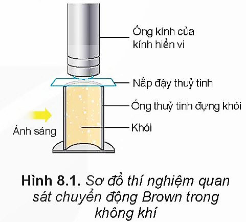
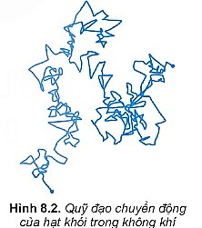
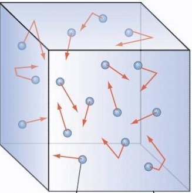

# Mô hình động học phân tử chất khí

## 1. Chuyển động và tương tác của phân tử khí

### a) Chuyển động Brown trong chất khí

Chiếu sáng một ống thuỷ tinh chứa khói và quan sát bằng kính hiển vi: các hạt khói **chuyển động hỗn loạn, không ngừng** theo những đường gấp khúc. Đó là **chuyển động Brown**.

:::note Nguyên nhân
Các hạt khói chuyển động hỗn loạn **không phải** vì chúng "sống" mà vì bị các **phân tử khí** (rất nhỏ, không nhìn thấy) chuyển động hỗn loạn va chạm từ mọi phía, lực va chạm không cân bằng nhau.
:::

**Kết luận:**
- Chất khí được cấu tạo từ các phân tử chuyển động **hỗn loạn, không ngừng**.
- Nhiệt độ khí càng cao thì các phân tử chuyển động càng nhanh. Ở điều kiện tiêu chuẩn, tốc độ trung bình của phân tử khí cỡ **vài trăm m/s** (khoảng 400–500 m/s với không khí).

### b) Tương tác giữa các phân tử khí

Giữa các phân tử khí cũng có lực hút và lực đẩy, nhưng vì chúng ở **rất xa nhau** nên lực liên kết **rất yếu** so với ở thể lỏng và thể rắn. Do đó chất khí không có hình dạng và thể tích riêng.

## 2. Mô hình động học phân tử chất khí

:::def Nội dung
1. Chất khí gồm các phân tử có kích thước **rất nhỏ so với khoảng cách** giữa chúng.
2. Các phân tử khí chuyển động **hỗn loạn, không ngừng**; chuyển động càng nhanh thì nhiệt độ khí càng cao.
3. Khi chuyển động, các phân tử khí **va chạm vào thành bình**, tác dụng lực lên thành bình và **gây ra áp suất**.
:::

## 3. Khí lí tưởng

Ở nhiệt độ và áp suất thông thường, có thể coi gần đúng các chất khí là **khí lí tưởng**:

:::def Mô hình khí lí tưởng
- Kích thước phân tử **rất nhỏ**, có thể **bỏ qua** (coi như chất điểm).
- **Bỏ qua lực tương tác** giữa các phân tử khi chúng chưa va chạm.
- Giữa hai va chạm liên tiếp, mỗi phân tử **chuyển động thẳng đều**.
- Va chạm giữa các phân tử với nhau và với thành bình là **va chạm hoàn toàn đàn hồi**: khi va vào thành bình, phân tử truyền động lượng cho thành bình rồi bật ngược lại.
:::

:::warn Dễ nhầm
Khí thực **không** hoàn toàn là khí lí tưởng. Khi bị nén rất mạnh (áp suất lớn) hoặc ở nhiệt độ rất thấp, các phân tử ở gần nhau nên không bỏ qua được kích thước và lực tương tác.
:::

## 4. Lượng chất – mol

:::def Mol và số Avogadro
**Mol** là lượng chất chứa số phân tử (hoặc nguyên tử) bằng số nguyên tử trong 12 g carbon-12, tức bằng **số Avogadro**:
$$N_A \approx 6{,}02\cdot 10^{23}\ \text{mol}^{-1}$$
**Khối lượng mol** $M$ là khối lượng của 1 mol chất (g/mol hoặc kg/mol).
:::

:::formula Các công thức lượng chất
$$n = \frac{N}{N_A} = \frac{m}{M}$$
Khối lượng một phân tử: $m_0 = \dfrac{M}{N_A}$.
Ở điều kiện tiêu chuẩn (0 °C, 1 atm), 1 mol khí bất kì chiếm thể tích $V_0 = 22{,}4$ lít: $n = \dfrac{V}{22{,}4}$ (V tính bằng lít).
:::

## 5. Ví dụ minh hoạ

:::example Ví dụ 1 – Giải thích hiện tượng
Vì sao quả bóng bay nở ra khi nhúng vào nước nóng và co lại khi nhúng vào nước đá?

**Giải.** Trong nước nóng, khí trong bóng nóng lên, các phân tử chuyển động **nhanh hơn**, va chạm vào vỏ bóng **mạnh và nhiều hơn** ⟹ áp suất khí tăng làm bóng căng ra. Trong nước đá thì ngược lại: phân tử chuyển động chậm đi, áp suất giảm, bóng co lại.
:::

:::example Ví dụ 2 – Số phân tử
Tính số phân tử nước trong 9 g nước. Biết $M = 18$ g/mol.

**Giải.** $n = \dfrac{m}{M} = \dfrac{9}{18} = 0{,}5$ mol ⟹ $N = n\,N_A = 0{,}5\cdot 6{,}02\cdot 10^{23} = 3{,}01\cdot 10^{23}$ phân tử.
:::

:::example Ví dụ 3 – Khối lượng một phân tử
Tính khối lượng một phân tử khí H₂ ($M = 2$ g/mol).

**Giải.** $m_0 = \dfrac{M}{N_A} = \dfrac{2}{6{,}02\cdot 10^{23}} \approx 3{,}32\cdot 10^{-24}$ g.
:::

:::example Ví dụ 4 – Hình dung độ lớn của N_A
Lấy toàn bộ phân tử nước trong 1,0 g hơi nước trải đều trên bề mặt Trái Đất (coi là hình cầu bán kính 6400 km). Mỗi mét vuông có bao nhiêu phân tử?

**Giải.** $N = \dfrac{1{,}0}{18}\cdot 6{,}02\cdot 10^{23} \approx 3{,}34\cdot 10^{22}$ phân tử.
Diện tích bề mặt Trái Đất: $S = 4\pi R^2 = 4\pi(6{,}4\cdot 10^6)^2 \approx 5{,}15\cdot 10^{14}$ m².
Mỗi mét vuông: $\dfrac{N}{S} \approx 6{,}5\cdot 10^{7}$ phân tử – hơn 65 triệu phân tử chỉ từ 1 gam nước!
:::

:::example Ví dụ 5 – Thể tích mol
Tính số mol của 224 ml khí N₂ ở 0 °C, 1 atm.

**Giải.** $n = \dfrac{V}{22{,}4} = \dfrac{0{,}224}{22{,}4} = 0{,}01$ mol.
:::

## Tóm tắt nhanh

- Phân tử khí: rất nhỏ, ở rất xa nhau, chuyển động hỗn loạn không ngừng; va vào thành bình gây ra áp suất.
- Khí lí tưởng: bỏ qua kích thước phân tử và lực tương tác; va chạm hoàn toàn đàn hồi.
- $n = \dfrac{N}{N_A} = \dfrac{m}{M}$; ở đktc $n = V/22{,}4$.
