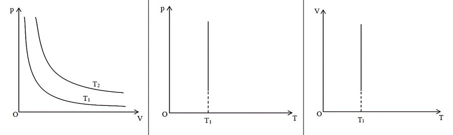
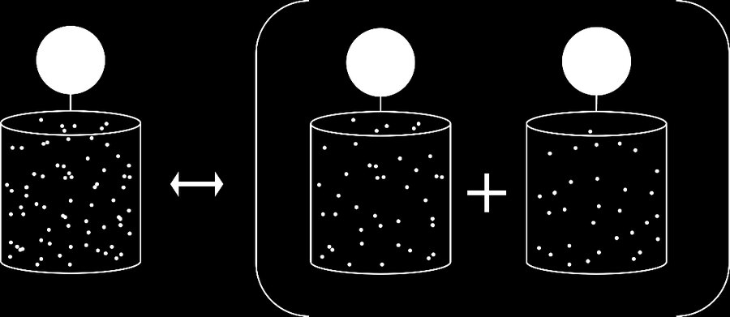
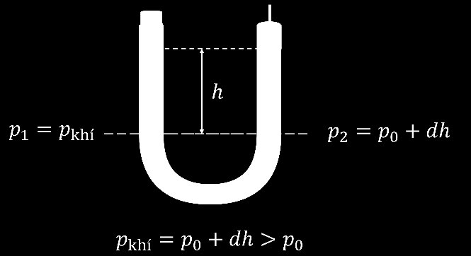

# Quá trình đẳng nhiệt – Định luật Boyle

Trạng thái của một lượng khí được mô tả bởi ba **thông số trạng thái**: áp suất $p$, thể tích $V$ và nhiệt độ tuyệt đối $T$. Khi giữ một thông số không đổi, ta khảo sát mối liên hệ giữa hai thông số còn lại.

## 1. Định luật Boyle

:::def Quá trình đẳng nhiệt
Quá trình biến đổi trạng thái của một **lượng khí xác định** trong đó **nhiệt độ được giữ không đổi**.
:::

:::formula Định luật Boyle
Trong quá trình đẳng nhiệt của một lượng khí xác định, **áp suất tỉ lệ nghịch với thể tích**:
$$p\,V = \text{hằng số} \qquad\Leftrightarrow\qquad p_1V_1 = p_2V_2$$
:::

- Nén khí (giảm $V$) thì áp suất tăng; cho khí giãn nở thì áp suất giảm.
- Vì khối lượng riêng $\rho = m/V$ nên ở nhiệt độ không đổi, **áp suất tỉ lệ thuận với khối lượng riêng** (và với mật độ phân tử): $\dfrac{p_1}{p_2} = \dfrac{\rho_1}{\rho_2}$.

:::note Lưu ý về đơn vị
Trong $p_1V_1 = p_2V_2$, chỉ cần hai vế **cùng đơn vị** (atm, Pa, mmHg… ; lít, m³, cm³…). Không cần đổi sang SI.
1 atm = 1,013·10⁵ Pa = 760 mmHg; 1 bar = 10⁵ Pa.
:::

## 2. Đường đẳng nhiệt

| Hệ toạ độ | Dạng đường đẳng nhiệt |
|---|---|
| $(p, V)$ | Một nhánh **hypebol**. Đường nằm **xa gốc toạ độ hơn** ứng với nhiệt độ **cao hơn** |
| $(p, T)$ | Đoạn thẳng **vuông góc với trục T** (song song trục p) |
| $(V, T)$ | Đoạn thẳng **vuông góc với trục T** (song song trục V) |
| $(p, 1/V)$ | Đường thẳng đi qua gốc toạ độ |

## 3. Định luật Dalton – trộn khí đẳng nhiệt

:::def Định luật Dalton
Áp suất của một hỗn hợp khí (không phản ứng hoá học với nhau) bằng **tổng áp suất riêng phần** của từng khí:
$$p = p_1 + p_2 + \dots$$
Áp suất riêng phần của một khí là áp suất nó gây ra nếu một mình chiếm toàn bộ thể tích của hỗn hợp.
:::

Trộn nhiều lượng khí ($p_1, V_1$), ($p_2, V_2$)… ở **cùng nhiệt độ** vào một bình thể tích $V$: áp dụng Boyle cho từng khí rồi cộng áp suất riêng phần, được:

:::formula Trộn khí đẳng nhiệt
$$p\,V = p_1V_1 + p_2V_2 + \dots$$
:::

### Bài toán bơm khí đẳng nhiệt

Bơm $N$ lần, mỗi lần đưa vào bình một lượng khí có thể tích $V_0$ ở áp suất $p_0$; bình thể tích $V$ ban đầu đã có khí áp suất $p_1$. Coi nhiệt độ không đổi:

:::formula Bơm khí
$$p\,V = p_1V + N\,p_0V_0$$
Nếu bình ban đầu **không có khí** (bóng xẹp hẳn): $p\,V = N\,p_0V_0$.
:::

## 4. Áp suất chất lỏng và nguyên lí Pascal

:::formula Áp suất tại độ sâu h trong chất lỏng
$$p = p_0 + \rho\,g\,h$$
$p_0$: áp suất tại mặt thoáng (thường là áp suất khí quyển); $\rho$: khối lượng riêng chất lỏng.
:::

- Hai điểm ở **cùng độ cao** trong cùng một khối chất lỏng đứng yên có **cùng áp suất**.
- Trong ống chữ U, nếu mực chất lỏng hai nhánh chênh nhau $h$ thì khí ở nhánh có mực **thấp hơn** có áp suất lớn hơn áp suất ở nhánh kia đúng một lượng $\rho g h$.

:::tip Đơn vị cmHg
Với các bài ống thuỷ ngân, dùng đơn vị **cmHg** rất tiện: cột thuỷ ngân cao $h$ (cm) gây áp suất đúng $h$ cmHg. Áp suất khí quyển thường lấy 76 cmHg.
:::

## 5. Ví dụ minh hoạ

:::example Ví dụ 1 – Áp dụng định luật Boyle
Nén đẳng nhiệt một lượng khí từ 2 lít xuống 1 lít. Áp suất thay đổi thế nào?

**Giải.** $p_1V_1 = p_2V_2 \Rightarrow \dfrac{p_2}{p_1} = \dfrac{V_1}{V_2} = 2$: áp suất **tăng 2 lần**.
:::

:::example Ví dụ 2 – Mở thông với buồng chân không
Buồng thể tích 2 m³ chứa khí nitrogen ở áp suất $1{,}0\cdot 10^5$ Pa được nối thông với một buồng chân không thể tích 8 m³. Khi cân bằng, nhiệt độ trở lại như ban đầu. Tính áp suất khí.

**Giải.** Lượng khí chiếm toàn bộ thể tích $2 + 8 = 10$ m³, nhiệt độ không đổi:
$$p_2 = \frac{p_1V_1}{V_2} = \frac{10^5\cdot 2}{10} = 2\cdot 10^4\ \text{Pa}$$
:::

:::example Ví dụ 3 – Trộn hai bình khí
Bình A thể tích 3 lít chứa khí ở 2 atm, bình B thể tích 2 lít chứa khí ở 1 atm. Nối hai bình bằng ống nhỏ, nhiệt độ không đổi. Tính áp suất chung.

**Giải.** $p\,(V_A + V_B) = p_AV_A + p_BV_B \Rightarrow p = \dfrac{2\cdot 3 + 1\cdot 2}{3 + 2} = 1{,}6$ atm.
:::

:::example Ví dụ 4 – Bơm ruột xe
Mỗi lần bơm đưa được 125 cm³ không khí ở áp suất $10^5$ Pa vào một ruột xe đã xẹp hẳn. Ruột xe căng có thể tích 2 lít. Cần bơm ít nhất bao nhiêu lần để áp suất trong ruột xe đạt $4\cdot 10^5$ Pa? Coi nhiệt độ không đổi.

**Giải.** Ruột xe ban đầu không có khí:
$$p\,V = N\,p_0V_0 \Rightarrow N = \frac{pV}{p_0V_0} = \frac{4\cdot 10^5\cdot 2000}{10^5\cdot 125} = 64\ \text{lần}$$
:::

:::example Ví dụ 5 – Bọt khí nổi lên từ đáy hồ
Một bọt khí nổi từ đáy hồ sâu 5 m lên mặt nước. Coi nhiệt độ không đổi; $p_0 = 1{,}013\cdot 10^5$ Pa, $\rho = 1000$ kg/m³, $g = 9{,}8$ m/s². Thể tích bọt khí tăng bao nhiêu lần?

**Giải.** Áp suất ở đáy hồ: $p_1 = p_0 + \rho g h = 1{,}013\cdot 10^5 + 1000\cdot 9{,}8\cdot 5 = 1{,}503\cdot 10^5$ Pa. Ở mặt nước $p_2 = p_0$.
$$\frac{V_2}{V_1} = \frac{p_1}{p_2} = \frac{1{,}503}{1{,}013} \approx 1{,}48\ \text{lần}$$
:::

## Tóm tắt nhanh

- Đẳng nhiệt: $p_1V_1 = p_2V_2$; đồ thị $(p, V)$ là hypebol, càng xa gốc thì $T$ càng cao.
- Trộn khí cùng nhiệt độ: $pV = \sum p_iV_i$; bơm khí: $pV = p_1V + Np_0V_0$.
- Chất lỏng: $p = p_0 + \rho g h$; cùng độ cao thì cùng áp suất.
