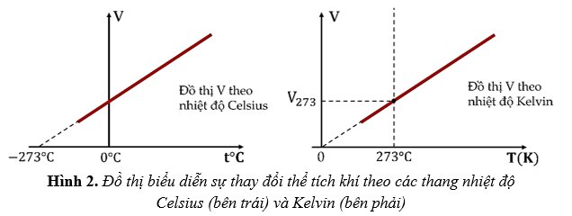
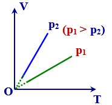
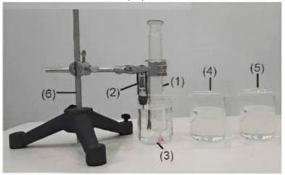
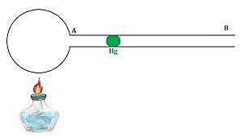

# Quá trình đẳng áp – Định luật Charles

## 1. Định luật Charles

:::def Quá trình đẳng áp
Quá trình biến đổi trạng thái của một **lượng khí xác định** trong đó **áp suất được giữ không đổi**.
:::

:::formula Định luật Charles
Trong quá trình đẳng áp của một lượng khí xác định, **thể tích tỉ lệ thuận với nhiệt độ tuyệt đối**:
$$\frac{V}{T} = \text{hằng số} \qquad\Leftrightarrow\qquad \frac{V_1}{T_1} = \frac{V_2}{T_2}$$
:::

:::warn Dễ nhầm
$T$ **bắt buộc** là nhiệt độ tuyệt đối (K): $T = t + 273$. Thể tích tỉ lệ với $T$, **không** tỉ lệ với $t$ (°C). Đun từ 10 °C lên 20 °C, thể tích **không** tăng gấp đôi mà chỉ tăng $\dfrac{293}{283} \approx 1{,}035$ lần.
:::

Viết theo nhiệt độ Celsius: $V = V_0\left(1 + \dfrac{t}{273}\right)$, với $V_0$ là thể tích ở 0 °C – khi tăng 1 °C, thể tích tăng thêm $\dfrac{1}{273}$ thể tích ở 0 °C.

Vì $\rho = m/V$ nên trong quá trình đẳng áp: $\dfrac{\rho_1}{\rho_2} = \dfrac{V_2}{V_1} = \dfrac{T_2}{T_1}$ – khí nóng thì loãng hơn (nhẹ hơn).

## 2. Đường đẳng áp

| Hệ toạ độ | Dạng đường đẳng áp |
|---|---|
| $(V, T)$ | Đường thẳng có **đường kéo dài đi qua gốc O** |
| $(V, t)$ | Đường thẳng cắt trục $t$ tại $-273$ °C |
| $(p, V)$ | Đoạn thẳng song song trục $V$ |
| $(p, T)$ | Đoạn thẳng song song trục $T$ |

:::tip Mẹo
Trên giản đồ $(V, T)$, kẻ một đường **thẳng đứng** (cùng $T$) cắt hai đường đẳng áp: đường nào cho $V$ **lớn hơn** thì có $p$ **nhỏ hơn** (theo Boyle). Vì vậy đường **dốc hơn** ứng với áp suất **nhỏ hơn**.
:::

## 3. Ứng dụng thực tế

- Quả bóng bàn bị móp, nhúng vào nước nóng thì phồng lại.
- Khinh khí cầu: đốt nóng không khí bên trong để khí giãn nở, nhẹ đi và bay lên.
- Lốp xe để ngoài nắng dễ căng phồng; bóng bay để gần lửa dễ nổ.

## 4. Thí nghiệm khảo sát quá trình đẳng áp

1. Nhốt một lượng khí trong xi-lanh có pit-tông di chuyển nhẹ (áp suất khí luôn bằng áp suất khí quyển).
2. Đặt xi-lanh vào cốc nước; lần lượt thay đổi nhiệt độ nước (nước nóng, nước lạnh).
3. Ghi nhiệt độ và thể tích khí tương ứng, lập tỉ số $V/T$.

**Kết quả:** tỉ số $V/T$ gần như không đổi ⟹ nghiệm đúng định luật Charles.

## 5. Ví dụ minh hoạ

:::example Ví dụ 1 – Áp dụng trực tiếp
Một lượng khí có thể tích 10 lít ở 27 °C. Nung nóng đẳng áp đến 127 °C. Tính thể tích khí lúc sau.

**Giải.** $T_1 = 300$ K, $T_2 = 400$ K.
$$V_2 = V_1\frac{T_2}{T_1} = 10\cdot\frac{400}{300} \approx 13{,}3\ \text{lít}$$
:::

:::example Ví dụ 2 – Biết độ tăng thể tích (SGK KNTT)
Tăng nhiệt độ của một lượng khí từ 32 °C lên 117 °C, giữ áp suất không đổi, thì thể tích tăng thêm 1,7 lít. Tìm thể tích lúc đầu và lúc sau.

**Giải.** $T_1 = 305$ K, $T_2 = 390$ K. $\dfrac{V_2}{V_1} = \dfrac{390}{305}$ và $V_2 - V_1 = 1{,}7$.
$$V_1\left(\frac{390}{305} - 1\right) = 1{,}7 \Rightarrow V_1 = \frac{1{,}7\cdot 305}{85} = 6{,}1\ \text{lít};\quad V_2 = 7{,}8\ \text{lít}$$
:::

:::example Ví dụ 3 – Qua khối lượng riêng (SGK KNTT)
12 g khí chiếm thể tích 4 lít ở 7 °C. Sau khi đun nóng đẳng áp, khối lượng riêng của khí là 1,2 g/lít. Tìm nhiệt độ khí sau khi đun.

**Giải.** $V_2 = \dfrac{m}{\rho_2} = \dfrac{12}{1{,}2} = 10$ lít. $T_1 = 280$ K.
$$T_2 = T_1\frac{V_2}{V_1} = 280\cdot\frac{10}{4} = 700\ \text{K} \;(= 427\ ^\circ\text{C})$$
:::

:::example Ví dụ 4 – Nhiệt kế khí
Một bình cầu thể tích 270 cm³ nối với ống nằm ngang tiết diện 0,1 cm². Một giọt thuỷ ngân ngăn khí trong bình với bên ngoài. Ở 0 °C, giọt thuỷ ngân cách miệng bình 30 cm. Ở 10 °C, giọt thuỷ ngân dịch chuyển bao nhiêu? Coi áp suất khí không đổi.

**Giải.** $V_1 = 270 + 0{,}1\cdot 30 = 273$ cm³ ở $T_1 = 273$ K.
$$V_2 = V_1\frac{T_2}{T_1} = 273\cdot\frac{283}{273} = 283\ \text{cm}^3$$
Thể tích khí trong ống lúc sau: $283 - 270 = 13$ cm³ ⟹ giọt cách miệng bình $13/0{,}1 = 130$ cm.
Giọt thuỷ ngân dịch ra xa thêm $130 - 30 = 100$ cm.
:::

## Tóm tắt nhanh

- Đẳng áp: $\dfrac{V_1}{T_1} = \dfrac{V_2}{T_2}$, **T tính bằng kelvin**.
- Đường đẳng áp trong $(V, T)$ là đường thẳng kéo dài qua gốc; càng dốc thì áp suất càng nhỏ.
- Đẳng áp: $\rho \sim 1/T$ – khí nóng thì nhẹ.
