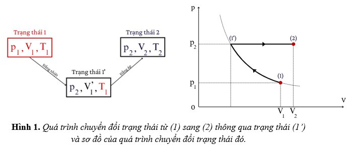
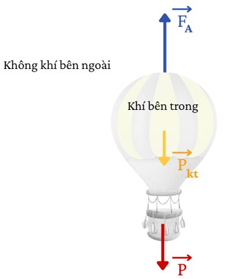

# Phương trình trạng thái của khí lí tưởng

Trong thực tế, áp suất, thể tích và nhiệt độ của một lượng khí thường **thay đổi cùng lúc**. Phương trình trạng thái liên hệ cả ba thông số trong một hệ thức.

## 1. Quá trình đẳng tích

:::formula Quá trình đẳng tích (thể tích không đổi)
Áp suất của một lượng khí xác định **tỉ lệ thuận với nhiệt độ tuyệt đối**:
$$\frac{p}{T} = \text{hằng số} \qquad\Leftrightarrow\qquad \frac{p_1}{T_1} = \frac{p_2}{T_2}$$
:::

- Đường đẳng tích trong hệ $(p, T)$ là đường thẳng **kéo dài qua gốc O**; đường **càng dốc** thì thể tích **càng nhỏ**.
- Ứng dụng: lốp xe phơi nắng dễ nổ; nồi áp suất; bình xịt không được để gần lửa.

## 2. Phương trình trạng thái của một lượng khí xác định

:::formula Phương trình trạng thái
$$\frac{pV}{T} = \text{hằng số} \qquad\Leftrightarrow\qquad \frac{p_1V_1}{T_1} = \frac{p_2V_2}{T_2}$$
:::

Có thể suy ra phương trình bằng cách cho khí đi từ trạng thái 1 sang trạng thái trung gian bằng quá trình **đẳng nhiệt**, rồi từ đó sang trạng thái 2 bằng quá trình **đẳng tích**.

| Quá trình | Thông số không đổi | Phương trình trạng thái trở thành |
|---|---|---|
| Đẳng nhiệt | $T$ | $p_1V_1 = p_2V_2$ (Boyle) |
| Đẳng áp | $p$ | $V_1/T_1 = V_2/T_2$ (Charles) |
| Đẳng tích | $V$ | $p_1/T_1 = p_2/T_2$ |

:::note Lưu ý
Trạng thái cuối chỉ phụ thuộc trạng thái đầu và các thông số cuối, **không phụ thuộc** khí đi theo con đường nào. Phương trình chỉ áp dụng cho **lượng khí không đổi** (không thêm, không rò rỉ).
:::

## 3. Phương trình Clapeyron

Với $n$ mol khí lí tưởng, hằng số trong phương trình trạng thái bằng $nR$:

:::formula Phương trình Clapeyron
$$pV = nRT = \frac{m}{M}RT$$
$R \approx 8{,}31$ J/(mol·K) là hằng số khí. Dùng đơn vị SI: $p$ (Pa), $V$ (m³), $T$ (K).
:::

Hệ quả hữu ích:
- **Khối lượng riêng** của khí: $\rho = \dfrac{m}{V} = \dfrac{pM}{RT}$.
- **Mật độ phân tử**: $\mu = \dfrac{N}{V} = \dfrac{p}{kT}$, với $k = \dfrac{R}{N_A} \approx 1{,}38\cdot 10^{-23}$ J/K (hằng số Boltzmann).

:::warn Dễ nhầm
Khi dùng $pV = nRT$ với $R = 8{,}31$, **phải** đổi về SI: 1 lít = $10^{-3}$ m³; 1 atm ≈ $1{,}013\cdot 10^5$ Pa; khối lượng mol tính bằng g/mol thì $m$ tính bằng g để $n = m/M$ đúng.
:::

## 4. Phương pháp giải

:::tip Các bước
1. Xác định **lượng khí** đang xét và xem nó có thay đổi không.
2. Liệt kê thông số **trạng thái 1** ($p_1, V_1, T_1$) và **trạng thái 2** ($p_2, V_2, T_2$); đổi nhiệt độ sang kelvin.
3. Lượng khí không đổi ⟹ dùng $\dfrac{p_1V_1}{T_1} = \dfrac{p_2V_2}{T_2}$. Lượng khí thay đổi (khí thoát ra, bơm thêm) ⟹ dùng Clapeyron cho từng trạng thái để tìm số mol.
:::

## 5. Ví dụ minh hoạ

:::example Ví dụ 1 – Nén khí trong bơm (SGK KNTT)
Bơm chứa 100 cm³ không khí ở 27 °C và $10^5$ Pa. Nén khí còn 20 cm³ và nhiệt độ tăng lên 39 °C. Tính áp suất khí trong bơm.

**Giải.** $T_1 = 300$ K, $T_2 = 312$ K.
$$p_2 = p_1\frac{V_1}{V_2}\frac{T_2}{T_1} = 10^5\cdot\frac{100}{20}\cdot\frac{312}{300} = 5{,}2\cdot 10^5\ \text{Pa}$$
:::

:::example Ví dụ 2 – Đẳng tích
Lốp xe được bơm đến 2,0 atm ở 27 °C. Xe chạy một lúc, nhiệt độ khí trong lốp lên 42 °C. Coi thể tích lốp không đổi. Tính áp suất khí trong lốp.

**Giải.** $p_2 = p_1\dfrac{T_2}{T_1} = 2{,}0\cdot\dfrac{315}{300} = 2{,}1$ atm.
:::

:::example Ví dụ 3 – Phương trình Clapeyron
Bình thể tích 5 lít chứa 0,3 mol khí nitrogen ở 32 °C. Tính áp suất khí.

**Giải.**
$$p = \frac{nRT}{V} = \frac{0{,}3\cdot 8{,}31\cdot 305}{5\cdot 10^{-3}} \approx 1{,}52\cdot 10^5\ \text{Pa}$$
:::

:::example Ví dụ 4 – Khối lượng khí trong bình
Bình 15 lít chứa nitrogen ($M = 28$ g/mol) ở $2{,}45\cdot 10^5$ Pa và 17 °C. Tính khối lượng khí.

**Giải.**
$$n = \frac{pV}{RT} = \frac{2{,}45\cdot 10^5\cdot 15\cdot 10^{-3}}{8{,}31\cdot 290} \approx 1{,}525\ \text{mol} \Rightarrow m = nM \approx 42{,}7\ \text{g}$$
:::

:::example Ví dụ 5 – Lượng khí đã dùng
Bình oxygen ($M = 32$ g/mol) thể tích 20 lít, ban đầu áp suất $1{,}5\cdot 10^6$ Pa ở 27 °C. Sau khi dùng một thời gian, áp suất còn $5\cdot 10^5$ Pa ở 17 °C. Tính khối lượng oxygen đã dùng.

**Giải.** Lượng khí thay đổi nên tính số mol ở từng trạng thái:
$$n_1 = \frac{1{,}5\cdot 10^6\cdot 0{,}02}{8{,}31\cdot 300} \approx 12{,}03\ \text{mol};\qquad n_2 = \frac{5\cdot 10^5\cdot 0{,}02}{8{,}31\cdot 290} \approx 4{,}15\ \text{mol}$$
$$\Delta m = (n_1 - n_2)\,M \approx 7{,}88\cdot 32 \approx 252\ \text{g}$$
:::

:::example Ví dụ 6 – Khinh khí cầu
Khinh khí cầu có thể tích 2000 m³, khối lượng vỏ, giỏ và người tổng cộng 450 kg. Không khí bên ngoài ở 25 °C có khối lượng riêng 1,2 kg/m³. Phải đốt nóng không khí trong khí cầu đến ít nhất bao nhiêu độ để khí cầu bắt đầu bay lên? Áp suất trong và ngoài khí cầu như nhau.

**Giải.** Khí cầu bay lên khi lực đẩy Archimedes không nhỏ hơn tổng trọng lượng:
$$\rho_{\text{ngoài}}Vg \geq Mg + \rho_{\text{trong}}Vg \Rightarrow \rho_{\text{trong}} \leq 1{,}2 - \frac{450}{2000} = 0{,}975\ \text{kg/m}^3$$
Cùng áp suất nên $\rho \sim 1/T$:
$$T_{\text{trong}} \geq 298\cdot\frac{1{,}2}{0{,}975} \approx 367\ \text{K} \;(\approx 94\ ^\circ\text{C})$$
:::

## Tóm tắt nhanh

- Lượng khí không đổi: $\dfrac{p_1V_1}{T_1} = \dfrac{p_2V_2}{T_2}$ (đơn vị $p$, $V$ tuỳ ý nhưng hai vế giống nhau; $T$ bằng kelvin).
- Đẳng tích: $p/T$ không đổi.
- $pV = nRT$ (đơn vị SI, $R = 8{,}31$); $\rho = \dfrac{pM}{RT}$.
