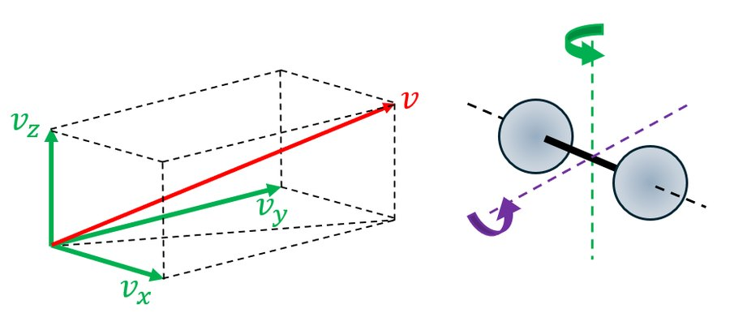
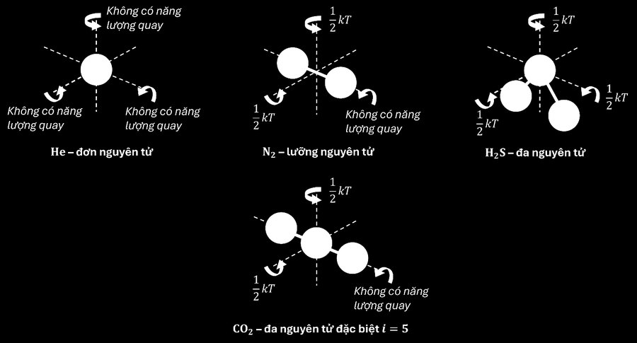

# Áp suất khí theo mô hình động học phân tử – Động năng phân tử và nhiệt độ

## 1. Áp suất khí theo mô hình động học phân tử

Áp suất khí là kết quả của vô số va chạm của các phân tử vào thành bình. Mỗi phân tử khối lượng $m$ đập vào thành bình với vận tốc $v_x$ rồi bật ngược lại, truyền cho thành bình động lượng $2mv_x$.

Vì chuyển động hỗn loạn nên không có phương nào được ưu tiên: $\overline{v_x^2} = \overline{v_y^2} = \overline{v_z^2} = \tfrac{1}{3}\overline{v^2}$. Từ đó:

:::formula Công thức áp suất
$$p = \frac{1}{3}\mu\,m\,\overline{v^2} = \frac{2}{3}\mu\,\overline{E_{\text{đ}}}$$
- $\mu = N/V$: mật độ phân tử (số phân tử trong 1 m³);
- $m$: khối lượng một phân tử;
- $\overline{v^2}$: trung bình bình phương tốc độ;
- $\overline{E_{\text{đ}}} = \tfrac{1}{2}m\overline{v^2}$: động năng tịnh tiến trung bình của một phân tử.
:::

Áp suất khí **tăng** khi mật độ phân tử tăng (nhiều va chạm hơn) hoặc phân tử chuyển động nhanh hơn (va chạm mạnh hơn).

Vì $\mu\,m = \rho$ (khối lượng riêng) nên cũng viết được $p = \tfrac{1}{3}\rho\,\overline{v^2}$.

## 2. Động năng phân tử và nhiệt độ

So sánh $p = \tfrac{2}{3}\mu\overline{E_{\text{đ}}}$ với $p = \mu kT$ (suy từ $pV = nRT$):

:::formula Động năng tịnh tiến trung bình của phân tử
$$\overline{E_{\text{đ}}} = \frac{3}{2}kT$$
$k = \dfrac{R}{N_A} \approx 1{,}38\cdot 10^{-23}$ J/K là **hằng số Boltzmann**.
:::

:::def Ý nghĩa của nhiệt độ
Nhiệt độ tuyệt đối là **số đo động năng tịnh tiến trung bình** của các phân tử. Ở cùng nhiệt độ, phân tử của **mọi chất khí** đều có cùng động năng tịnh tiến trung bình.
:::

:::formula Tốc độ căn quân phương
$$v_{\text{rms}} = \sqrt{\overline{v^2}} = \sqrt{\frac{3kT}{m}} = \sqrt{\frac{3RT}{M}}$$
$M$ tính bằng **kg/mol**. Ở cùng nhiệt độ, khí nhẹ (M nhỏ) có phân tử chuyển động nhanh hơn.
:::

## 3. Nội năng của khí lí tưởng

Khí lí tưởng bỏ qua tương tác phân tử nên **nội năng chỉ gồm động năng** các phân tử ⟹ **chỉ phụ thuộc nhiệt độ**.

Ngoài chuyển động tịnh tiến, phân tử gồm nhiều nguyên tử còn **quay**. Mỗi "cách chuyển động độc lập" (bậc tự do) đóng góp trung bình $\tfrac{1}{2}kT$ vào năng lượng của phân tử.

| Loại khí | Ví dụ | Số bậc tự do $i$ | Nội năng $U$ |
|---|---|---|---|
| Đơn nguyên tử | He, Ne, Ar | 3 (tịnh tiến) | $\tfrac{3}{2}nRT$ |
| Lưỡng nguyên tử | O₂, N₂, H₂ | 5 (3 tịnh tiến + 2 quay) | $\tfrac{5}{2}nRT$ |
| Đa nguyên tử (phân tử không thẳng) | H₂O, CH₄ | 6 (3 tịnh tiến + 3 quay) | $3nRT$ |

:::formula Nội năng và độ biến thiên nội năng
$$U = \frac{i}{2}nRT \qquad\Rightarrow\qquad \Delta U = \frac{i}{2}nR\,\Delta T$$
:::

:::note Áp dụng định luật I
Với khí lí tưởng: $\Delta U = A + Q$ và $\Delta U$ chỉ phụ thuộc $\Delta T$.
- **Đẳng tích**: $A = 0$ ⟹ $Q = \Delta U$.
- **Đẳng nhiệt**: $\Delta U = 0$ ⟹ $Q = -A$ (nhiệt nhận vào bằng công khí sinh ra).
- **Đẳng áp**: công khí sinh ra $p\Delta V = nR\Delta T$, nên $Q = \Delta U + p\Delta V$.
:::

## 4. Ví dụ minh hoạ

:::example Ví dụ 1 – Mật độ phân tử trong chân không
Buồng chân không có áp suất $10^{-10}$ Pa ở 300 K. Tính số phân tử khí trong 1 cm³.

**Giải.** $\mu = \dfrac{p}{kT} = \dfrac{10^{-10}}{1{,}38\cdot 10^{-23}\cdot 300} \approx 2{,}4\cdot 10^{10}$ phân tử/m³ ⟹ khoảng $2{,}4\cdot 10^{4}$ phân tử trong 1 cm³ – vẫn rất nhiều dù là "chân không".
:::

:::example Ví dụ 2 – Động năng trung bình
Tính động năng tịnh tiến trung bình của phân tử không khí trong phòng ở 25 °C.

**Giải.** $\overline{E_{\text{đ}}} = \dfrac{3}{2}kT = 1{,}5\cdot 1{,}38\cdot 10^{-23}\cdot 298 \approx 6{,}17\cdot 10^{-21}$ J.
:::

:::example Ví dụ 3 – Tốc độ căn quân phương
Tính tốc độ căn quân phương của phân tử helium ($M = 4$ g/mol) ở 27 °C.

**Giải.** $v_{\text{rms}} = \sqrt{\dfrac{3RT}{M}} = \sqrt{\dfrac{3\cdot 8{,}31\cdot 300}{4\cdot 10^{-3}}} \approx 1367$ m/s.
:::

:::example Ví dụ 4 – Định luật I cho khí lí tưởng
Cung cấp nhiệt cho 4 g helium trong bình kín (thể tích không đổi) làm nhiệt độ tăng từ 300 K lên 400 K. Tính nhiệt lượng đã cung cấp.

**Giải.** $n = 1$ mol, khí đơn nguyên tử, đẳng tích nên $A = 0$:
$$Q = \Delta U = \frac{3}{2}nR\,\Delta T = 1{,}5\cdot 1\cdot 8{,}31\cdot 100 \approx 1247\ \text{J}$$
:::

## Tóm tắt nhanh

- $p = \tfrac{1}{3}\mu m\overline{v^2} = \tfrac{2}{3}\mu\overline{E_{\text{đ}}}$; $p = \mu kT$.
- $\overline{E_{\text{đ}}} = \tfrac{3}{2}kT$: nhiệt độ là số đo động năng trung bình của phân tử.
- $v_{\text{rms}} = \sqrt{3RT/M}$ (M tính bằng kg/mol).
- Khí lí tưởng: $U = \tfrac{i}{2}nRT$, chỉ phụ thuộc nhiệt độ.
