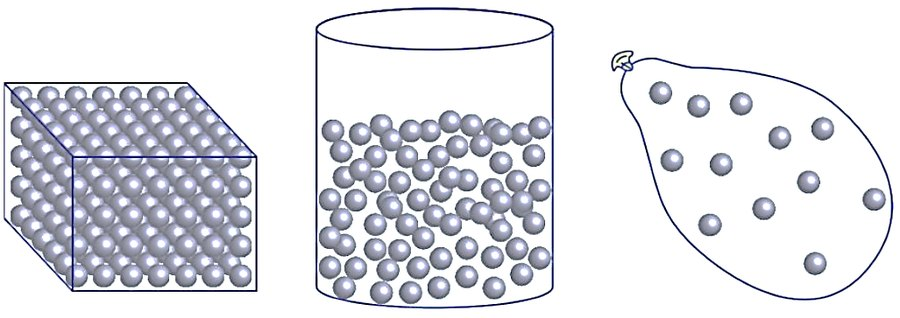
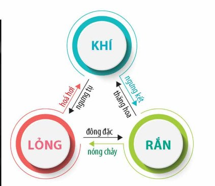
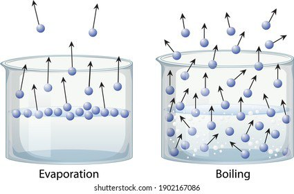
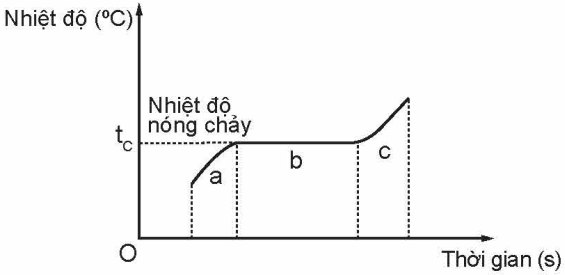

# Cấu trúc của chất – Sự chuyển thể

Mọi vật quanh ta – cục nước đá, cốc nước, không khí – đều được tạo từ những hạt rất nhỏ. Cách các hạt ấy **sắp xếp, chuyển động và hút đẩy nhau** quyết định chất đó là rắn, lỏng hay khí, và vì sao chất có thể chuyển từ thể này sang thể khác.

## 1. Mô hình động học phân tử về cấu tạo chất

:::def Nội dung của mô hình động học phân tử
1. Các chất được cấu tạo từ các hạt riêng biệt gọi là **phân tử**.
2. Các phân tử **chuyển động hỗn loạn, không ngừng**. Nhiệt độ của vật càng cao thì các phân tử chuyển động càng nhanh.
3. Giữa các phân tử có **lực hút và lực đẩy** (gọi chung là lực liên kết phân tử). Khi các phân tử ở gần nhau thì lực đẩy chiếm ưu thế; khi ở xa nhau thì lực hút chiếm ưu thế.
:::

## 2. Cấu trúc của chất rắn, chất lỏng, chất khí

Hai quy luật giúp giải thích cấu trúc của hầu hết các chất:

- Khoảng cách giữa các phân tử **càng lớn** thì lực liên kết giữa chúng **càng yếu**.
- Các phân tử sắp xếp **càng có trật tự** thì lực liên kết giữa chúng **càng mạnh**.

| Đặc điểm | Thể rắn | Thể lỏng | Thể khí |
|---|---|---|---|
| Khoảng cách giữa các phân tử | Rất gần nhau (cỡ kích thước phân tử) | Xa hơn ở thể rắn một chút | Rất xa nhau (gấp hàng chục lần kích thước phân tử) |
| Sự sắp xếp | Trật tự | Kém trật tự | Không có trật tự |
| Chuyển động của phân tử | Dao động quanh vị trí cân bằng **cố định** | Dao động quanh vị trí cân bằng **luôn thay đổi** | Chuyển động hỗn loạn tự do |
| Lực liên kết | Rất mạnh | Yếu hơn thể rắn | Rất yếu |
| Hình dạng | Xác định | Theo hình dạng bình chứa | Theo hình dạng bình chứa |
| Thể tích | Xác định | Xác định | Chiếm toàn bộ bình chứa |

:::warn Dễ nhầm
Chất lỏng có **thể tích xác định** nhưng **không có hình dạng riêng** – đổ nước từ cốc sang bát thì nước đổi hình dạng mà thể tích giữ nguyên. Chất khí thì không có cả hình dạng lẫn thể tích riêng.
:::

## 3. Sự chuyển thể

Khi nhiệt độ, áp suất thay đổi, một chất có thể chuyển từ thể này sang thể khác.

| Quá trình | Chiều chuyển thể | Thu hay toả nhiệt |
|---|---|---|
| Nóng chảy | Rắn → Lỏng | Thu nhiệt |
| Đông đặc | Lỏng → Rắn | Toả nhiệt |
| Hoá hơi | Lỏng → Khí (hơi) | Thu nhiệt |
| Ngưng tụ | Khí (hơi) → Lỏng | Toả nhiệt |
| Thăng hoa | Rắn → Khí | Thu nhiệt |
| Ngưng kết | Khí → Rắn | Toả nhiệt |

:::note Lưu ý
Một số chất rắn như iodine (i-ốt), băng phiến, đá khô (CO₂ ở thể rắn) có thể chuyển **thẳng** sang thể khí khi nhận nhiệt – đó là sự **thăng hoa**.
:::

### a) Giải thích sự hoá hơi

Sự hoá hơi xảy ra theo hai hình thức: **bay hơi** và **sôi**.

- **Bay hơi** xảy ra ở **mặt thoáng** chất lỏng, ở **mọi nhiệt độ**. Các phân tử va chạm và truyền năng lượng cho nhau, nên luôn có một số phân tử gần mặt thoáng có động năng đủ lớn để thắng lực hút của các phân tử chất lỏng xung quanh và thoát ra ngoài, trở thành phân tử hơi. Ví dụ: cốc nước để hở cạn dần.
- **Sôi** xảy ra khi chất lỏng được đun đến **nhiệt độ sôi**: sự hoá hơi diễn ra **cả trong lòng lẫn trên bề mặt** chất lỏng. Trong suốt quá trình sôi, nhiệt độ chất lỏng **không đổi** (nếu áp suất không đổi).

| | Bay hơi | Sôi |
|---|---|---|
| Xảy ra ở đâu | Chỉ ở mặt thoáng | Cả trong lòng và mặt thoáng |
| Nhiệt độ | Mọi nhiệt độ | Nhiệt độ sôi xác định (phụ thuộc áp suất) |
| Tốc độ | Chậm | Nhanh |

### b) Giải thích sự nóng chảy

- Khi nung nóng vật rắn kết tinh, các phân tử nhận năng lượng và **dao động mạnh hơn**.
- Đến một nhiệt độ xác định (**nhiệt độ nóng chảy**), một số phân tử thắng được lực liên kết và rời khỏi vị trí của chúng – quá trình nóng chảy bắt đầu.
- Từ lúc này, nhiệt lượng nhận vào dùng để **phá vỡ liên kết** của mạng tinh thể nên **nhiệt độ không tăng**. Khi trật tự tinh thể bị phá vỡ hoàn toàn, vật rắn đã thành khối lỏng.

- **Đoạn a:** chất rắn nóng lên, chưa nóng chảy.
- **Đoạn b (nằm ngang):** chất rắn **đang nóng chảy** – nhiệt độ giữ nguyên bằng $t_c$.
- **Đoạn c:** chất đã nóng chảy hoàn toàn, chất lỏng tiếp tục nóng lên.

## 4. Chất rắn kết tinh và chất rắn vô định hình

| | Chất rắn kết tinh | Chất rắn vô định hình |
|---|---|---|
| Cấu trúc | Có cấu trúc tinh thể (phân tử sắp xếp trật tự) | Không có cấu trúc tinh thể |
| Nhiệt độ nóng chảy | **Xác định** | **Không xác định** (mềm dần rồi mới lỏng) |
| Tính chất vật lí theo hướng | Đơn tinh thể: **dị hướng**; đa tinh thể: **đẳng hướng** | **Đẳng hướng** |
| Ví dụ | Đơn tinh thể: hạt muối, thạch anh, kim cương. Đa tinh thể: hầu hết kim loại (sắt, nhôm, đồng…) | Thuỷ tinh, nhựa, cao su, nhựa đường… |

:::tip Mẹo nhớ
"Kết tinh – có điểm nóng chảy; vô định hình – chảy dần". Đường và lưu huỳnh là ví dụ chất có thể tồn tại ở **cả hai** dạng: kết tinh hoặc vô định hình.
:::

## Tóm tắt nhanh

- Ba ý của mô hình động học phân tử: **hạt riêng biệt – chuyển động không ngừng – có lực hút và đẩy**.
- Rắn: hình dạng và thể tích xác định. Lỏng: thể tích xác định, hình dạng theo bình. Khí: chiếm cả bình.
- Nóng chảy, hoá hơi, thăng hoa **thu nhiệt**; đông đặc, ngưng tụ, ngưng kết **toả nhiệt**.
- Trong lúc nóng chảy (chất kết tinh) hay đang sôi, **nhiệt độ không đổi**.
