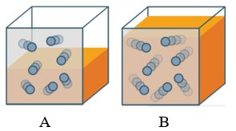
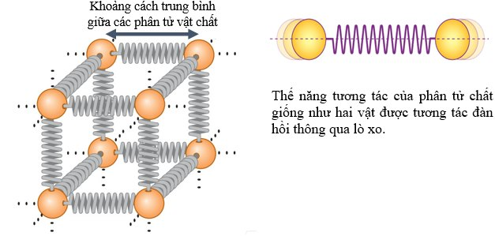
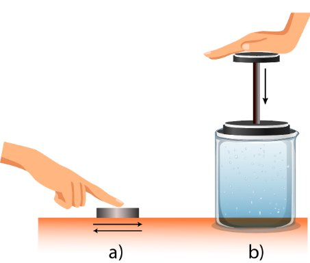
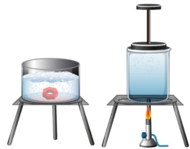
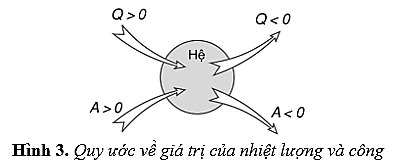
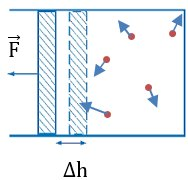
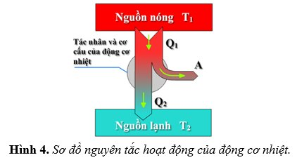

# Nội năng – Định luật I của nhiệt động lực học

Vì sao cọ hai bàn tay vào nhau lại thấy ấm? Vì sao bơm xe đạp một lúc thì thân bơm nóng lên? Câu trả lời nằm ở một dạng năng lượng "ẩn" bên trong mọi vật: **nội năng**.

## 1. Nội năng

Theo mô hình động học phân tử, các phân tử vừa chuyển động không ngừng, vừa tương tác với nhau, nên mỗi phân tử có hai dạng năng lượng:

| Đặc điểm của phân tử | Dạng năng lượng | Phụ thuộc vào |
|---|---|---|
| Chuyển động không ngừng | **Động năng** phân tử | Tốc độ chuyển động của phân tử |
| Tương tác với nhau bằng lực liên kết | **Thế năng** tương tác phân tử | Khoảng cách giữa các phân tử |

:::def Nội năng
Tổng động năng và thế năng tương tác của các phân tử cấu tạo nên vật gọi là **nội năng** của vật.
Kí hiệu: $U$. Đơn vị: jun (J).
:::

### Nội năng phụ thuộc vào nhiệt độ và thể tích

- **Nhiệt độ:** nhiệt độ càng cao thì phân tử chuyển động càng nhanh ⟹ động năng phân tử tăng ⟹ nội năng tăng.

- **Thể tích:** thể tích thay đổi thì khoảng cách giữa các phân tử thay đổi ⟹ thế năng phân tử thay đổi ⟹ nội năng thay đổi.

:::note Lưu ý
- Các phân tử chuyển động không ngừng nên tốc độ và khoảng cách giữa chúng luôn thay đổi. Vì vậy, "động năng" và "thế năng" phân tử ở đây được hiểu là **giá trị trung bình**.
- Với **khí lí tưởng**, bỏ qua tương tác giữa các phân tử nên thế năng phân tử bằng 0: nội năng **chỉ phụ thuộc nhiệt độ**.
:::

## 2. Hai cách làm thay đổi nội năng

| | Thực hiện công | Truyền nhiệt |
|---|---|---|
| Ví dụ | Cọ xát miếng kim loại trên sàn; ấn nhanh pit-tông nén khí trong xi-lanh | Thả miếng kim loại vào nước nóng; hơ xi-lanh chứa khí trên ngọn lửa |
| Bản chất | Có sự **chuyển hoá** năng lượng (cơ năng → nội năng) | Chỉ có sự **truyền** nội năng từ vật này sang vật khác, không chuyển hoá |

:::def Nhiệt lượng
Phần nội năng mà vật nhận thêm được hay mất bớt đi trong quá trình truyền nhiệt gọi là **nhiệt lượng**, kí hiệu $Q$, đơn vị jun (J).
:::

## 3. Định luật I của nhiệt động lực học

:::formula Định luật I
Độ biến thiên nội năng của vật bằng tổng công và nhiệt lượng mà vật **nhận được**:
$$\Delta U = A + Q$$
:::

Trong đó: $\Delta U$ là độ biến thiên nội năng (J); $A$ là công vật nhận được (J); $Q$ là nhiệt lượng vật nhận được (J).

| Đại lượng | Dương (> 0) | Âm (< 0) |
|---|---|---|
| $Q$ | Vật **nhận** nhiệt lượng | Vật **toả** nhiệt lượng |
| $A$ | Vật **nhận** công (bị nén) | Vật **thực hiện** công (giãn nở, sinh công) |
| $\Delta U$ | Nội năng **tăng** | Nội năng **giảm** |

:::tip Mẹo nhớ dấu
Đứng ở vị trí **của vật**: cái gì "đi vào" vật thì dương, "đi ra" khỏi vật thì âm. Khí bị nén ⟹ nhận công ⟹ $A > 0$; khí giãn nở đẩy pit-tông ⟹ sinh công ⟹ $A < 0$.
:::

### Công của khí khi áp suất không đổi

Khi khí trong xi-lanh có áp suất $p$ không đổi, đẩy pit-tông tiết diện $S$ dịch chuyển một đoạn $\Delta h$:

:::formula Độ lớn công của khí
$$|A| = F\cdot\Delta h = p\,S\,\Delta h = p\,|\Delta V|$$
Khí **giãn nở** ($\Delta V > 0$): khí sinh công, $A = -p\,\Delta V$. Khí **bị nén**: khí nhận công, $A > 0$.
:::

## 4. Động cơ nhiệt

**Động cơ nhiệt** là thiết bị biến đổi nội năng của nhiên liệu thành cơ năng. Mỗi động cơ nhiệt đều có ba bộ phận chính:

- **Nguồn nóng** (nhiệt độ $T_1$): cung cấp nhiệt lượng $Q_1$ cho tác nhân.
- **Tác nhân và cơ cấu phát động:** tác nhân (thường là khí) nhận nhiệt, giãn nở và sinh công $A$.
- **Nguồn lạnh** (nhiệt độ $T_2 < T_1$): nhận phần nhiệt lượng $Q_2$ còn lại do tác nhân toả ra.

## 5. Ví dụ minh hoạ

:::example Ví dụ 1 – Tính ΔU từ công và nhiệt lượng
Cung cấp cho vật một công 200 J nhưng vật bị thất thoát ra môi trường một nhiệt lượng 120 J. Nội năng của vật thay đổi thế nào?

**Giải.** Vật nhận công: $A = 200\ \text{J}$; vật toả nhiệt: $Q = -120\ \text{J}$.
$$\Delta U = A + Q = 200 + (-120) = 80\ \text{J} > 0$$
Nội năng của vật **tăng thêm 80 J**.
:::

:::example Ví dụ 2 – Nén khí trong xi-lanh nằm ngang
Cung cấp nhiệt lượng 40 J cho khí trong xi-lanh nằm ngang, đồng thời đẩy pit-tông bằng lực không đổi 40 N làm pit-tông dịch chuyển 25 cm để nén khí. Tính độ biến thiên nội năng của khí.

**Giải.** Khí nhận nhiệt: $Q = 40\ \text{J}$. Khí bị nén nên nhận công:
$$A = F\cdot d = 40\cdot 0{,}25 = 10\ \text{J}$$
$$\Delta U = A + Q = 10 + 40 = 50\ \text{J}$$
Nội năng của khí **tăng 50 J**.
:::

:::example Ví dụ 3 – Khí giãn nở đẳng áp
Cung cấp nhiệt lượng 1000 J cho khí trong xi-lanh nằm ngang; khí giãn nở đẩy pit-tông làm thể tích tăng thêm 2 lít. Áp suất khí không đổi, bằng $3\cdot 10^5$ Pa. Tính độ biến thiên nội năng của khí.

**Giải.** Khí nhận nhiệt: $Q = 1000\ \text{J}$. Khí giãn nở nên sinh công:
$$|A| = p\,\Delta V = 3\cdot 10^5\cdot 2\cdot 10^{-3} = 600\ \text{J} \Rightarrow A = -600\ \text{J}$$
$$\Delta U = A + Q = -600 + 1000 = 400\ \text{J}$$
Nội năng của khí **tăng 400 J**.
:::

:::example Ví dụ 4 – Vật trượt có ma sát
Vật khối lượng 1 kg trượt không vận tốc đầu từ đỉnh một mặt phẳng nghiêng dài 21 m, nghiêng 30° so với phương ngang. Tốc độ của vật ở chân dốc là 4,1 m/s. Lấy $g = 9{,}8\ \text{m/s}^2$, bỏ qua trao đổi nhiệt với môi trường và giả sử toàn bộ năng lượng hao hụt chuyển thành nội năng của vật.

a) Tính công của lực ma sát. b) Nội năng của vật thay đổi bao nhiêu?

**Giải.** a) Chọn gốc thế năng tại chân dốc. Độ biến thiên cơ năng bằng công của lực ma sát:
$$A_{ms} = \tfrac{1}{2}mv^2 - mgl\sin 30^\circ = \tfrac{1}{2}\cdot 1\cdot 4{,}1^2 - 1\cdot 9{,}8\cdot 21\cdot 0{,}5 \approx -94{,}5\ \text{J}$$
Công của lực ma sát **âm** vì lực ma sát cản chuyển động.

b) Cơ năng của vật giảm 94,5 J. Phần năng lượng này không mất đi mà **chuyển hoá thành nội năng** (vật nóng lên). Không có trao đổi nhiệt ($Q = 0$) nên:
$$\Delta U = |A_{ms}| = 94{,}5\ \text{J}$$
Nội năng của vật **tăng 94,5 J**.
:::

:::warn Dễ nhầm ở Ví dụ 4
Công của lực ma sát **tác dụng lên chuyển động** là âm ($-94{,}5$ J), nhưng nội năng của vật lại **tăng** 94,5 J. Hai kết quả không mâu thuẫn: cơ năng mất đi bao nhiêu thì nội năng tăng bấy nhiêu.
:::

## Tóm tắt nhanh

- Nội năng = tổng động năng + thế năng của các phân tử; phụ thuộc **nhiệt độ** và **thể tích** (khí lí tưởng: chỉ phụ thuộc nhiệt độ).
- Hai cách thay đổi nội năng: **thực hiện công** (có chuyển hoá năng lượng) và **truyền nhiệt** (chỉ truyền).
- $\Delta U = A + Q$; nhận vào thì dương, cho đi thì âm.
- Khí giãn nở đẳng áp: $A = -p\,\Delta V$.
