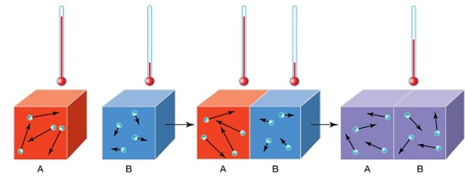
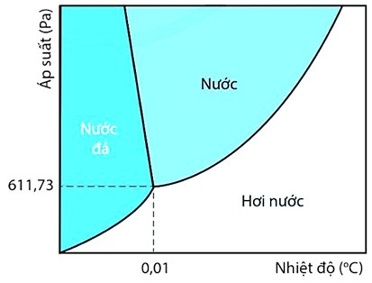
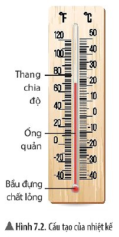

# Nhiệt độ – Thang nhiệt độ – Nhiệt kế

## 1. Nhiệt độ và cân bằng nhiệt

:::def Nhiệt độ
**Nhiệt độ** là đại lượng đặc trưng cho mức độ nóng, lạnh của vật. Vật có nhiệt độ cao hơn thì nóng hơn.
Nhiệt độ còn cho biết **chiều truyền nhiệt** giữa các vật và khi nào các vật đạt **cân bằng nhiệt**.
:::

- Khi hai vật có nhiệt độ khác nhau tiếp xúc nhau, năng lượng nhiệt **tự truyền từ vật nóng hơn sang vật lạnh hơn**.
- Quá trình truyền nhiệt dừng lại khi nhiệt độ hai vật bằng nhau: hai vật ở trạng thái **cân bằng nhiệt**.

:::warn Dễ nhầm
Nhiệt luôn truyền theo chiều **nhiệt độ** giảm dần, **không** phụ thuộc vật nào có nội năng lớn hơn. Một bể nước lớn ở 30 °C có nội năng lớn hơn nhiều so với một viên bi sắt ở 200 °C, nhưng khi thả viên bi vào bể, nhiệt vẫn truyền từ viên bi sang nước.
:::

## 2. Các thang đo nhiệt độ

### a) Thang Celsius (°C)

- Hai mốc: nhiệt độ **nước đá đang tan** là **0 °C** và nhiệt độ **nước tinh khiết đang sôi** là **100 °C** (ở áp suất 1 atm).
- Khoảng giữa hai mốc chia thành **100 phần bằng nhau**, mỗi phần là 1 °C. Kí hiệu nhiệt độ: $t$.
- Nhiệt độ thấp hơn 0 °C mang giá trị âm.

### b) Thang Kelvin (K) – thang nhiệt độ tuyệt đối

- Mốc thứ nhất: **độ không tuyệt đối 0 K** – nhiệt độ thấp nhất có thể; không vật nào có nhiệt độ thấp hơn. Ở 0 K, động năng chuyển động nhiệt của các phân tử là nhỏ nhất.
- Mốc thứ hai: **điểm ba của nước** là **273,16 K** (tức 0,01 °C) – trạng thái mà nước đá, nước lỏng và hơi nước cùng tồn tại cân bằng.
- Kí hiệu nhiệt độ: $T$. Đơn vị: kelvin (K) – **không** viết "°K".

:::note Lưu ý về điểm ba
Điểm ba của nước xảy ra ở áp suất rất thấp, khoảng **611,7 Pa** (nhỏ hơn nhiều so với áp suất khí quyển ~101 325 Pa), **không** phải ở áp suất tiêu chuẩn.
:::

### c) Thang Fahrenheit (°F)

- Hai mốc: nước đá đang tan là **32 °F**, nước sôi là **212 °F** (ở 1 atm).
- Khoảng giữa hai mốc chia thành **180 phần bằng nhau**.

| Mốc | Celsius | Kelvin | Fahrenheit |
|---|---|---|---|
| Độ không tuyệt đối | −273,15 °C | 0 K | −459,67 °F |
| Nước đá đang tan (1 atm) | 0 °C | 273,15 K | 32 °F |
| Nước sôi (1 atm) | 100 °C | 373,15 K | 212 °F |

## 3. Chuyển đổi giữa các thang đo

:::formula Các công thức chuyển đổi
$$T\,(\text{K}) = t\,(^\circ\text{C}) + 273{,}15 \approx t\,(^\circ\text{C}) + 273$$
$$t\,(^\circ\text{F}) = 1{,}8\,t\,(^\circ\text{C}) + 32$$
:::

- Một độ chia trên thang Kelvin **bằng** một độ chia trên thang Celsius: $\Delta T\,(\text{K}) = \Delta t\,(^\circ\text{C})$.
- Một độ chia trên thang Fahrenheit **nhỏ hơn**: $\Delta t\,(^\circ\text{F}) = 1{,}8\,\Delta t\,(^\circ\text{C})$.

### Tổng quát: chuyển đổi giữa hai thang X và Y bất kì

Mọi thang đo đều chia đều, nên nhiệt độ theo thang X là **hàm bậc nhất** của nhiệt độ theo thang Y:

:::formula Liên hệ giữa hai thang đo bất kì
$$T_X = a\,T_Y + b\quad (a \neq 0)$$
hoặc dùng tỉ lệ giữa hai mốc chung (mốc 1 và mốc 2):
$$\frac{T_X - T_{X1}}{T_{X2} - T_{X1}} = \frac{T_Y - T_{Y1}}{T_{Y2} - T_{Y1}}$$
:::

:::tip Cách làm
Tìm hai mốc đã biết ở cả hai thang (thường là nước đá tan và nước sôi), thay vào $T_X = a\,T_Y + b$ được hệ hai phương trình để tìm $a$, $b$.
:::

## 4. Nhiệt kế

Nhiệt kế hoạt động dựa trên một tính chất vật lí **thay đổi theo nhiệt độ**:

| Loại nhiệt kế | Nguyên lí |
|---|---|
| Nhiệt kế chất lỏng (rượu, thuỷ ngân, dầu) | Sự nở vì nhiệt của cột chất lỏng trong ống thuỷ tinh |
| Nhiệt kế kim loại | Sự nở dài của thanh kim loại mỏng thẳng hoặc xoắn ốc |
| Nhiệt kế khí | Sự nở vì nhiệt của một lượng khí ở áp suất không đổi |
| Nhiệt kế điện trở, cặp nhiệt điện | Điện trở hoặc hiệu điện thế thay đổi theo nhiệt độ |
| Nhiệt kế hồng ngoại | Bức xạ hồng ngoại vật phát ra phụ thuộc nhiệt độ (định luật Wien: $\lambda_{\max}\,T \approx 2900\ \mu\text{m}\cdot\text{K}$) |

Với nhiệt kế chất lỏng, chiều dài cột chất lỏng $\ell$ là hàm bậc nhất của nhiệt độ:
$$\frac{T - T_1}{T_2 - T_1} = \frac{\ell - \ell_1}{\ell_2 - \ell_1}$$

## 5. Ví dụ minh hoạ

:::example Ví dụ 1 – Đổi nhiệt độ
a) Đổi sang kelvin: 27 °C; −5 °C; 0 °C. b) Đổi sang độ C: 27 K; 300 K; 0 K.

**Giải.** a) $27 + 273 = 300$ K; $-5 + 273 = 268$ K; $0 + 273 = 273$ K.
b) $27 - 273 = -246$ °C; $300 - 273 = 27$ °C; $0 - 273 = -273$ °C (chính xác là −273,15 °C).
:::

:::example Ví dụ 2 – Độ tăng nhiệt độ
Một vật được làm nóng từ 20 °C lên 50 °C. Theo thang Kelvin, nhiệt độ của vật tăng bao nhiêu?

**Giải.** $\Delta t = 30$ °C. Vì một độ chia của hai thang bằng nhau nên $\Delta T = \Delta t = 30$ K.
:::

:::example Ví dụ 3 – Thang đo tự chế
Một bạn tự chế thang nhiệt độ Z: nước đá đang tan ứng với 20 °Z, nước sôi (1 atm) ứng với 160 °Z.
a) Lập công thức đổi từ °C sang °Z. b) Vật có nhiệt độ 90 °Z thì ứng với bao nhiêu °C? c) Ở nhiệt độ nào hai thang có cùng số chỉ?

**Giải.** a) Đặt $T_Z = a\,t + b$.
- Nước đá tan: $20 = a\cdot 0 + b \Rightarrow b = 20$.
- Nước sôi: $160 = 100a + 20 \Rightarrow a = 1{,}4$.

Vậy $T_Z = 1{,}4\,t + 20$.

b) $90 = 1{,}4\,t + 20 \Rightarrow t = 50$ °C.

c) $t = 1{,}4\,t + 20 \Rightarrow t = -50$ °C (khi đó cả hai thang cùng chỉ −50).
:::

:::example Ví dụ 4 – Khoảng cách vạch chia
Trên một nhiệt kế thuỷ ngân thang Celsius, khoảng cách giữa vạch 20 °C và 32 °C là 1,5 cm. Khoảng cách giữa vạch 15 °C và 51 °C là bao nhiêu?

**Giải.** Mỗi 1 °C ứng với $\dfrac{1{,}5}{32 - 20} = 0{,}125$ cm. Khoảng cách cần tìm: $(51 - 15)\cdot 0{,}125 = 4{,}5$ cm.
:::

## Tóm tắt nhanh

- Nhiệt truyền tự nhiên từ vật **nhiệt độ cao** sang vật **nhiệt độ thấp**, đến khi cân bằng nhiệt.
- $T = t + 273$; $t_F = 1{,}8\,t + 32$; $\Delta T = \Delta t$.
- 0 K là độ không tuyệt đối; điểm ba của nước là 273,16 K (0,01 °C, áp suất ~611,7 Pa).
- Hai thang bất kì: $T_X = a\,T_Y + b$, tìm $a$, $b$ từ hai mốc chung.
