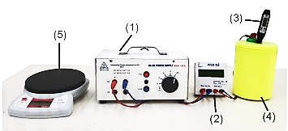
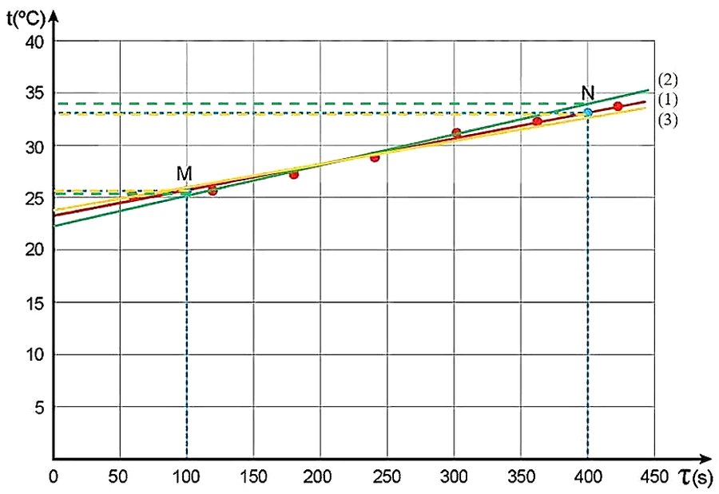
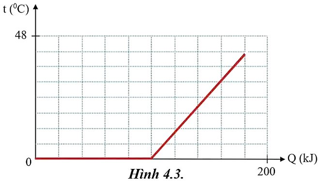

# Nhiệt dung riêng

Vì sao bờ biển mát về ban ngày mà ấm về ban đêm? Vì sao nước được dùng làm chất làm mát trong động cơ ô tô? Đều là nhờ **nhiệt dung riêng** rất lớn của nước.

## 1. Nhiệt dung riêng

:::def Nhiệt dung riêng
**Nhiệt dung riêng** $c$ của một chất là nhiệt lượng cần truyền cho **1 kg** chất đó để nhiệt độ của nó **tăng thêm 1 K** (hay 1 °C).
Đơn vị: J/(kg·K).
:::

:::formula Nhiệt lượng làm thay đổi nhiệt độ
$$Q = m\,c\,\Delta T \qquad\Rightarrow\qquad c = \frac{Q}{m\,\Delta T}$$
:::

- $Q$: nhiệt lượng vật thu vào hoặc toả ra (J);
- $m$: khối lượng vật (kg);
- $\Delta T = T_2 - T_1$: độ thay đổi nhiệt độ (K). Vì một độ chia của hai thang bằng nhau nên dùng $\Delta t$ (°C) cũng được.

:::tip Ý nghĩa
Chất có nhiệt dung riêng **càng lớn** thì **càng khó nóng lên và càng khó nguội đi**. Nước có $c$ rất lớn nên dùng để làm mát, sưởi ấm, và giúp khí hậu vùng biển ôn hoà.
:::

**Nhiệt dung riêng của một số chất ở 0 °C** (theo sách giáo khoa):

| Chất | $c$ (J/(kg·K)) | Chất | $c$ (J/(kg·K)) |
|---|---|---|---|
| Nhôm | 880 | Nước | 4180 |
| Đồng | 380 | Nước biển | 3950 |
| Chì | 126 | Rượu | 2500 |
| Nước đá | 1800 | Thuỷ ngân | 140 |

:::note Lưu ý
Trong bài tập, luôn dùng giá trị **đề bài cho** (ví dụ có đề lấy $c_{\text{nước}} = 4200$ J/(kg·K)). Một số tài liệu ghi nhiệt dung riêng của nước đá khoảng 2100 J/(kg·K).
:::

## 2. Phương pháp giải bài tập

### a) Phương trình cân bằng nhiệt

Khi các vật trao đổi nhiệt với nhau (bỏ qua hao phí ra môi trường):

:::formula Phương trình cân bằng nhiệt
$$Q_{\text{toả}} = Q_{\text{thu}}$$
:::

:::tip Các bước giải
1. Xác định vật nào **toả** nhiệt (nóng hơn), vật nào **thu** nhiệt (lạnh hơn).
2. Gọi nhiệt độ cân bằng là $t$ (nằm giữa nhiệt độ cao nhất và thấp nhất).
3. Viết $Q_{\text{toả}} = m_1 c_1 (t_1 - t)$ và $Q_{\text{thu}} = m_2 c_2 (t - t_2)$, sao cho mỗi hiệu nhiệt độ đều **dương**.
4. Cho $Q_{\text{toả}} = Q_{\text{thu}}$ rồi giải tìm ẩn.
:::

### b) Điện năng chuyển thành nhiệt năng

Nhiệt lượng do dụng cụ điện công suất $\mathcal{P}$ (hoặc điện trở $R$ có dòng điện $I$) toả ra trong thời gian $t$:
$$Q_{\text{toả}} = \mathcal{P}\,t = I^2 R\,t$$

:::formula Hiệu suất
$$H = \frac{Q_{\text{có ích}}}{Q_{\text{toàn phần}}}\cdot 100\% \quad\Rightarrow\quad Q_{\text{có ích}} = H\cdot\mathcal{P}\,t$$
:::

:::warn Dễ nhầm
Nhiệt lượng **có ích** (làm nóng vật) luôn **nhỏ hơn** nhiệt lượng bếp toả ra. Do đó: $H\cdot\mathcal{P}\,t = Q_{\text{có ích}}$, **không phải** $\mathcal{P}\,t = H\cdot Q$.
:::

## 3. Thực hành đo nhiệt dung riêng của nước

**Dụng cụ:** biến thế nguồn; oát kế có đo thời gian; nhiệt kế điện tử (độ phân giải 0,1 °C); nhiệt lượng kế có điện trở nhiệt; cân điện tử; dây nối.

**Tiến hành:**
1. Đổ nước vào nhiệt lượng kế sao cho điện trở nhiệt chìm hoàn toàn; xác định khối lượng nước $m$.
2. Cắm đầu đo nhiệt kế vào nhiệt lượng kế; nối oát kế với nhiệt lượng kế và nguồn điện.
3. Bật nguồn, khuấy liên tục. Cứ mỗi phút ghi công suất $\mathcal{P}$ và nhiệt độ $t$.
4. Tắt nguồn.

**Xử lí số liệu:** vẽ đồ thị nhiệt độ theo thời gian (gần như một đường thẳng), chọn hai điểm M, N trên đường thẳng và tính:
$$c = \frac{\overline{\mathcal{P}}\,(\tau_N - \tau_M)}{m\,(t_N - t_M)}$$

Với số liệu mẫu trong sách ($m = 0{,}15$ kg, $\overline{\mathcal{P}} \approx 15{,}54$ W), kết quả $c \approx 4255 \pm 247$ J/(kg·K), sai số tỉ đối khoảng 5,8%.

:::note Vì sao kết quả đo thường lớn hơn giá trị thật?
Một phần nhiệt lượng bị **truyền ra môi trường** và làm nóng bình nhiệt lượng kế, nên nước nóng lên ít hơn ⟹ $\Delta t$ đo được nhỏ hơn ⟹ $c$ tính ra lớn hơn.
:::

## 4. Ví dụ minh hoạ

:::example Ví dụ 1 – Tính nhiệt dung riêng
Vật đồng chất khối lượng 300 g thu nhiệt lượng 6900 J thì nóng thêm 50 °C. Tính nhiệt dung riêng của chất làm vật.

**Giải.**
$$c = \frac{Q}{m\,\Delta t} = \frac{6900}{0{,}3\cdot 50} = 460\ \text{J/(kg}\cdot\text{K)}$$
:::

:::example Ví dụ 2 – Ấm siêu tốc có hiệu suất
Ấm siêu tốc có thân bằng thép khối lượng 0,5 kg, chứa 1,8 lít nước ở 25 °C. Biết $c_{\text{thép}} = 460$ J/(kg·K), $c_{\text{nước}} = 4180$ J/(kg·K), $D_{\text{nước}} = 1000$ kg/m³.
a) Tính nhiệt lượng cần để đun sôi ấm nước (100 °C).
b) Ấm có công suất 1500 W, hiệu suất 95%. Tính thời gian đun sôi.

**Giải.** a) Khối lượng nước: $m_n = 1000\cdot 1{,}8\cdot 10^{-3} = 1{,}8$ kg. Cả ấm và nước đều nóng từ 25 °C lên 100 °C:
$$Q = (m_{\text{ấm}}c_{\text{thép}} + m_n c_n)\,\Delta t = (0{,}5\cdot 460 + 1{,}8\cdot 4180)\cdot 75 = 581\,550\ \text{J}$$

b) Chỉ 95% điện năng biến thành nhiệt có ích:
$$H\,\mathcal{P}\,t = Q \Rightarrow t = \frac{Q}{H\,\mathcal{P}} = \frac{581\,550}{0{,}95\cdot 1500} \approx 408\ \text{s} \approx 6\ \text{phút } 48\ \text{giây}$$
:::

:::example Ví dụ 3 – Đọc đồ thị
Đồ thị (Hình 4.3) biểu diễn nhiệt độ của một khối nước đá theo nhiệt lượng cung cấp. Tính khối lượng khối nước đá, biết $c_{\text{nước}} = 4180$ J/(kg·K) và bỏ qua sự hoá hơi.

**Giải.** Đoạn nằm ngang (0 → 100 kJ) là lúc nước đá đang tan ở 0 °C. Đoạn xiên: nước (do nước đá tan ra) nhận thêm $Q = 4$ ô $= 80$ kJ và nóng từ 0 °C lên $7\cdot 6 = 42$ °C. Vậy:
$$m = \frac{Q}{c\,\Delta t} = \frac{80\,000}{4180\cdot 42} \approx 0{,}46\ \text{kg}$$
:::

:::example Ví dụ 4 – Cân bằng nhiệt
Thả một miếng đồng 0,2 kg ở 100 °C vào 0,5 kg nước ở 20 °C. Bỏ qua trao đổi nhiệt với bình và môi trường; $c_{Cu} = 380$, $c_n = 4200$ J/(kg·K). Tìm nhiệt độ cân bằng.

**Giải.** Đồng toả nhiệt, nước thu nhiệt:
$$0{,}2\cdot 380\,(100 - t) = 0{,}5\cdot 4200\,(t - 20)$$
$$7600 - 76t = 2100t - 42\,000 \Rightarrow t = \frac{49\,600}{2176} \approx 22{,}8\ ^\circ\text{C}$$
:::

## Tóm tắt nhanh

- $Q = m\,c\,\Delta t$; $c$ càng lớn thì vật càng khó nóng, khó nguội.
- Cân bằng nhiệt: $Q_{\text{toả}} = Q_{\text{thu}}$, mỗi hiệu nhiệt độ viết sao cho dương.
- Có hiệu suất: $Q_{\text{có ích}} = H\,\mathcal{P}\,t$.
