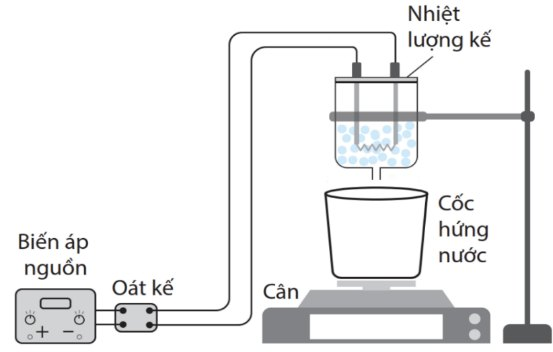
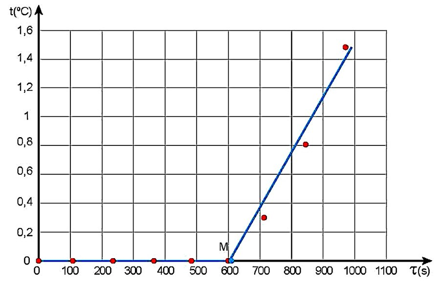

# Nhiệt nóng chảy riêng

Đặt một cốc nước đá lên bàn: nước đá tan dần nhưng nhiệt độ của hỗn hợp nước – nước đá **vẫn giữ 0 °C** cho đến khi tan hết. Nhiệt lượng nhận vào lúc này không làm tăng nhiệt độ mà dùng để **phá vỡ liên kết** của mạng tinh thể.

## 1. Nhiệt nóng chảy riêng

:::def Nhiệt nóng chảy riêng
**Nhiệt nóng chảy riêng** $\lambda$ của một chất là nhiệt lượng cần cung cấp để **1 kg** chất đó chuyển hoàn toàn từ thể rắn sang thể lỏng **ở nhiệt độ nóng chảy**.
Đơn vị: J/kg.
:::

:::formula Nhiệt lượng nóng chảy
$$Q = \lambda\,m \qquad\Rightarrow\qquad \lambda = \frac{Q}{m}$$
:::

- $\lambda$ phụ thuộc **bản chất của chất** (và áp suất bên ngoài).
- Khi **đông đặc** ở cùng nhiệt độ, 1 kg chất **toả ra** đúng nhiệt lượng $\lambda$.

**Nhiệt độ nóng chảy và nhiệt nóng chảy riêng của một số chất** (áp suất tiêu chuẩn):

| Chất | Nhiệt độ nóng chảy (°C) | $\lambda$ (J/kg) |
|---|---|---|
| Nước đá | 0 | $3{,}34\cdot 10^5$ |
| Sắt | 1535 | $2{,}72\cdot 10^5$ |
| Đồng | 1084 | $1{,}80\cdot 10^5$ |
| Bạc | 962 | $0{,}88\cdot 10^5$ |
| Vàng | 1064 | $0{,}64\cdot 10^5$ |
| Chì | 327 | $0{,}25\cdot 10^5$ |

## 2. Phương pháp giải bài tập

Khi một vật rắn được đun từ nhiệt độ ban đầu $t_1$ cho đến khi nóng chảy hết, quá trình gồm **hai giai đoạn**:

| Giai đoạn | Hiện tượng | Nhiệt lượng |
|---|---|---|
| 1 | Vật rắn nóng lên từ $t_1$ đến nhiệt độ nóng chảy $t_{nc}$ | $Q_1 = m\,c_{\text{rắn}}\,(t_{nc} - t_1)$ |
| 2 | Vật nóng chảy hoàn toàn ở $t_{nc}$ (nhiệt độ không đổi) | $Q_2 = \lambda\,m$ |
| 3 (nếu có) | Chất lỏng tiếp tục nóng lên đến $t_2$ | $Q_3 = m\,c_{\text{lỏng}}\,(t_2 - t_{nc})$ |

Tổng nhiệt lượng: $Q = Q_1 + Q_2 + Q_3$.

:::tip Bài toán "nước đá tan hết hay chưa?"
Khi thả nước đá (0 °C) vào nước ấm, **đừng vội giả sử nước đá tan hết**. Làm như sau:
1. Tính nhiệt lượng $Q_{\text{max}}$ mà nước ấm toả ra **nếu nguội tới 0 °C**.
2. Tính nhiệt lượng $Q_{\text{tan}} = \lambda\,m_{\text{đá}}$ cần để nước đá **tan hết**.
3. Nếu $Q_{\text{max}} \geq Q_{\text{tan}}$: đá tan hết, nhiệt độ cân bằng $\geq 0$ °C. Nếu $Q_{\text{max}} < Q_{\text{tan}}$: đá chỉ tan một phần, nhiệt độ cân bằng **đúng bằng 0 °C**, khối lượng đá tan $= Q_{\text{max}}/\lambda$.
:::

## 3. Thực hành đo nhiệt nóng chảy riêng của nước đá

### Phương án 1 (sách Cánh Diều)

1. Cho nước đá vào nhiệt lượng kế. Khi nước bắt đầu chảy xuống đều (khoảng 1 phút), hứng nước vào cốc trên cân **trong thời gian $t$**, ghi khối lượng nước trong cốc là $m$ – đây là lượng đá tan do **nhiệt từ môi trường**.
2. Bật nguồn, đọc công suất $\mathcal{P}$ trên oát kế. Hứng tiếp **thêm một khoảng thời gian $t$** nữa, ghi tổng khối lượng nước trong cốc là $M$.

Trong lần hứng thứ hai, lượng đá tan gồm phần do môi trường (vẫn khoảng $m$) và phần do dòng điện, nên lượng đá tan **nhờ dòng điện** là $M - m - m = M - 2m$:

:::formula Công thức (Cánh Diều)
$$\lambda = \frac{\mathcal{P}\,t}{M - 2m}$$
:::

Với số liệu mẫu: $m = 2{,}0\cdot 10^{-3}$ kg, $M = 17{,}5\cdot 10^{-3}$ kg, $t = 180$ s, $\mathcal{P} = 24$ W:
$$\lambda = \frac{24\cdot 180}{(17{,}5 - 4{,}0)\cdot 10^{-3}} = 3{,}2\cdot 10^5\ \text{J/kg}$$
– khá sát giá trị $3{,}34\cdot 10^5$ J/kg.

### Phương án 2 (sách Kết nối tri thức)

1. Cho nước đá vào nhiệt lượng kế sao cho điện trở nhiệt chìm hoàn toàn; xác định khối lượng nước đá $m$.
2. Cắm nhiệt kế, nối oát kế với nhiệt lượng kế và nguồn điện, bật nguồn.
3. Khuấy liên tục; cứ 2 phút ghi thời gian, nhiệt độ, công suất.
4. Vẽ đồ thị nhiệt độ theo thời gian: đoạn **nằm ngang ở 0 °C** ứng với thời gian nước đá đang tan $\Delta\tau$.

:::formula Công thức (KNTT)
$$\lambda = \frac{\overline{\mathcal{P}}\,\Delta\tau}{m}$$
:::

## 4. Ví dụ minh hoạ

:::example Ví dụ 1 – Làm nóng chảy ở nhiệt độ nóng chảy
Tính nhiệt lượng cần để làm nóng chảy hoàn toàn 5 kg nước đá ở 0 °C. Lấy $\lambda = 3{,}4\cdot 10^5$ J/kg.

**Giải.** $Q = \lambda\,m = 3{,}4\cdot 10^5\cdot 5 = 1{,}7\cdot 10^6$ J $= 1{,}7$ MJ.
:::

:::example Ví dụ 2 – So sánh hai chất
Nhiệt lượng làm nóng chảy hoàn toàn 1 kg nhôm ở nhiệt độ nóng chảy có thể làm nóng chảy bao nhiêu kg chì ở nhiệt độ nóng chảy? Lấy $\lambda_{Al} = 4\cdot 10^5$ J/kg, $\lambda_{Pb} = 2{,}5\cdot 10^4$ J/kg.

**Giải.** $Q = \lambda_{Al}\cdot 1 = 4\cdot 10^5$ J. Khối lượng chì: $m = \dfrac{Q}{\lambda_{Pb}} = \dfrac{4\cdot 10^5}{2{,}5\cdot 10^4} = 16$ kg.
:::

:::example Ví dụ 3 – Hai giai đoạn
Tính nhiệt lượng cần để 2 kg nước đá ở 0 °C tan hết thành nước ở 60 °C. Lấy $c = 4200$ J/(kg·K), $\lambda = 3{,}4\cdot 10^5$ J/kg.

**Giải.** Nước đá (0 °C) $\xrightarrow{\text{nóng chảy}}$ nước (0 °C) $\xrightarrow{\text{nóng lên}}$ nước (60 °C).
$$Q_1 = \lambda\,m = 3{,}4\cdot 10^5\cdot 2 = 680\ \text{kJ}$$
$$Q_2 = m\,c\,\Delta t = 2\cdot 4200\cdot 60 = 504\ \text{kJ}$$
$$Q = Q_1 + Q_2 = 1184\ \text{kJ}$$
:::

:::example Ví dụ 4 – Nung nóng chảy thỏi nhôm
Thỏi nhôm 5,0 kg ở 30 °C. Nhôm nóng chảy ở 658 °C, $\lambda = 3{,}9\cdot 10^5$ J/kg, $c = 880$ J/(kg·K). Tính nhiệt lượng cần để nhôm nóng chảy hoàn toàn.

**Giải.**
$$Q_1 = m\,c\,\Delta t = 5\cdot 880\cdot (658 - 30) = 2\,763\,200\ \text{J}$$
$$Q_2 = \lambda\,m = 3{,}9\cdot 10^5\cdot 5 = 1\,950\,000\ \text{J}$$
$$Q = Q_1 + Q_2 = 4\,713\,200\ \text{J} \approx 4713\ \text{kJ}$$
:::

:::example Ví dụ 5 – Nước đá tan hết hay chưa?
Thả 100 g nước đá ở 0 °C vào 300 g nước ở 20 °C. Lấy $c = 4200$ J/(kg·K), $\lambda = 3{,}4\cdot 10^5$ J/kg. Sau khi cân bằng nhiệt, trong bình có bao nhiêu nước (lỏng)?

**Giải.**
- Nước nguội từ 20 °C xuống 0 °C toả tối đa: $Q_{\max} = 0{,}3\cdot 4200\cdot 20 = 25\,200$ J.
- Để tan hết, nước đá cần: $Q_{\text{tan}} = 3{,}4\cdot 10^5\cdot 0{,}1 = 34\,000$ J.

Vì $Q_{\max} < Q_{\text{tan}}$ nên nước đá **chỉ tan một phần**, nhiệt độ cân bằng là 0 °C. Lượng đá tan:
$$m_{\text{tan}} = \frac{25\,200}{3{,}4\cdot 10^5} \approx 0{,}074\ \text{kg} = 74\ \text{g}$$
Lượng nước lỏng trong bình: $300 + 74 = 374$ g.
:::

:::example Ví dụ 6 – Tìm khối lượng nước đá ban đầu
Thả một viên nước đá ở 0 °C vào 1,5 kg nước ở 25 °C. Sau khi cân bằng nhiệt, viên đá còn lại 0,45 kg. Tìm khối lượng viên đá ban đầu (cùng số liệu $c$, $\lambda$ như trên).

**Giải.** Đá còn dư nên nhiệt độ cân bằng là 0 °C. Gọi $m$ là khối lượng đá ban đầu:
$$(m - 0{,}45)\cdot 3{,}4\cdot 10^5 = 1{,}5\cdot 4200\cdot 25 = 157\,500$$
$$\Rightarrow m \approx 0{,}913\ \text{kg}$$
:::

## Tóm tắt nhanh

- $Q = \lambda\,m$; trong lúc nóng chảy (hay đông đặc), **nhiệt độ không đổi**.
- Bài nhiều giai đoạn: tách riêng **nóng lên** ($mc\Delta t$) và **nóng chảy** ($\lambda m$) rồi cộng lại.
- Nước đá + nước ấm: so sánh $Q_{\max}$ với $\lambda\,m_{\text{đá}}$ trước khi giải.
