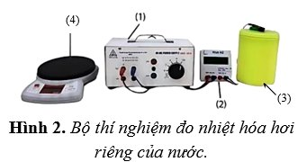
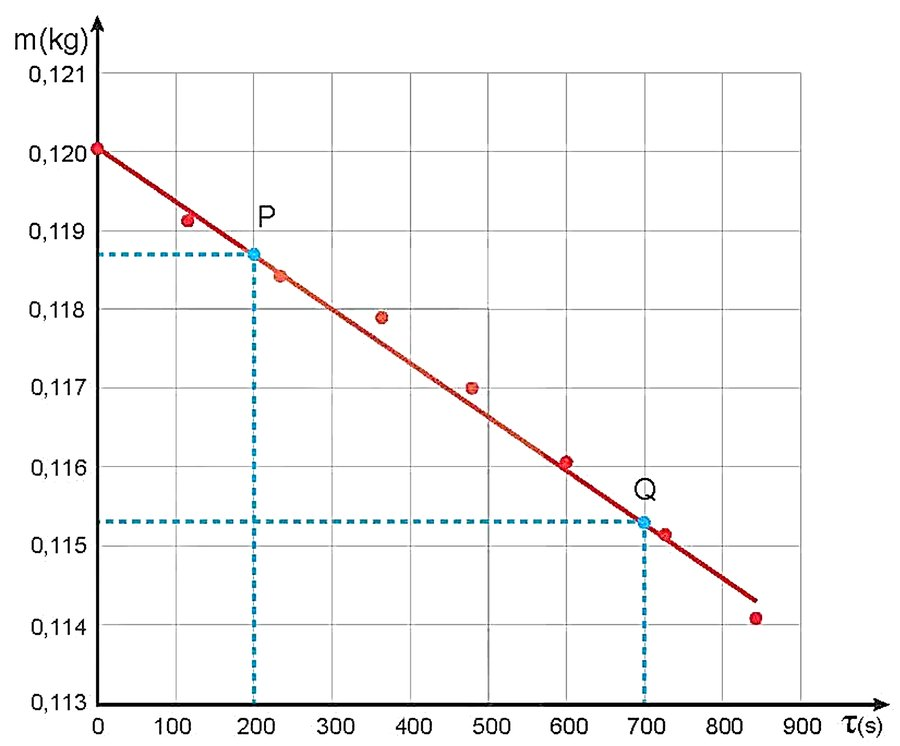

# Nhiệt hoá hơi riêng

Đun một ấm nước: nước nóng dần đến 100 °C rồi sôi. Dù bếp vẫn cháy, nhiệt độ nước **không tăng thêm** – toàn bộ nhiệt lượng lúc này dùng để biến nước thành hơi.

## 1. Nhiệt hoá hơi riêng

Thí nghiệm cho thấy: nhiệt lượng cần để một chất lỏng hoá hơi hoàn toàn ở nhiệt độ không đổi **tỉ lệ với khối lượng** và **phụ thuộc vào bản chất** chất lỏng.

:::def Nhiệt hoá hơi riêng
**Nhiệt hoá hơi riêng** $L$ của một chất lỏng là nhiệt lượng cần cung cấp để **1 kg** chất lỏng đó hoá hơi hoàn toàn **ở một nhiệt độ xác định** (thường là nhiệt độ sôi).
Đơn vị: J/kg.
:::

:::formula Nhiệt lượng hoá hơi
$$Q = L\,m \qquad\Rightarrow\qquad L = \frac{Q}{m}$$
:::

- Khi **ngưng tụ** ở cùng nhiệt độ, 1 kg hơi **toả ra** đúng nhiệt lượng $L$. Vì vậy bị bỏng hơi nước ở 100 °C thường nặng hơn bị bỏng nước sôi 100 °C.
- $L$ của cùng một chất **tăng khi nhiệt độ hoá hơi giảm**. Ví dụ nước: $2{,}26\cdot 10^6$ J/kg ở 100 °C nhưng khoảng $2{,}39\cdot 10^6$ J/kg ở 50 °C.

**Nhiệt hoá hơi riêng gần đúng ở nhiệt độ sôi** (áp suất tiêu chuẩn):

| Chất lỏng | $L$ (J/kg) |
|---|---|
| Nước | $2{,}3\cdot 10^6$ |
| Amoniac | $1{,}4\cdot 10^6$ |
| Rượu | $0{,}9\cdot 10^6$ |
| Ether | $0{,}4\cdot 10^6$ |

:::note So sánh với nhiệt nóng chảy riêng
Với nước, $L \approx 2{,}26\cdot 10^6$ J/kg lớn gấp gần **7 lần** $\lambda \approx 3{,}34\cdot 10^5$ J/kg: tách hẳn các phân tử ra xa nhau (hoá hơi) tốn năng lượng hơn nhiều so với chỉ phá vỡ trật tự tinh thể (nóng chảy).
:::

## 2. Phương pháp giải bài tập

Đun chất lỏng từ nhiệt độ $t_1$ đến khi hoá hơi một phần hoặc hoàn toàn:

| Giai đoạn | Hiện tượng | Nhiệt lượng |
|---|---|---|
| 1 | Chất lỏng (và bình chứa) nóng lên đến nhiệt độ sôi $t_s$ | $Q_1 = \sum m\,c\,(t_s - t_1)$ |
| 2 | Một lượng $m_h$ chất lỏng hoá hơi ở $t_s$ | $Q_2 = L\,m_h$ |

:::tip Bài toán tổng hợp rắn – lỏng – khí
Nước đá ở $t < 0$ °C biến thành hơi ở 100 °C phải qua **4 giai đoạn**:
$$Q = m\,c_{\text{đá}}(0 - t) + \lambda m + m\,c_{\text{nước}}\cdot 100 + L m$$
Vẽ sơ đồ các giai đoạn trước khi tính sẽ tránh bỏ sót.
:::

:::tip Bài toán hơi nước ngưng tụ
Dẫn $m_h$ hơi nước ở 100 °C vào nước lạnh: hơi **toả nhiệt hai lần** – khi ngưng tụ ($L m_h$) và khi nước ngưng tụ nguội từ 100 °C xuống $t$ ($m_h c\,(100 - t)$).
:::

## 3. Thực hành đo nhiệt hoá hơi riêng của nước

**Dụng cụ:** biến thế nguồn; oát kế có đo thời gian; nhiệt lượng kế có điện trở nhiệt; cân điện tử; dây nối; nước nóng.

**Tiến hành:**
1. Đặt nhiệt lượng kế lên cân, đổ nước nóng vào sao cho điện trở nhiệt chìm trong nước.
2. Nối oát kế với nhiệt lượng kế và nguồn điện, bật nguồn đun nước đến khi sôi.
3. Khi nước đã sôi, cứ 2 phút ghi công suất trên oát kế và khối lượng trên cân.
4. Tắt nguồn.

**Xử lí số liệu:** vẽ đồ thị khối lượng $m$ theo thời gian – là một đường thẳng **đi xuống** vì nước hoá hơi dần. Chọn hai điểm P, Q trên đường thẳng:

:::formula Công thức tính
$$L = \frac{\overline{\mathcal{P}}\,(t_Q - t_P)}{m_P - m_Q}$$
Trong đó $\overline{\mathcal{P}}(t_Q - t_P)$ là nhiệt lượng điện trở toả ra, $m_P - m_Q$ là khối lượng nước đã hoá hơi trong khoảng thời gian đó.
:::

## 4. Ví dụ minh hoạ

:::example Ví dụ 1 – Hoá hơi ở nhiệt độ sôi
Ấm chứa 1,5 kg nước ở 100 °C. Biết $L = 2{,}26\cdot 10^6$ J/kg. Tính nhiệt lượng cần để nước trong ấm cạn hết.

**Giải.** $Q = L\,m = 2{,}26\cdot 10^6\cdot 1{,}5 = 3{,}39\cdot 10^6$ J $= 3{,}39$ MJ.
:::

:::example Ví dụ 2 – Đổi thể tích sang khối lượng
Rượu có $L = 0{,}9\cdot 10^6$ J/kg, khối lượng riêng 0,8 kg/lít. Tính nhiệt lượng để 10 lít rượu hoá hơi hoàn toàn ở nhiệt độ sôi.

**Giải.** $m = D\,V = 0{,}8\cdot 10 = 8$ kg; $Q = L\,m = 0{,}9\cdot 10^6\cdot 8 = 7{,}2\cdot 10^6$ J $= 7{,}2$ MJ.
:::

:::example Ví dụ 3 – Hai giai đoạn
Tính nhiệt lượng để 10 kg nước ở 25 °C chuyển hoàn toàn thành hơi ở 100 °C. Lấy $c = 4200$ J/(kg·K), $L = 2{,}26\cdot 10^6$ J/kg.

**Giải.**
$$Q_1 = m\,c\,\Delta t = 10\cdot 4200\cdot 75 = 3{,}15\cdot 10^6\ \text{J}$$
$$Q_2 = L\,m = 2{,}26\cdot 10^6\cdot 10 = 22{,}6\cdot 10^6\ \text{J}$$
$$Q = Q_1 + Q_2 = 25{,}75\cdot 10^6\ \text{J}$$
:::

:::example Ví dụ 4 – Ấm điện
Ấm điện 1000 W chứa 300 g nước ở 20 °C (áp suất tiêu chuẩn). Lấy $c = 4200$ J/(kg·K), $L = 2{,}26\cdot 10^6$ J/kg; coi toàn bộ nhiệt lượng của ấm truyền cho nước.
a) Tính thời gian đun sôi nước. b) Nếu để nước sôi thêm 2 phút thì trong ấm còn bao nhiêu nước?

**Giải.** a) $Q_1 = 0{,}3\cdot 4200\cdot 80 = 100\,800$ J; $t = \dfrac{Q_1}{\mathcal{P}} = \dfrac{100\,800}{1000} = 100{,}8$ s.

b) Trong 2 phút, ấm cung cấp $Q = 1000\cdot 120 = 120\,000$ J, dùng hết cho hoá hơi:
$$m_h = \frac{Q}{L} = \frac{120\,000}{2{,}26\cdot 10^6} \approx 0{,}053\ \text{kg}$$
Nước còn lại: $0{,}3 - 0{,}053 \approx 0{,}247$ kg.
:::

:::example Ví dụ 5 – Có hiệu suất và bình chứa
Ấm nhôm 600 g chứa 1,5 lít nước ở 20 °C. Sau 35 phút đun, 20% lượng nước đã hoá hơi ở 100 °C. Chỉ 75% nhiệt lượng bếp toả ra được dùng để đun ấm. Biết $c_{Al} = 880$, $c_n = 4200$ J/(kg·K), $L = 2{,}26\cdot 10^6$ J/kg, $D_n = 1$ kg/lít. Tính nhiệt lượng trung bình bếp toả ra mỗi giây.

**Giải.** $m_n = 1{,}5$ kg.
- Ấm và nước nóng lên 80 °C: $Q_1 = (1{,}5\cdot 4200 + 0{,}6\cdot 880)\cdot 80 = 546\,240$ J.
- 20% nước hoá hơi: $Q_2 = 0{,}2\cdot 1{,}5\cdot 2{,}26\cdot 10^6 = 678\,000$ J.
- Nhiệt lượng có ích: $Q = Q_1 + Q_2 = 1\,224\,240$ J.

Nhiệt lượng bếp toả ra: $Q_{\text{bếp}} = \dfrac{Q}{H} = \dfrac{1\,224\,240}{0{,}75} = 1\,632\,320$ J.

Mỗi giây: $\mathcal{P} = \dfrac{1\,632\,320}{35\cdot 60} \approx 777$ J/s (tức 777 W).
:::

## Tóm tắt nhanh

- $Q = L\,m$; trong lúc sôi, **nhiệt độ không đổi**.
- Ngưng tụ toả ra đúng nhiệt lượng hoá hơi đã thu vào.
- Bài nhiều giai đoạn: nóng lên ($mc\Delta t$) → hoá hơi ($Lm$); có hiệu suất thì $Q_{\text{có ích}} = H\cdot Q_{\text{toàn phần}}$.
