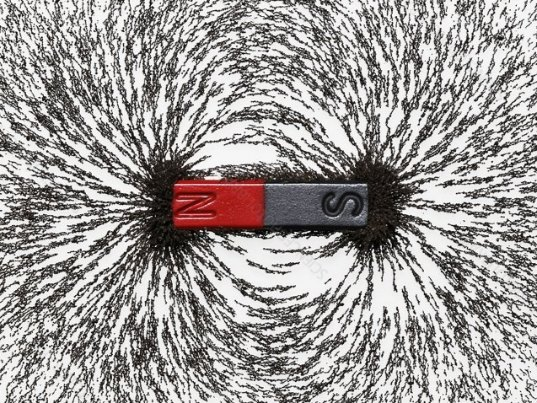
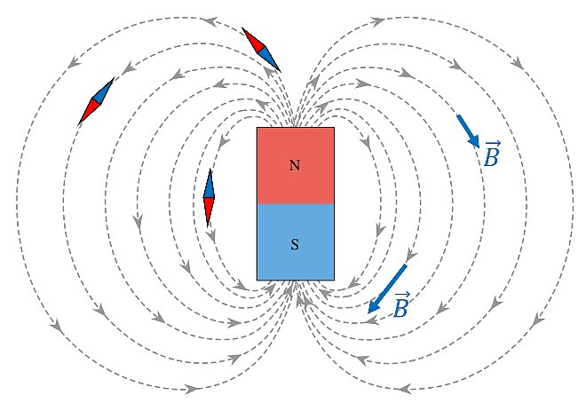
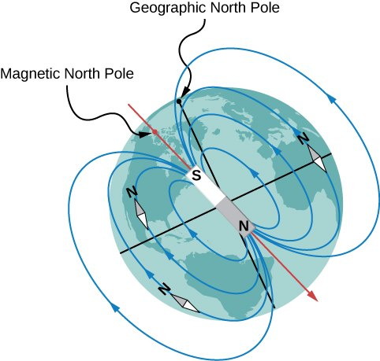
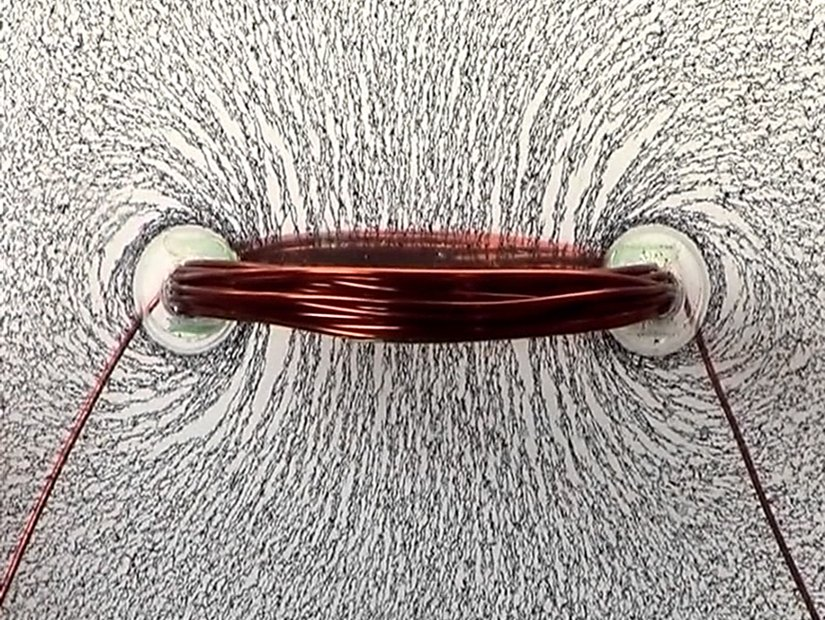

# Từ trường

## 1. Khái niệm từ trường

:::def Từ trường
**Từ trường** là dạng vật chất tồn tại xung quanh **nam châm** và **dòng điện** (điện tích chuyển động). Biểu hiện cụ thể: từ trường tác dụng **lực từ** lên nam châm, dòng điện hoặc điện tích chuyển động đặt trong nó.
:::

- Nam châm luôn có hai cực: **cực Bắc (N)** và **cực Nam (S)**. Các cực cùng tên đẩy nhau, khác tên hút nhau. Không tách được hai cực ra riêng: bẻ đôi nam châm lại được hai nam châm nhỏ, mỗi cái vẫn có đủ hai cực.
- Để phát hiện từ trường, dùng **kim nam châm thử**: đặt ở đâu có từ trường thì kim bị lệch và định hướng theo một phương xác định.
- **Hướng của từ trường** tại một điểm là hướng **Nam → Bắc** của kim nam châm thử nằm cân bằng tại điểm đó.

## 2. Từ phổ – Đường sức từ

:::def Từ phổ
Hình ảnh các đường mạt sắt sắp xếp xung quanh nam châm hay dòng điện gọi là **từ phổ**. Từ phổ cho biết dạng các đường sức từ.
:::

:::def Đường sức từ
**Đường sức từ** là những đường vẽ trong từ trường sao cho tiếp tuyến tại mỗi điểm trùng với **hướng của từ trường** tại điểm đó.
:::

**Tính chất của đường sức từ:**
- Qua mỗi điểm chỉ vẽ được **một** đường sức từ; các đường sức **không cắt nhau**.
- Đường sức từ là những **đường cong khép kín** (hoặc vô hạn ở hai đầu). Bên ngoài nam châm, đường sức **đi ra từ cực Bắc, đi vào cực Nam**.
- Nơi từ trường **mạnh** thì đường sức **dày**, nơi yếu thì đường sức **thưa**.

:::def Từ trường đều
Từ trường mà các đường sức từ là những đường **thẳng song song, cách đều nhau** gọi là **từ trường đều** (ví dụ: khoảng giữa hai cực của nam châm chữ U, lòng ống dây dài).
:::

### Từ trường Trái Đất

Trái Đất là một nam châm khổng lồ. **Cực Bắc địa lí** nằm gần **cực Nam từ** của Trái Đất – vì thế cực Bắc của kim la bàn bị hút về phía Bắc địa lí.

:::warn Dễ nhầm
Cực từ ở gần Bắc cực địa lí là **cực Nam** của "nam châm Trái Đất". Trục từ của Trái Đất lệch khoảng vài độ so với trục quay, nên la bàn không chỉ đúng hướng Bắc địa lí.
:::

## 3. Từ trường của dòng điện

Năm 1820, Oersted phát hiện: đặt kim nam châm gần dây dẫn có dòng điện, kim bị lệch đi ⟹ **dòng điện sinh ra từ trường**.

| Dòng điện | Dạng đường sức từ |
|---|---|
| Dây dẫn thẳng dài | Những **đường tròn đồng tâm** nằm trong mặt phẳng vuông góc với dây, tâm nằm trên dây |
| Vòng dây tròn | Đường sức qua tâm vòng dây là đường **thẳng**; các đường khác cong, đi vào mặt này, ra mặt kia |
| Ống dây dài | Bên trong ống: đường sức **song song, cách đều** (từ trường đều); bên ngoài giống nam châm thẳng |

Chiều của đường sức từ do dòng điện sinh ra được xác định bằng **quy tắc nắm tay phải** (xem bài *Lực từ – Cảm ứng từ*).

## 4. Nhiệt độ Curie (tìm hiểu thêm)

Khi bị nung nóng đến một nhiệt độ xác định, vật liệu sắt từ **mất từ tính** – nhiệt độ đó gọi là **nhiệt độ Curie**. Ví dụ sắt có nhiệt độ Curie khoảng 770 °C. Vì vậy không nên nung nóng nam châm vĩnh cửu.

## Tóm tắt nhanh

- Từ trường tồn tại quanh nam châm và dòng điện; tác dụng lực từ lên nam châm, dòng điện đặt trong nó.
- Hướng từ trường: hướng Nam → Bắc của kim nam châm thử.
- Đường sức từ: không cắt nhau, khép kín, ra Bắc vào Nam (ngoài nam châm), dày ở nơi từ trường mạnh.
- Dây thẳng: đường sức tròn đồng tâm; ống dây: bên trong là từ trường đều.
