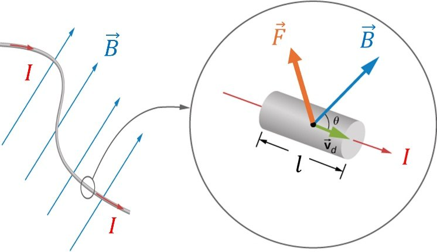
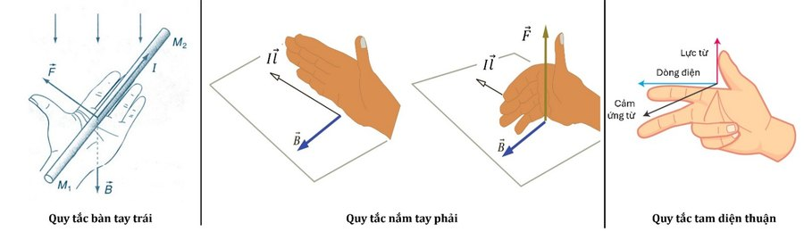
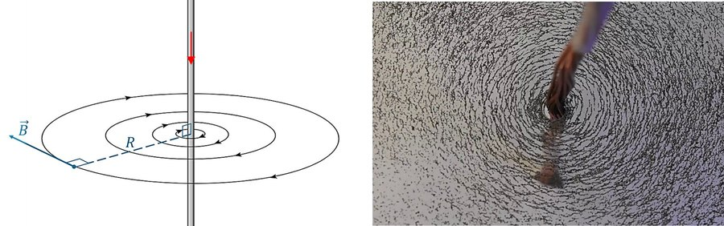
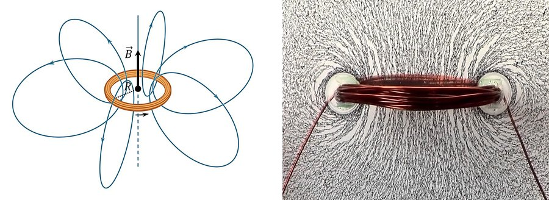
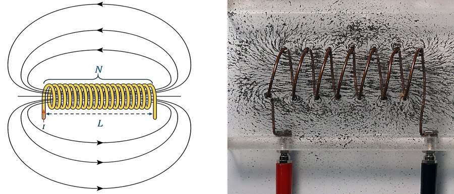
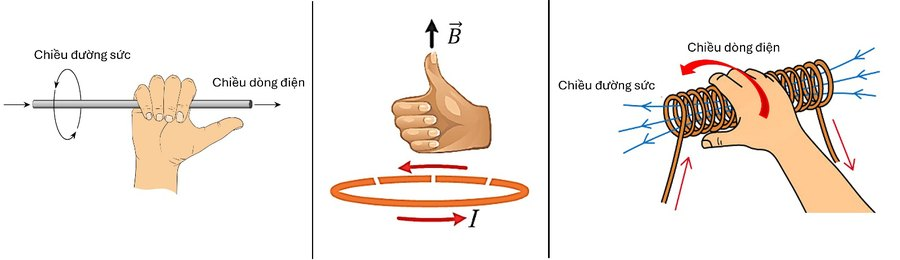

# Lực từ tác dụng lên dây dẫn mang dòng điện – Cảm ứng từ

## 1. Lực từ và cảm ứng từ

Đặt một đoạn dây dẫn thẳng có dòng điện trong từ trường đều: dây chịu tác dụng của **lực từ**. Thí nghiệm cho thấy độ lớn lực từ tỉ lệ với cường độ dòng điện $I$, chiều dài dây $l$ và phụ thuộc góc $\alpha$ giữa dây và đường sức từ.

:::def Cảm ứng từ
**Cảm ứng từ** $\vec{B}$ đặc trưng cho từ trường **về phương diện tác dụng lực**. Độ lớn của cảm ứng từ bằng thương số giữa lực từ tác dụng lên đoạn dây vuông góc với đường sức và tích $I\,l$:
$$B = \frac{F}{I\,l}$$
Đơn vị: **tesla (T)**. 1 T = 1 N/(A·m).
Vectơ $\vec{B}$ có hướng trùng với hướng của từ trường (hướng của đường sức từ).
:::

:::formula Lực từ tác dụng lên đoạn dây dẫn
$$F = B\,I\,l\,\sin\alpha$$
$\alpha$: góc giữa dây dẫn (chiều dòng điện) và vectơ $\vec{B}$.
:::

- Dây **vuông góc** với đường sức ($\alpha = 90^\circ$): lực từ **lớn nhất**, $F = BIl$.
- Dây **song song** với đường sức ($\alpha = 0$ hoặc $180^\circ$): **không có** lực từ.

:::note Lưu ý
Công thức áp dụng cho **đoạn dây thẳng** đặt trong **từ trường đều**. Lực từ **vuông góc** với cả dây dẫn và với $\vec{B}$.
:::

## 2. Quy tắc bàn tay trái – xác định chiều lực từ

:::def Quy tắc bàn tay trái
Đặt bàn tay **trái** duỗi thẳng sao cho các đường sức từ **hướng vào lòng bàn tay**, chiều từ cổ tay đến các ngón tay giữa là **chiều dòng điện**; khi đó **ngón cái choãi ra 90°** chỉ chiều của **lực từ**.
:::

:::tip Kí hiệu vuông góc mặt phẳng hình vẽ
- ⊙ : vectơ hướng **ra ngoài** mặt giấy (thấy "đầu mũi tên").
- ⊗ : vectơ hướng **vào trong** mặt giấy (thấy "đuôi mũi tên").
:::

## 3. Cảm ứng từ của dòng điện trong các dây dẫn có hình dạng đặc biệt

Trong không khí (chân không), với $\mu_0 = 4\pi\cdot 10^{-7}$ T·m/A:

| Dòng điện | Độ lớn cảm ứng từ | Chiều đường sức |
|---|---|---|
| Dây thẳng dài, tại điểm cách dây $r$ | $B = 2\cdot 10^{-7}\dfrac{I}{r}$ | Nắm tay phải: ngón cái theo chiều dòng điện, bốn ngón khum chỉ chiều đường sức |
| Tâm khung dây tròn bán kính $R$, $N$ vòng | $B = 2\pi\cdot 10^{-7}\dfrac{N\,I}{R}$ | Nắm tay phải: bốn ngón khum theo chiều dòng điện, ngón cái chỉ chiều $\vec{B}$ ở tâm |
| Trong lòng ống dây dài $l$, $N$ vòng | $B = 4\pi\cdot 10^{-7}\,n\,I$, với $n = \dfrac{N}{l}$ | Như vòng dây tròn: ngón cái chỉ chiều $\vec{B}$ trong lòng ống (đi ra ở cực Bắc) |

:::warn Dễ nhầm
- Dùng tay **trái** để tìm chiều **lực từ**; dùng tay **phải** để tìm chiều **đường sức từ** do dòng điện sinh ra.
- Trong công thức ống dây, $n$ là **số vòng trên mỗi mét chiều dài**, không phải tổng số vòng.
:::

:::formula Nguyên lí chồng chất
Nhiều dòng điện cùng gây ra từ trường tại một điểm: $\vec{B} = \vec{B_1} + \vec{B_2} + \dots$ (cộng **vectơ**).
:::

## 4. Ví dụ minh hoạ

:::example Ví dụ 1 – Tính lực từ
Dây dẫn thẳng có dòng điện 20 A đặt vuông góc với đường sức của từ trường đều $B = 5\cdot 10^{-3}$ T. Tính lực từ tác dụng lên mỗi mét dây.

**Giải.** $F = BIl = 5\cdot 10^{-3}\cdot 20\cdot 1 = 0{,}1$ N.
:::

:::example Ví dụ 2 – Lực từ thay đổi
Một đoạn dây dẫn đặt trong từ trường đều. Nếu tăng chiều dài dây và cường độ dòng điện mỗi đại lượng lên 2 lần thì lực từ thay đổi thế nào?

**Giải.** $F = BIl\sin\alpha$ tỉ lệ với tích $I\,l$ ⟹ lực từ tăng $2\cdot 2 = 4$ lần.
:::

:::example Ví dụ 3 – Tìm cảm ứng từ
Đoạn dây dài 5 cm vuông góc với đường sức từ, dòng điện 0,75 A, chịu lực từ $3\cdot 10^{-3}$ N. Tính $B$.

**Giải.** $B = \dfrac{F}{Il} = \dfrac{3\cdot 10^{-3}}{0{,}75\cdot 0{,}05} = 0{,}08$ T.
:::

:::example Ví dụ 4 – Dây thẳng dài
Dòng điện thẳng dài 4 A. Tính cảm ứng từ tại điểm cách dây 5 cm.

**Giải.** $B = 2\cdot 10^{-7}\dfrac{I}{r} = 2\cdot 10^{-7}\cdot\dfrac{4}{0{,}05} = 1{,}6\cdot 10^{-5}$ T.
:::

:::example Ví dụ 5 – Khung dây tròn
Khung dây tròn bán kính 4 cm gồm 10 vòng, dòng điện mỗi vòng 0,4 A. Tính cảm ứng từ tại tâm khung.

**Giải.** $B = 2\pi\cdot 10^{-7}\dfrac{NI}{R} = 2\pi\cdot 10^{-7}\cdot\dfrac{10\cdot 0{,}4}{0{,}04} \approx 6{,}28\cdot 10^{-5}$ T.
:::

:::example Ví dụ 6 – Ống dây
Ống dây dài 20 cm có 2400 vòng, dòng điện 0,5 A. Tính cảm ứng từ trong lòng ống.

**Giải.** $n = \dfrac{2400}{0{,}2} = 12\,000$ vòng/m.
$$B = 4\pi\cdot 10^{-7}\cdot 12\,000\cdot 0{,}5 \approx 7{,}54\cdot 10^{-3}\ \text{T}$$
:::

## Tóm tắt nhanh

- $F = BIl\sin\alpha$; chiều lực từ theo **quy tắc bàn tay trái**.
- $B = \dfrac{F}{Il}$ (dây vuông góc đường sức), đơn vị tesla.
- Dây thẳng $2\cdot 10^{-7}I/r$; tâm vòng tròn $2\pi\cdot 10^{-7}NI/R$; ống dây $4\pi\cdot 10^{-7}nI$; chiều theo **quy tắc nắm tay phải**.
