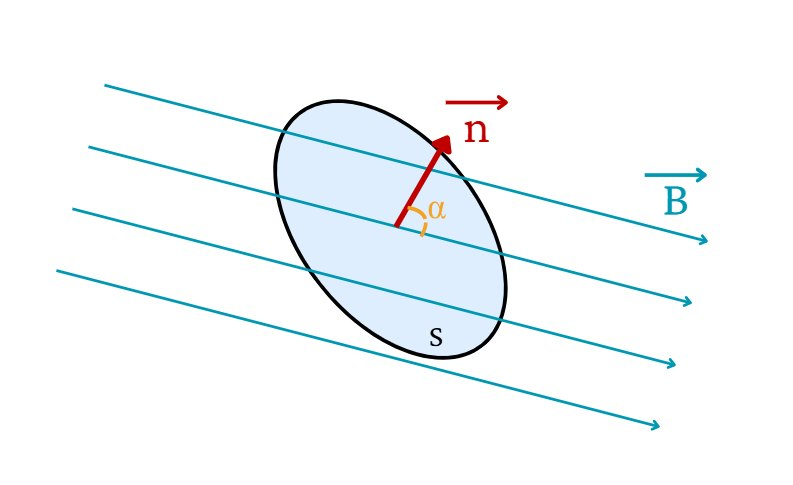
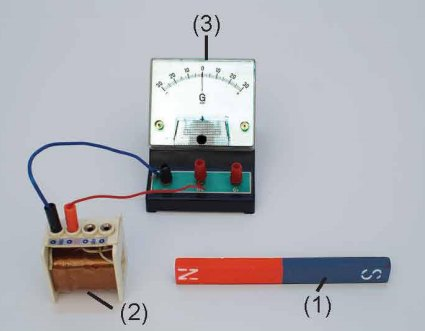
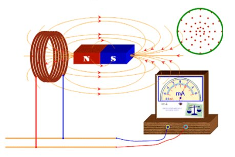
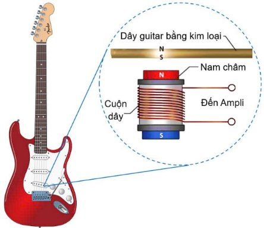
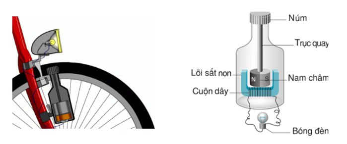

# Từ thông – Hiện tượng cảm ứng điện từ

## 1. Từ thông

Hình dung từ thông như "**số đường sức từ xuyên qua** một diện tích": khung càng rộng, từ trường càng mạnh và khung càng "đón" thẳng đường sức thì từ thông càng lớn.

:::formula Từ thông qua khung dây phẳng
$$\Phi = N\,B\,S\cos\alpha$$
- $S$: diện tích khung (m²); $N$: số vòng dây;
- $\alpha$: góc giữa vectơ cảm ứng từ $\vec{B}$ và **vectơ pháp tuyến** $\vec{n}$ của mặt khung.

Đơn vị: **vêbe (Wb)**, 1 Wb = 1 T·m².
:::

| Vị trí của khung | $\alpha$ | Từ thông |
|---|---|---|
| Mặt khung **vuông góc** với đường sức | 0° | Cực đại $\Phi = NBS$ |
| Mặt khung **song song** với đường sức | 90° | Bằng 0 |

:::warn Dễ nhầm
$\alpha$ là góc giữa $\vec{B}$ và **pháp tuyến**, không phải góc giữa $\vec{B}$ và **mặt phẳng khung**. Nếu đề cho mặt khung hợp với đường sức góc $\beta$ thì $\alpha = 90^\circ - \beta$.
:::

## 2. Hiện tượng cảm ứng điện từ

:::def Hiện tượng cảm ứng điện từ
Khi **từ thông** qua một mạch kín **biến thiên** thì trong mạch xuất hiện **dòng điện cảm ứng**. Hiện tượng chỉ tồn tại **trong thời gian từ thông biến thiên**.
:::

Có thể làm từ thông biến thiên bằng cách: thay đổi $B$ (đưa nam châm lại gần/ra xa, thay đổi dòng điện trong nam châm điện), thay đổi diện tích $S$ (thanh trượt), hoặc thay đổi góc $\alpha$ (quay khung).

### Chiều dòng điện cảm ứng – Định luật Lenz

:::def Định luật Lenz
Dòng điện cảm ứng có chiều sao cho **từ trường do nó sinh ra chống lại sự biến thiên** của từ thông đã sinh ra nó.
:::

:::tip Cách xác định chiều dòng cảm ứng
1. Xác định chiều $\vec{B}$ của nam châm qua mạch và xem từ thông **tăng hay giảm**.
2. Từ thông **tăng** ⟹ $\vec{B}_{\text{cảm ứng}}$ **ngược chiều** $\vec{B}$. Từ thông **giảm** ⟹ $\vec{B}_{\text{cảm ứng}}$ **cùng chiều** $\vec{B}$.
3. Dùng quy tắc nắm tay phải suy ra chiều dòng điện cảm ứng.

Nói gọn: nam châm **lại gần** thì bị **đẩy**, **ra xa** thì bị **hút** – mạch luôn "chống lại" chuyển động.
:::

## 3. Suất điện động cảm ứng – Định luật Faraday

:::formula Định luật Faraday
$$e_c = -\frac{\Delta\Phi}{\Delta t} \qquad\Rightarrow\qquad |e_c| = \left|\frac{\Delta\Phi}{\Delta t}\right| = N\left|\frac{\Delta(BS\cos\alpha)}{\Delta t}\right|$$
Độ lớn suất điện động cảm ứng bằng **tốc độ biến thiên của từ thông**. Dấu "−" thể hiện định luật Lenz.
:::

Dòng điện cảm ứng trong mạch có điện trở $R$: $i_c = \dfrac{|e_c|}{R}$.

:::formula Đoạn dây dẫn chuyển động trong từ trường
Thanh dài $l$ chuyển động với vận tốc $\vec{v}$ vuông góc với thanh, trong từ trường $\vec{B}$:
$$|e_c| = B\,l\,v\sin\theta$$
$\theta$: góc giữa $\vec{v}$ và $\vec{B}$. Khi $\vec{v} \perp \vec{B}$: $|e_c| = Blv$.
:::

## 4. Ứng dụng trong thực tế

- **Ghi-ta điện:** dây đàn bằng thép bị nam châm từ hoá; khi dây rung, từ thông qua cuộn dây biến thiên tạo ra dòng điện cảm ứng, được khuếch đại thành âm thanh.
- **Dynamo xe đạp:** núm quay làm nam châm quay trong cuộn dây, sinh ra dòng điện thắp sáng đèn.

## 5. Ví dụ minh hoạ

:::example Ví dụ 1 – Tìm góc từ thông
Hình vuông cạnh 5 cm đặt trong từ trường đều $B = 4\cdot 10^{-4}$ T. Từ thông qua hình vuông là $10^{-6}$ Wb. Tính góc giữa $\vec{B}$ và mặt phẳng hình vuông.

**Giải.** $\cos\alpha = \dfrac{\Phi}{BS} = \dfrac{10^{-6}}{4\cdot 10^{-4}\cdot 0{,}05^2} = 1 \Rightarrow \alpha = 0$.
$\vec{B}$ song song với pháp tuyến ⟹ $\vec{B}$ **vuông góc** với mặt phẳng hình vuông (góc 90°).
:::

:::example Ví dụ 2 – Mặt khung nghiêng
Khung dây phẳng diện tích 50 cm² đặt trong từ trường đều $B = 0{,}3$ T, mặt khung hợp với đường sức góc 30°. Tính từ thông qua khung.

**Giải.** Góc giữa $\vec{B}$ và pháp tuyến: $\alpha = 90^\circ - 30^\circ = 60^\circ$.
$$\Phi = BS\cos\alpha = 0{,}3\cdot 50\cdot 10^{-4}\cdot 0{,}5 = 7{,}5\cdot 10^{-4}\ \text{Wb}$$
:::

:::example Ví dụ 3 – Định luật Faraday
Khung dây hình vuông cạnh 10 cm đặt cố định, mặt khung vuông góc với đường sức từ. Cảm ứng từ tăng đều từ 0 đến 0,5 T trong 0,1 s. Tính suất điện động cảm ứng.

**Giải.** $|e_c| = \dfrac{\Delta B\cdot S}{\Delta t} = \dfrac{0{,}5\cdot 0{,}1^2}{0{,}1} = 0{,}05$ V.
:::

:::example Ví dụ 4 – Đọc đồ thị B(t)
Khung dây phẳng 25 cm², 10 vòng, mặt khung vuông góc với đường sức. Cảm ứng từ giảm đều từ $2{,}4\cdot 10^{-3}$ T về 0 trong 0,4 s. Tính suất điện động cảm ứng.

**Giải.** $|e_c| = N\dfrac{|\Delta B|S}{\Delta t} = 10\cdot\dfrac{2{,}4\cdot 10^{-3}\cdot 25\cdot 10^{-4}}{0{,}4} = 1{,}5\cdot 10^{-4}$ V.
:::

:::example Ví dụ 5 – Thanh trượt
Thanh MN dài 0,2 m trượt đều trên hai ray với tốc độ 3 m/s trong từ trường đều $B = 0{,}5$ T vuông góc với mặt phẳng ray. Mạch có điện trở 0,5 Ω. Tính suất điện động và dòng điện cảm ứng.

**Giải.** $|e_c| = Blv = 0{,}5\cdot 0{,}2\cdot 3 = 0{,}3$ V; $I = \dfrac{0{,}3}{0{,}5} = 0{,}6$ A.
:::

## Tóm tắt nhanh

- $\Phi = NBS\cos\alpha$ ($\alpha$ giữa $\vec{B}$ và pháp tuyến), đơn vị Wb.
- Từ thông qua mạch kín biến thiên ⟹ có dòng điện cảm ứng; chiều theo định luật Lenz (chống lại sự biến thiên).
- $|e_c| = |\Delta\Phi/\Delta t|$; thanh chuyển động: $|e_c| = Blv\sin\theta$.
