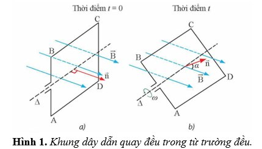
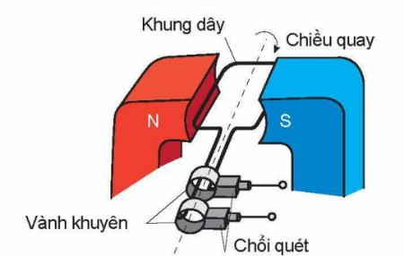
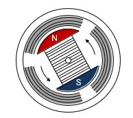

# Máy phát điện xoay chiều – Dòng điện xoay chiều

## 1. Nguyên tắc tạo ra dòng điện xoay chiều

Cho khung dây $N$ vòng, diện tích $S$ **quay đều** với tốc độ góc $\omega$ quanh trục vuông góc với đường sức của từ trường đều $\vec{B}$. Góc giữa $\vec{B}$ và pháp tuyến thay đổi theo thời gian: $\alpha = \omega t + \varphi$.

:::formula Từ thông và suất điện động
$$\Phi = NBS\cos(\omega t + \varphi) = \Phi_0\cos(\omega t + \varphi)$$
$$e = -\Phi' = NBS\omega\sin(\omega t + \varphi) = E_0\cos\!\left(\omega t + \varphi - \frac{\pi}{2}\right)$$
Suất điện động cực đại: $E_0 = NBS\omega = \omega\,\Phi_0$.
:::

- Suất điện động **trễ pha** $\pi/2$ so với từ thông: khi từ thông cực đại thì $e = 0$ và ngược lại.
- Vì $e$ và $\Phi$ vuông pha: $\left(\dfrac{e}{E_0}\right)^2 + \left(\dfrac{\Phi}{\Phi_0}\right)^2 = 1$.

## 2. Dòng điện xoay chiều

:::def Dòng điện xoay chiều
Dòng điện có cường độ biến thiên điều hoà theo thời gian:
$$i = I_0\cos(\omega t + \varphi_i)$$
$i$: cường độ tức thời; $I_0 > 0$: cường độ cực đại; $\omega$: tần số góc; $\varphi_i$: pha ban đầu.
Chu kì $T = \dfrac{2\pi}{\omega}$, tần số $f = \dfrac{1}{T} = \dfrac{\omega}{2\pi}$.
:::

:::formula Giá trị hiệu dụng
$$I = \frac{I_0}{\sqrt{2}};\qquad U = \frac{U_0}{\sqrt{2}};\qquad E = \frac{E_0}{\sqrt{2}}$$
:::

:::def Ý nghĩa của giá trị hiệu dụng
Cường độ hiệu dụng của dòng xoay chiều bằng cường độ của **dòng điện không đổi** mà khi cùng đi qua một điện trở trong cùng thời gian thì toả ra **cùng nhiệt lượng**. Ampe kế, vôn kế xoay chiều đo giá trị hiệu dụng; số ghi trên thiết bị (220 V) cũng là giá trị hiệu dụng.
:::

Nhiệt lượng toả ra trên điện trở $R$: $Q = I^2Rt = \dfrac{U^2}{R}t$ (dùng **giá trị hiệu dụng**).

## 3. Máy phát điện xoay chiều

**Cấu tạo** gồm hai bộ phận chính:
- **Phần cảm** (nam châm): tạo ra từ trường.
- **Phần ứng** (các cuộn dây): nơi xuất hiện suất điện động cảm ứng.

Bộ phận đứng yên gọi là **stato**, bộ phận quay gọi là **roto**. Trong máy công suất lớn, phần cảm (nam châm) quay còn các cuộn dây đứng yên.

**Nguyên tắc hoạt động:** dựa trên **hiện tượng cảm ứng điện từ** – roto quay làm từ thông qua các cuộn dây biến thiên điều hoà, sinh ra suất điện động xoay chiều.

:::formula Tần số dòng điện do máy phát tạo ra
$$f = n\,p$$
$n$: tốc độ quay của roto (vòng/giây); $p$: số **cặp** cực của nam châm.
:::

## 4. Ứng dụng và an toàn điện

**Ứng dụng:** dòng điện xoay chiều dễ tạo ra, dễ biến đổi điện áp (bằng máy biến áp) nên được dùng trong lưới điện, động cơ, thiết bị gia dụng, chiếu sáng…

:::warn Quy tắc an toàn điện
- Không chạm tay trần vào dây điện trần, ổ cắm, nơi có biển cảnh báo nguy hiểm.
- Lắp **cầu chì, aptomat**; nối **dây tiếp đất** cho vỏ kim loại của thiết bị.
- Ngắt điện trước khi sửa chữa; không dùng thiết bị khi tay ướt.
- Tránh xa đường dây cao thế, trạm biến áp; không thả diều gần đường dây điện.
:::

## 5. Ví dụ minh hoạ

:::example Ví dụ 1 – Các đại lượng đặc trưng
Cho $i = 5\cos(100\pi t)$ (A).
a) Tìm $\omega$, $T$, $f$ và $I$. b) Tính $i$ tại $t = 0$ và $t = 0{,}25$ s.

**Giải.** a) $\omega = 100\pi$ rad/s; $T = \dfrac{2\pi}{\omega} = 0{,}02$ s; $f = 50$ Hz; $I = \dfrac{5}{\sqrt{2}} \approx 3{,}54$ A.
b) $t = 0$: $i = 5\cos 0 = 5$ A. $t = 0{,}25$ s: $i = 5\cos(25\pi) = 5\cos\pi = -5$ A.
:::

:::example Ví dụ 2 – Viết biểu thức dòng điện
Dòng điện xoay chiều có $f = 50$ Hz, $I = 2$ A; tại $t = 0$ cường độ đạt cực đại. Viết biểu thức $i$.

**Giải.** $I_0 = I\sqrt{2} = 2\sqrt{2}$ A; $\omega = 2\pi f = 100\pi$ rad/s; tại $t = 0$, $i = I_0$ nên $\varphi = 0$:
$$i = 2\sqrt{2}\cos(100\pi t)\ \text{(A)}$$
:::

:::example Ví dụ 3 – Khung dây quay
Khung dây phẳng $S = 20$ cm², $N = 100$ vòng quay đều 50 vòng/s quanh trục vuông góc với từ trường đều $B = 0{,}2$ T. Lúc $t = 0$, pháp tuyến của khung cùng hướng với $\vec{B}$. Viết biểu thức $\Phi$ và $e$.

**Giải.** $\omega = 2\pi\cdot 50 = 100\pi$ rad/s; $\Phi_0 = NBS = 100\cdot 0{,}2\cdot 20\cdot 10^{-4} = 0{,}04$ Wb; $\varphi = 0$.
$$\Phi = 0{,}04\cos(100\pi t)\ \text{(Wb)}$$
$$e = \omega\Phi_0\sin(100\pi t) = 4\pi\sin(100\pi t) \approx 12{,}6\cos\!\left(100\pi t - \frac{\pi}{2}\right)\ \text{(V)}$$
:::

:::example Ví dụ 4 – Nhiệt lượng trên điện trở
Đặt điện áp $u = 220\sqrt{2}\cos(100\pi t)$ (V) vào hai đầu điện trở 110 Ω. Tính cường độ hiệu dụng, công suất và nhiệt lượng toả ra trong 10 phút.

**Giải.** $U = 220$ V; $I = \dfrac{U}{R} = 2$ A; $P = UI = 440$ W; $Q = Pt = 440\cdot 600 = 264\,000$ J.
:::

:::example Ví dụ 5 – Hao phí trên đường dây
Truyền công suất 4,4 kW đến nơi tiêu thụ bằng điện áp hiệu dụng 220 V qua đường dây có điện trở tổng 2 Ω (coi hệ số công suất bằng 1). Tính công suất hao phí và hiệu suất truyền tải.

**Giải.** $I = \dfrac{P}{U} = 20$ A; $\Delta P = I^2R = 800$ W; $H = \dfrac{P - \Delta P}{P} = \dfrac{3600}{4400} \approx 81{,}8\%$.
:::

## Tóm tắt nhanh

- $\Phi = \Phi_0\cos(\omega t + \varphi)$, $e = E_0\sin(\omega t + \varphi)$, $E_0 = NBS\omega$; $e$ trễ pha $\pi/2$ so với $\Phi$.
- Giá trị hiệu dụng = cực đại chia $\sqrt{2}$; dụng cụ đo và số ghi trên thiết bị là giá trị hiệu dụng.
- Máy phát: phần cảm tạo từ trường, phần ứng sinh suất điện động; $f = np$.
