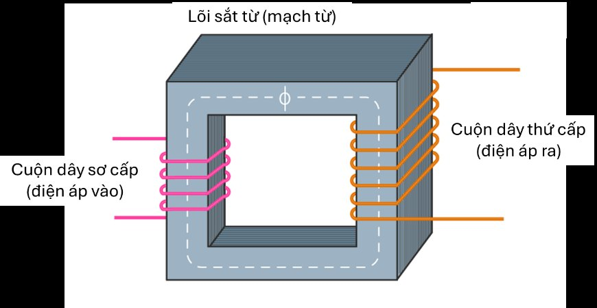
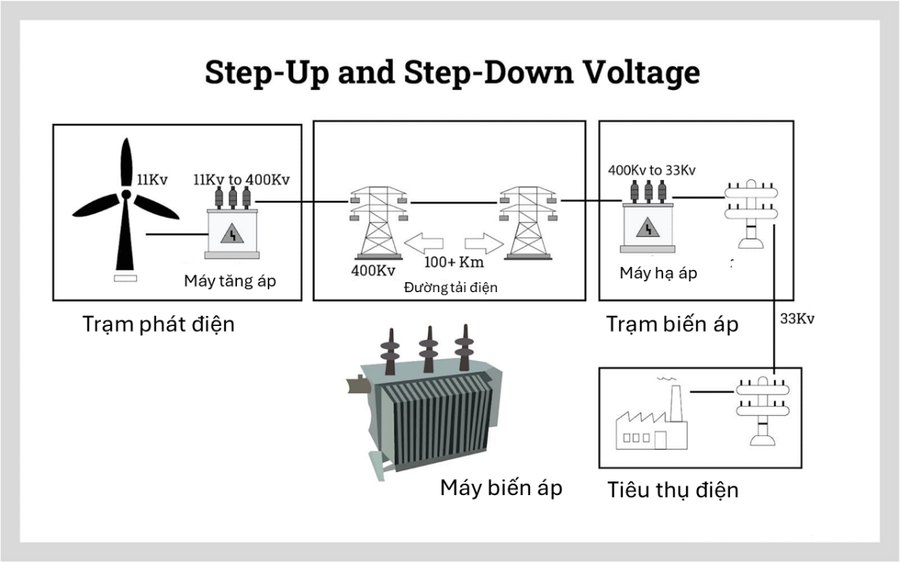
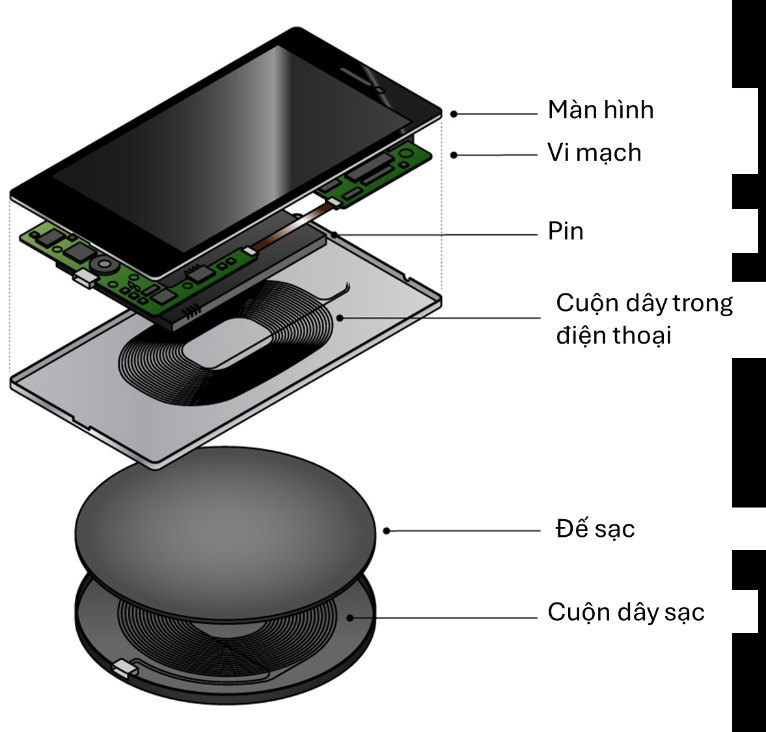
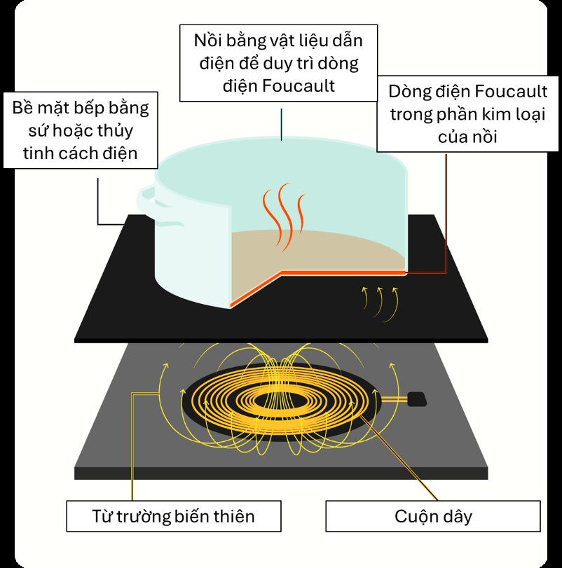
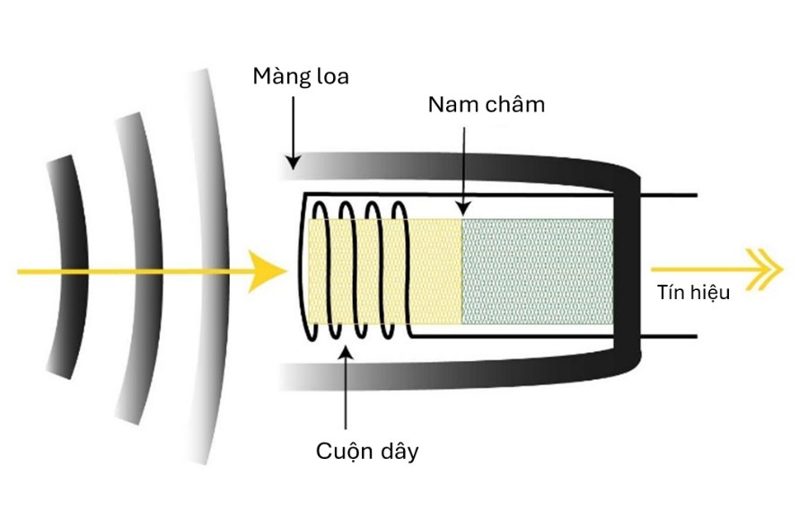
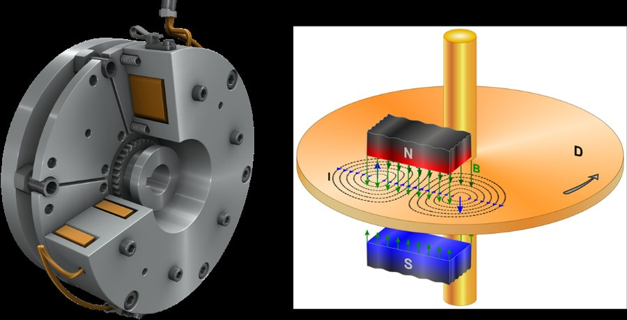

# Ứng dụng hiện tượng cảm ứng điện từ

## 1. Máy biến áp

:::def Máy biến áp
Thiết bị **biến đổi điện áp xoay chiều** mà **không làm thay đổi tần số**.
- **Lõi** làm bằng các lá thép kĩ thuật điện ghép cách điện với nhau (giảm dòng Foucault).
- **Cuộn sơ cấp** ($N_1$ vòng) nối với nguồn điện xoay chiều; **cuộn thứ cấp** ($N_2$ vòng) nối với tải tiêu thụ.
:::

**Nguyên tắc hoạt động:** dòng điện xoay chiều trong cuộn sơ cấp tạo từ thông biến thiên trong lõi; từ thông này đi qua cuộn thứ cấp và sinh ra suất điện động cảm ứng – dựa trên **hiện tượng cảm ứng điện từ**.

:::formula Máy biến áp lí tưởng (bỏ qua hao phí)
$$\frac{U_2}{U_1} = \frac{N_2}{N_1} = \frac{I_1}{I_2}$$
:::

- $N_2 > N_1$: **máy tăng áp** (điện áp tăng, dòng điện giảm).
- $N_2 < N_1$: **máy hạ áp**.

:::warn Dễ nhầm
Máy biến áp **không** hoạt động với dòng điện một chiều không đổi (từ thông không biến thiên). Tỉ số dòng điện **ngược** với tỉ số điện áp.
:::

## 2. Truyền tải điện năng đi xa

:::formula Công suất hao phí trên đường dây
$$\Delta P = I^2R = \frac{P^2R}{U^2\cos^2\varphi}$$
$P$: công suất truyền đi; $U$: điện áp ở đầu đường dây; $R$: điện trở đường dây.
:::

Để giảm hao phí, cách hiệu quả nhất là **tăng điện áp** trước khi truyền: tăng $U$ lên $k$ lần thì $\Delta P$ giảm $k^2$ lần. Vì vậy nhà máy dùng máy **tăng áp**, đến nơi tiêu thụ dùng máy **hạ áp**.

:::formula Hiệu suất truyền tải
$$H = \frac{P - \Delta P}{P}$$
:::

## 3. Các ứng dụng khác

| Thiết bị | Cách hoạt động |
|---|---|
| **Sạc không dây** | Cuộn dây trong đế sạc có dòng xoay chiều tạo từ trường biến thiên; cuộn dây trong điện thoại xuất hiện dòng cảm ứng để nạp pin |
| **Đàn ghi-ta điện** | Dây đàn thép bị từ hoá rung động làm từ thông qua cuộn dây biến thiên → dòng điện cảm ứng → khuếch đại thành âm thanh |
| **Bếp từ** | Cuộn dây dưới mặt bếp có dòng xoay chiều tần số cao tạo từ trường biến thiên; đáy nồi (vật liệu nhiễm từ) xuất hiện **dòng Foucault** làm nồi nóng lên |
| **Micro điện động** | Sóng âm làm màng loa và cuộn dây dao động trong từ trường của nam châm → dòng điện cảm ứng biến đổi theo âm thanh |
| **Phanh điện từ** | Đĩa kim loại quay giữa hai cực nam châm điện xuất hiện dòng Foucault, lực từ cản chuyển động làm đĩa quay chậm lại |

:::note Dòng Foucault
Khi khối kim loại đặt trong từ trường biến thiên (hoặc chuyển động trong từ trường), trong khối kim loại xuất hiện các dòng điện cảm ứng khép kín gọi là **dòng Foucault**. Dòng này làm kim loại **nóng lên** (có ích ở bếp từ, lò cảm ứng; có hại ở lõi máy biến áp, động cơ) và tạo **lực cản** chuyển động (phanh điện từ).
:::

:::warn Nồi dùng cho bếp từ
Bếp từ chỉ đun được nồi có **đáy nhiễm từ** (thép, gang, inox nhiễm từ). Nồi nhôm, thuỷ tinh, sứ không nóng trên bếp từ.
:::

## 4. Ví dụ minh hoạ

:::example Ví dụ 1 – Máy biến áp
Máy biến áp có cuộn sơ cấp 1000 vòng, cuộn thứ cấp 50 vòng. Đặt vào cuộn sơ cấp điện áp hiệu dụng 220 V. Tính điện áp hiệu dụng ở cuộn thứ cấp. Đây là máy tăng áp hay hạ áp?

**Giải.** $U_2 = U_1\dfrac{N_2}{N_1} = 220\cdot\dfrac{50}{1000} = 11$ V. $N_2 < N_1$ ⟹ máy **hạ áp**.
:::

:::example Ví dụ 2 – Lợi ích của tăng áp
Truyền công suất 100 kW qua đường dây có điện trở 10 Ω (hệ số công suất bằng 1). Tính công suất hao phí khi điện áp truyền đi là a) 10 kV; b) 1 kV.

**Giải.** a) $I = \dfrac{P}{U} = 10$ A ⟹ $\Delta P = I^2R = 1000$ W (chỉ 1% công suất).
b) $I = 100$ A ⟹ $\Delta P = 100\,000$ W – hao phí bằng **toàn bộ** công suất!
Giảm điện áp 10 lần làm hao phí tăng 100 lần.
:::

:::example Ví dụ 3 – Dòng điện qua hai cuộn
Máy biến áp lí tưởng có $N_1 = 200$ vòng, $N_2 = 1000$ vòng. Dòng điện hiệu dụng ở cuộn thứ cấp là 0,5 A. Tính dòng điện ở cuộn sơ cấp.

**Giải.** $\dfrac{I_1}{I_2} = \dfrac{N_2}{N_1} = 5 \Rightarrow I_1 = 2{,}5$ A.
:::

## Tóm tắt nhanh

- Máy biến áp: $\dfrac{U_2}{U_1} = \dfrac{N_2}{N_1} = \dfrac{I_1}{I_2}$; chỉ dùng cho điện xoay chiều.
- Hao phí truyền tải $\Delta P = \dfrac{P^2R}{U^2\cos^2\varphi}$ ⟹ tăng $U$ để giảm hao phí.
- Sạc không dây, ghi-ta điện, bếp từ, micro, phanh điện từ đều dựa trên cảm ứng điện từ.
