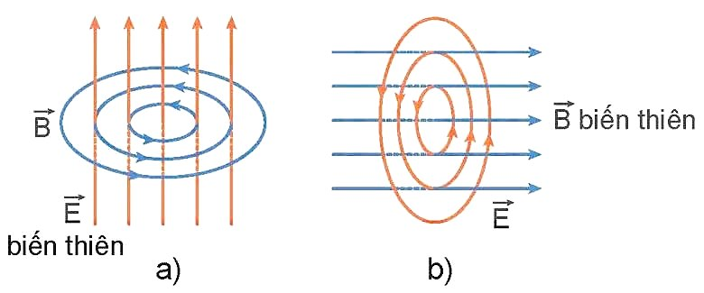
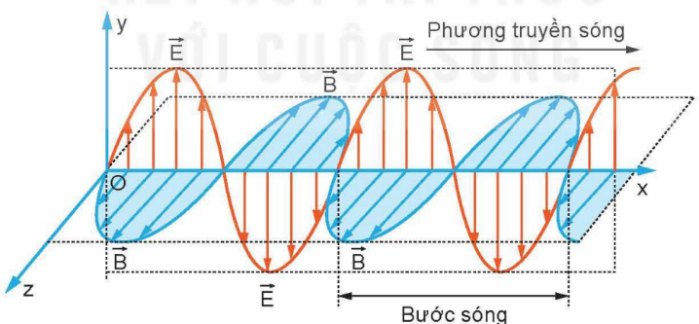
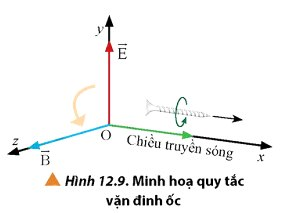

# Điện từ trường – Mô hình sóng điện từ

## 1. Điện từ trường

Maxwell đã chỉ ra mối liên hệ hai chiều giữa điện trường và từ trường:

:::def Hai giả thuyết của Maxwell
- **Từ trường biến thiên** theo thời gian sinh ra **điện trường xoáy** – điện trường có các đường sức là những **đường cong kín** (khác với điện trường tĩnh, có đường sức hở, đi ra từ điện tích dương).
- **Điện trường biến thiên** theo thời gian sinh ra **từ trường** – đường sức từ cũng khép kín bao quanh đường sức điện.
:::

:::def Điện từ trường
Điện trường biến thiên và từ trường biến thiên luôn **liên quan mật thiết**, là hai thành phần của một trường thống nhất gọi là **điện từ trường**.
:::

:::note Lưu ý
Hiện tượng cảm ứng điện từ chính là biểu hiện của điện trường xoáy: điện trường xoáy đẩy các electron trong dây dẫn kín chuyển động, tạo ra dòng điện cảm ứng.
:::

## 2. Sóng điện từ

:::def Sóng điện từ
**Sóng điện từ** là điện từ trường **lan truyền trong không gian**.
:::

**Đặc điểm của sóng điện từ:**
- Truyền được trong **mọi môi trường, kể cả chân không**. Tốc độ trong chân không: $c = 3\cdot 10^8$ m/s – chính là tốc độ ánh sáng.
- Là **sóng ngang**: $\vec{E}$, $\vec{B}$ và phương truyền $\vec{v}$ đôi một **vuông góc** và tạo thành một tam diện thuận.
- Tại mỗi điểm, $\vec{E}$ và $\vec{B}$ dao động **cùng pha**, **cùng tần số**.
- Tuân theo các quy luật phản xạ, khúc xạ, giao thoa, nhiễu xạ; **mang năng lượng**.

:::def Quy tắc xác định hướng
Quay cái vặn đinh ốc (hoặc vặn nút chai) theo chiều từ $\vec{E}$ sang $\vec{B}$ thì chiều tiến của nó là **chiều truyền sóng** $\vec{v}$.
:::

:::formula Bước sóng
$$\lambda = \frac{c}{f} = c\,T \quad (\text{trong chân không})$$
:::

### Thang sóng điện từ

| Loại sóng | Bước sóng (gần đúng) | Ứng dụng |
|---|---|---|
| Sóng vô tuyến | từ cỡ mm đến hàng km | Phát thanh, truyền hình, điện thoại, wifi |
| Tia hồng ngoại | 760 nm – 1 mm | Điều khiển từ xa, sưởi, chụp ảnh nhiệt |
| Ánh sáng nhìn thấy | 380 nm – 760 nm | Chiếu sáng, quan sát |
| Tia tử ngoại | 10 nm – 380 nm | Diệt khuẩn, phát hiện vết nứt |
| Tia X | 10⁻¹¹ m – 10⁻⁸ m | Chụp X-quang, kiểm tra hành lí |
| Tia gamma | nhỏ hơn 10⁻¹¹ m | Xạ trị, khử trùng thực phẩm |

Bước sóng càng **ngắn** thì tần số càng **lớn**, năng lượng và khả năng đâm xuyên càng mạnh.

## 3. Ví dụ minh hoạ

:::example Ví dụ 1 – Bước sóng
Sóng điện từ tần số 100 MHz truyền trong chân không. Tính bước sóng.

**Giải.** $\lambda = \dfrac{c}{f} = \dfrac{3\cdot 10^8}{100\cdot 10^6} = 3$ m.
:::

:::example Ví dụ 2 – Đài phát thanh FM
Một kênh phát thanh FM phát trên tần số 96,5 MHz. Tính bước sóng của sóng điện từ kênh này.

**Giải.** $\lambda = \dfrac{3\cdot 10^8}{96{,}5\cdot 10^6} \approx 3{,}11$ m.
:::

:::example Ví dụ 3 – Xác định hướng của B
Sóng điện từ truyền theo phương ngang từ Đông sang Tây. Tại một thời điểm, vectơ $\vec{E}$ hướng về phía Bắc. Khi đó $\vec{B}$ hướng thế nào?

**Giải.** Chọn trục Ox hướng Đông, Oy hướng Bắc, Oz hướng lên. Sóng truyền theo $-Ox$, $\vec{E}$ theo $+Oy$.
Cần $\vec{E}\times\vec{B}$ cùng hướng $-Ox$. Vì $\hat{y}\times(-\hat{z}) = -\hat{x}$ nên $\vec{B}$ hướng theo $-Oz$: **thẳng đứng hướng xuống**.
:::

## Tóm tắt nhanh

- Từ trường biến thiên sinh ra điện trường xoáy (đường sức khép kín) và ngược lại ⟹ điện từ trường.
- Sóng điện từ: sóng ngang, $\vec{E} \perp \vec{B} \perp \vec{v}$, $E$ và $B$ cùng pha; truyền được trong chân không với $c = 3\cdot 10^8$ m/s.
- $\lambda = c/f$.
